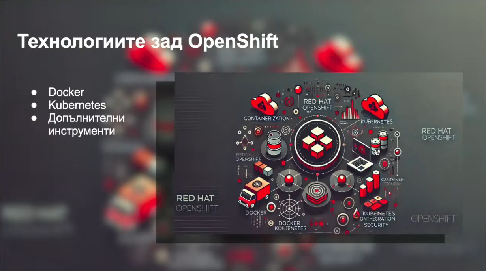

# OpenShift — уводни бележки за начинаещи (видео и слайдове)

> **Module 09 — първа стъпка.** Този документ е концептуално въведение, **не** ръководство за инсталация и **не** изпълнимо упражнение.
>
> **Видео:** [YouTube — soQ8B6f_0w4](https://www.youtube.com/watch?v=soQ8B6f_0w4) · [предоставен линк към транскрипт](https://youtubetotranscript.com/transcript?v=soQ8B6f_0w4).
>
> **Произход и граници:** Двата изображения по-долу са налични в репото и съдържат слайдове от видеото. В момента транскриптът и самото видео не можаха да бъдат прочетени надеждно през наличния уеб достъп. Затова бележките **разглеждат потвърдените теми от двата слайда и ги допълват с проверена официална документация**; не претендират да възпроизвеждат целия разказ или точния ред на видеото. Не са измисляни времеви маркери и цитати. При достъпен транскрипт може да бъде направена следваща редакция по минути.

## 0. Какво трябва да знаеш предварително?

Достатъчни са основните понятия от Kubernetes: **контейнер**, **Pod**, **Deployment**, **Service**, **Namespace**, **RBAC** и **Ingress**. Ако ги знаеш, OpenShift няма да е нов свят от нулата — той използва Kubernetes и добавя интегрирана платформа за разработване, доставка, сигурност и експлоатация на приложения.

**Най-краткото определение:** *Red Hat OpenShift е Kubernetes-базирана платформа, която предоставя допълнителни интегрирани инструменти и управлявани компоненти за изграждане, внедряване и поддържане на приложения.*

Не бъркай **Kubernetes** (оркестрация на контейнери) с **OpenShift** (по-широка платформа, стъпила върху Kubernetes).

## 1. Слайд: „Технологиите зад OpenShift“



Слайдът изброява три основни идеи:

1. **Docker** — познат инструмент за създаване на контейнерни образи и локална работа с контейнери. **Историческо уточнение:** не приемай, че съвременните OpenShift възли използват Docker Engine. OpenShift 4.x използва **CRI-O** като container runtime; OpenShift 5 също е базиран на CRI-O. Създаването на образ с Docker/Buildah/друг OCI-съвместим инструмент не е същото като runtime на клъстера.
2. **Kubernetes** — API и контролери, които управляват Pods, Deployments, Services, конфигурация, scheduling, възстановяване и мащабиране.
3. **Допълнителни инструменти** — специфичните за OpenShift удобства: Projects, Routes, Build механизми, web console, `oc` CLI, Security Context Constraints (SCC), Operators, интеграции за registry и управление на платформата.

Мисловен модел:

```text
Твоят код (.NET, Java, Node.js...)
          |
       OCI image  <-- образът може да се изгради с различни инструменти
          |
 OpenShift application platform
   | Kubernetes API + workload controllers
   | Projects, Routes, security policies, console, operators, builds
          |
 Kubernetes cluster nodes + CRI-O + containers
```

**Важно:** Това е учебна схема, не точна мрежова или компонентна архитектура.

## 2. Слайд: „Основни компоненти на OpenShift“


### 2.1. Projects — работни пространства

В Kubernetes вече познаваш **Namespaces**. OpenShift **Project** е ориентираното към потребителя представяне на namespace с допълнителен проектен workflow и управление на достъпа.

- Един екип може да работи в проект `payments-dev`, друг — в `payments-test`.
- Pods, Deployments, Services и Routes са ресурси в даден namespace/project.
- Project **не** е отделен клъстер и не означава автоматично пълна мрежова изолация.
- **RBAC** определя кой потребител или service account може да извършва действия.

Аналогия: *Namespace е Kubernetes логическият обхват; Project е начинът OpenShift да представи и управлява този обхват за екипи.*

### 2.2. Builds — от изходен код до container image

**Build** процесът е за създаване на **image**, а **Deployment** е за изпълнение на този image като Pods. Това са различни фази.

Пример с ASP.NET Core:

```text
Git repository с .NET код
       |
       | build (в CI или чрез OpenShift build tooling)
       v
Container image
       |
       v
Registry
       |
       v
Deployment -> Pods, които изпълняват приложението
```

OpenShift е познат с **BuildConfig / Source-to-Image (S2I)** и **ImageStreams**, но не е задължително да ги използваш. Съществуват и външни CI системи, Dockerfile/OCI build workflows и други интеграции. Точният учебен път ще бъде избран по-късно според конкретната версия и предоставените материали.

**Капан:** Build ≠ Deploy. Успешно създаден image не доказва, че приложението е стартирало успешно.

### 2.3. Routes — достъп до приложението извън клъстера

Позната ти е схемата `Pod <- Service <- Ingress`. OpenShift традиционно предлага и ресурс **Route**, който публикува Service през ingress/router инфраструктурата.

```text
Клиент (браузър, API consumer)
         |
    HTTPS hostname
         |
    OpenShift Route
         |
    Service (port)
         |
    Pod (.NET API listening on targetPort)
```

- **Service** намира и балансира Pods вътре в клъстера.
- **Route** предоставя външен hostname и правила за публикуване; TLS конфигурацията зависи от конкретната Route.
- **Ingress** е стандартен Kubernetes API, който също може да бъде използван в OpenShift при подходяща конфигурация.
- Route не замества Deployment, Service или Pod.

**Капан:** портът на контейнера, `Service.port`, `Service.targetPort` и външният HTTPS порт не са непременно един и същ порт.

### 2.4. Web Console и `oc` CLI — два начина за работа

**Web Console** е графичен интерфейс за разглеждане и управление на приложения, ресурси и състоянието на клъстера според правата ти.

**`oc`** е OpenShift CLI. То поддържа много от познатите ти операции от `kubectl` и добавя OpenShift-специфични команди.

| Позната задача | Kubernetes | OpenShift |
|---|---|---|
| Избиране на контекст | `kubectl config current-context` | `oc config current-context` |
| Списък на Pods | `kubectl get pods -n payments-dev` | `oc get pods -n payments-dev` |
| Deployment | `kubectl get deployment -n payments-dev` | `oc get deployment -n payments-dev` |
| Работно пространство | `kubectl get namespaces` | `oc projects` (достъпни проекти) |
| Текуща идентичност | — | `oc whoami` |
| Избор на проект | `kubectl config set-context --current --namespace=payments-dev` | `oc project payments-dev` |
| OpenShift Routes | — (не е стандартен Kubernetes ресурс) | `oc get routes -n payments-dev` |

Това са **илюстративни команди**, а не готов lab: изискват инсталиран `oc`, достъп до OpenShift cluster и подходящи permissions. `payments-dev` е примерен проект, не предварително създаден ресурс.

**Бележка за конзолата:** снимки или по-стари видеа могат да показват отделни Developer/Administrator perspectives. Интерфейсът се развива; не приемай старото меню за задължително в актуалните версии.

### 2.5. SCC — Security Context Constraints

**Security Context Constraints** са OpenShift-механизъм за ограничения на това *как* могат да работят Pods/контейнери — например по отношение на UID, привилегии, capabilities и достъп до host ресурси.

Разграничи три неща:

| Механизъм | Отговаря на въпроса |
|---|---|
| **RBAC** | *Кой* може да създава/чете/променя ресурси? |
| **SCC** | *С какъв допустим security context* може да бъде допуснат Pod? |
| **NetworkPolicy** | *Кой мрежов трафик* е разрешен между избрани Pods/адреси? |

**Капан за .NET приложения:** образ, който очаква задължително да работи като root или да записва в root-owned директория, може да има проблем при по-строги security настройки. Ще разгледаме адаптирането на ASP.NET Core образи в бъдещо практическо упражнение, а не ще заобикаляме правилата чрез привилегирован Pod.

## 3. Как компонентите работят заедно — една заявка от начало до край

Да си представим, че екипът публикува `payments-api`:

1. **Project `payments-dev`** определя логическия обхват и правата на екипа.
2. Кодът се **build-ва** до контейнерен образ чрез избрания pipeline.
3. Образът се поставя в **registry**.
4. **Deployment** описва желаните replicas и image; Kubernetes създава **Pods**.
5. **SCC** и останалите security механизми влияят върху допускането и изпълнението на Pods.
6. **Service** насочва трафика към готовите Pods.
7. **Route** публикува API-то чрез hostname, например `payments.example.test` (пример, не действащ адрес).
8. **Web Console** и **`oc`** позволяват да се наблюдават status, events и logs.

Това е *концептуална последователност*, не предписана система за автоматизация на builds/deployments.

## 4. Кое е познато и кое е ново спрямо Modules 00–08?

| Вече знаеш от Kubernetes | Какво добавя/променя OpenShift |
|---|---|
| Namespace, RBAC | Project workflow и интеграция с потребители и права |
| Pods, Deployments, Services | Същите основни Kubernetes API обекти, плюс платформени инструменти |
| Ingress и TLS | OpenShift Routes и router/ingress integration |
| CI/CD и container images | OpenShift build инструменти, registry/ImageStreams при избор на тези workflow-и |
| `kubectl` | `oc` CLI и web console |
| Pod security context, RBAC, NetworkPolicy | Допълнителни SCC правила и платформени defaults |
| kubeadm + containerd + Calico във вашия lab | **Не** се пренася механично: OpenShift има собствен installation/cluster lifecycle и обичайно използва CRI-O и интегрирано управлявана мрежова конфигурация |

**Особено важно:** не инсталирай OpenShift „върху“ готовия kubeadm/Calico lab като поредния addon. За бъдещите упражнения ще бъде определена **отделна, поддържана OpenShift/OKD среда**. Този документ не избира такава среда.

## 5. Версионен контекст към 11 ноември 2026 г.

На **9 ноември 2026 г.** Red Hat обяви обща наличност (**GA**) на **OpenShift 5**, базиран на **Kubernetes 1.36 и CRI-O 1.36**. Това е важно, защото основният Kubernetes курс е за **Kubernetes 1.37** — **номерата не трябва да се изравняват изкуствено**.

**Тук все още НЕ фиксираме версия за OpenShift практическите упражнения.** След предоставянето на останалите материали ще се оценят OpenShift срещу OKD, наличните lab варианти, изискванията за ресурси и съвместимостта на конкретните команди.

Исторически слайдове/видеа могат да бъдат ценни за понятията, но демонстрационните интерфейси и установки не са автоматично актуални.

## 6. Самопроверка (без клъстер)

Опитай първо без да гледаш отговорите:

1. OpenShift отделен заместител на Kubernetes ли е?
2. Каква е разликата между Build и Deployment?
3. Защо трябва Service между Route и Pod?
4. Как Project се отнася към Namespace?
5. Защо RBAC не е равнозначен на SCC?
6. Защо Docker на първия слайд не означава, че OpenShift 5 използва Docker Engine на worker nodes?
7. Можеш ли да копираш kubeadm + Calico конфигурацията от Kubernetes course и да я считаш за OpenShift installation?

**Кратки отговори:**

1. Не — OpenShift е платформа върху Kubernetes.
2. Build произвежда image; Deployment управлява стартирането му като Pods.
3. Route публикува Service; Service открива и маршрутизира към съответните Pods, въпреки смяната на Pod IP адресите.
4. Project представя namespace в OpenShift workflow-а с проектни правила/метаданни и права.
5. RBAC разрешава API действия; SCC ограничава допустимия security context на Pod.
6. Docker може да е инструмент за build; OpenShift runtime е CRI-O.
7. Не — инсталацията и конфигурацията на OpenShift са отделен продуктово управляван процес.

## 7. Какво остава за следващите материали?

- **Видеото:** за детайлно съответствие с всички изказани теми, точен ред и времеви маркери е необходим прочитаем транскрипт или преглед на видеото. Даденият адрес е запазен по-горе, но съдържанието му не беше достъпно при тази редакция.
- **Снимките:** двете налични илюстрации са достатъчни за първоначалното *концептуално въведение*. Ако видеото показва практически действия в web console, `oc` терминал или diagrams, от които искаме точни инструкции, ще трябва допълнителен кадър за съответния момент.
- **Следващи modules/labs:** все още не са определени OpenShift версия, lab инфраструктура, инсталационна процедура или финален набор от упражнения. Този документ **не предрешава** обхвата на Module 09.

## Източници

- [Видео — YouTube](https://www.youtube.com/watch?v=soQ8B6f_0w4) и [линк към транскрипта](https://youtubetotranscript.com/transcript?v=soQ8B6f_0w4) — предоставени от обучаващия се; визуално потвърдени само двата слайда в репото.
- [Red Hat OpenShift Container Platform 4.20 — Architecture](https://docs.redhat.com/en/documentation/openshift_container_platform/4.20/html-single/architecture/architecture) — официална референция за Kubernetes основата, CRI-O, Routes, Operators и компонентите на платформата.
- [Red Hat OpenShift 5 — What's new (9 November 2026)](https://www.redhat.com/en/blog/announcing-red-hat-openshift-5) — официално съобщение за OpenShift 5 и Kubernetes/CRI-O version baseline.
- [Red Hat OpenShift 4.20 — Web Console](https://docs.redhat.com/en/documentation/openshift_container_platform/4.20/html-single/web_console/index) — развитие на интерфейса и perspectives.

> **Статус на проверките:** редакционна/статична проверка на Markdown, относителните линкове към двата налични PNG и понятията в официалните референции. Няма жив OpenShift cluster test; документът няма изпълними manifests.
