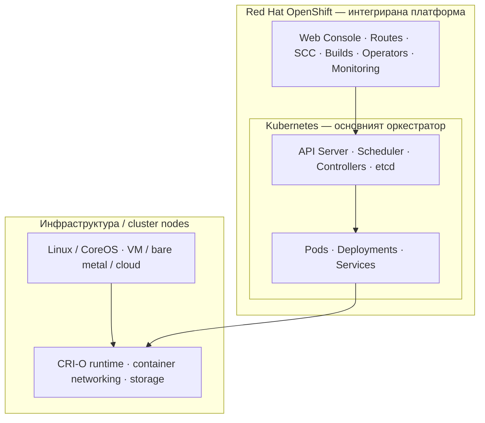
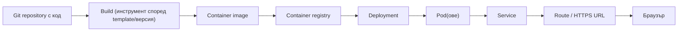

# OpenShift — уводни бележки за начинаещи (видео и слайдове)

> **Module 09 — първа стъпка.** Този документ е концептуално въведение, **не** ръководство за инсталация и **не** изпълнимо упражнение.
>
> **Видео:** [YouTube — soQ8B6f_0w4](https://www.youtube.com/watch?v=soQ8B6f_0w4) · [предоставен линк към транскрипт](https://youtubetotranscript.com/transcript?v=soQ8B6f_0w4).
>
> **Източник:** Бележките са изработени по **пълния текстов транскрипт, предоставен от участника**, и **трите оригинални слайда** в репото. Допълнителните инженерни уточнения и проверки са ясно отделени. Транскриптът е автоматично генериран и съдържа грешки в разпознаването на термини; няма времеви маркери или потвърдено име/URL на демонстрационния Git repository. Не твърдим, че сме прегледали всеки кадър от видеото.

## 0. Какво трябва да знаеш предварително?

Достатъчни са основните понятия от Kubernetes: **контейнер**, **Pod**, **Deployment**, **Service**, **Namespace**, **RBAC** и **Ingress**. Ако ги знаеш, OpenShift няма да е нов свят от нулата — той използва Kubernetes и добавя интегрирана платформа за разработване, доставка, сигурност и експлоатация на приложения.

**Най-краткото определение:** *Red Hat OpenShift е Kubernetes-базирана платформа, която предоставя допълнителни интегрирани инструменти и управлявани компоненти за изграждане, внедряване и поддържане на приложения.*

Не бъркай **Kubernetes** (оркестрация на контейнери) с **OpenShift** (по-широка платформа, стъпила върху Kubernetes).

### Архитектурата в една схема (Mermaid)

Това е редактираща се диаграма в Markdown, която GitHub визуализира директно:



**Как да я четеш:** **Kubernetes е реалният orchestration engine в OpenShift**, а OpenShift предоставя интеграциите и начина за администриране. Отдолу съществуват Linux възли и container runtime. Диаграмата е **концептуална**, не deployment схема: много OpenShift компоненти сами работят като Pods/Operators вътре в Kubernetes; стрелките не означават, че платформата заобикаля Kubernetes API.


## 1. Слайд: „Технологиите зад OpenShift“


Слайдът изброява три основни идеи:

1. **Docker** — познат инструмент за създаване на контейнерни образи и локална работа с контейнери. **Историческо уточнение:** не приемай, че съвременните OpenShift възли използват Docker Engine. OpenShift 4.x използва **CRI-O** като container runtime; OpenShift 5 също е базиран на CRI-O. Създаването на образ с Docker/Buildah/друг OCI-съвместим инструмент не е същото като runtime на клъстера.
2. **Kubernetes** — API и контролери, които управляват Pods, Deployments, Services, конфигурация, scheduling, възстановяване и мащабиране.
3. **Допълнителни инструменти** — специфичните за OpenShift удобства: Projects, Routes, Build механизми, web console, `oc` CLI, Security Context Constraints (SCC), Operators, интеграции за registry и управление на платформата.

Мисловен модел:

```text
Твоят код (.NET, Java, Node.js...)
          |
       OCI image  <-- образът може да се изгради с различни инструменти
          |
 OpenShift application platform
   | Kubernetes API + workload controllers
   | Projects, Routes, security policies, console, operators, builds
          |
 Kubernetes cluster nodes + CRI-O + containers
```

**Важно:** Това е учебна схема, не точна мрежова или компонентна архитектура.

## 2. Слайд: „Основни компоненти на OpenShift“


### 2.1. Projects — работни пространства

В Kubernetes вече познаваш **Namespaces**. OpenShift **Project** е ориентираното към потребителя представяне на namespace с допълнителен проектен workflow и управление на достъпа.

- Един екип може да работи в проект `payments-dev`, друг — в `payments-test`.
- Pods, Deployments, Services и Routes са ресурси в даден namespace/project.
- Project **не** е отделен клъстер и не означава автоматично пълна мрежова изолация.
- **RBAC** определя кой потребител или service account може да извършва действия.

Аналогия: *Namespace е Kubernetes логическият обхват; Project е начинът OpenShift да представи и управлява този обхват за екипи.*

### 2.2. Builds — от изходен код до container image

**Build** процесът е за създаване на **image**, а **Deployment** е за изпълнение на този image като Pods. Това са различни фази.

Пример с ASP.NET Core:

```text
Git repository с .NET код
       |
       | build (в CI или чрез OpenShift build tooling)
       v
Container image
       |
       v
Registry
       |
       v
Deployment -> Pods, които изпълняват приложението
```

OpenShift е познат с **BuildConfig / Source-to-Image (S2I)** и **ImageStreams**, но не е задължително да ги използваш. Съществуват и външни CI системи, Dockerfile/OCI build workflows и други интеграции. Точният учебен път ще бъде избран по-късно според конкретната версия и предоставените материали.

**Капан:** Build ≠ Deploy. Успешно създаден image не доказва, че приложението е стартирало успешно.

### 2.3. Routes — достъп до приложението извън клъстера

Позната ти е схемата `Pod <- Service <- Ingress`. OpenShift традиционно предлага и ресурс **Route**, който публикува Service през ingress/router инфраструктурата.

```text
Клиент (браузър, API consumer)
         |
    HTTPS hostname
         |
    OpenShift Route
         |
    Service (port)
         |
    Pod (.NET API listening on targetPort)
```

- **Service** намира и балансира Pods вътре в клъстера.
- **Route** предоставя външен hostname и правила за публикуване; TLS конфигурацията зависи от конкретната Route.
- **Ingress** е стандартен Kubernetes API, който също може да бъде използван в OpenShift при подходяща конфигурация.
- Route не замества Deployment, Service или Pod.

**Капан:** портът на контейнера, `Service.port`, `Service.targetPort` и външният HTTPS порт не са непременно един и същ порт.

### 2.4. Web Console и `oc` CLI — два начина за работа

**Web Console** е графичен интерфейс за разглеждане и управление на приложения, ресурси и състоянието на клъстера според правата ти.

**`oc`** е OpenShift CLI. То поддържа много от познатите ти операции от `kubectl` и добавя OpenShift-специфични команди.

| Позната задача | Kubernetes | OpenShift |
|---|---|---|
| Избиране на контекст | `kubectl config current-context` | `oc config current-context` |
| Списък на Pods | `kubectl get pods -n payments-dev` | `oc get pods -n payments-dev` |
| Deployment | `kubectl get deployment -n payments-dev` | `oc get deployment -n payments-dev` |
| Работно пространство | `kubectl get namespaces` | `oc projects` (достъпни проекти) |
| Текуща идентичност | — | `oc whoami` |
| Избор на проект | `kubectl config set-context --current --namespace=payments-dev` | `oc project payments-dev` |
| OpenShift Routes | — (не е стандартен Kubernetes ресурс) | `oc get routes -n payments-dev` |

Това са **илюстративни команди**, а не готов lab: изискват инсталиран `oc`, достъп до OpenShift cluster и подходящи permissions. `payments-dev` е примерен проект, не предварително създаден ресурс.

**Бележка за конзолата:** снимки или по-стари видеа могат да показват отделни Developer/Administrator perspectives. Интерфейсът се развива; не приемай старото меню за задължително в актуалните версии.

### 2.5. SCC — Security Context Constraints

**Security Context Constraints** са OpenShift-механизъм за ограничения на това *как* могат да работят Pods/контейнери — например по отношение на UID, привилегии, capabilities и достъп до host ресурси.

Разграничи три неща:

| Механизъм | Отговаря на въпроса |
|---|---|
| **RBAC** | *Кой* може да създава/чете/променя ресурси? |
| **SCC** | *С какъв допустим security context* може да бъде допуснат Pod? |
| **NetworkPolicy** | *Кой мрежов трафик* е разрешен между избрани Pods/адреси? |

**Капан за .NET приложения:** образ, който очаква задължително да работи като root или да записва в root-owned директория, може да има проблем при по-строги security настройки. Ще разгледаме адаптирането на ASP.NET Core образи в бъдещо практическо упражнение, а не ще заобикаляме правилата чрез привилегирован Pod.


## 3. Трети слайд: Kubernetes vs OpenShift


Слайдът сравнява три аспекта: отворен код/корпоративно решение, нужда от допълнителни инструменти/интеграция, и Kubernetes API/OpenShift платформа.

| Послание на слайда | Инженерно уточнение |
|---|---|
| Kubernetes е технология с отворен код; OpenShift е завършено корпоративно решение | Kubernetes е open source; комерсиалният OpenShift включва продуктови интеграции и възможности за поддръжка. **OKD** е community/upstream проектът в екосистемата — не всеки вариант на OpenShift е търговски управлявана услуга. |
| Kubernetes изисква допълнителни инструменти | В vanilla Kubernetes много неща (web console, мониторинг, registry, CI/CD) се инсталират/интегрират отделно; **не** означава, че Kubernetes е неспособен да ги предостави чрез други дистрибуции. |
| OpenShift се управлява „чрез платформата“, Kubernetes — „чрез API“ | **OpenShift също използва Kubernetes API.** Web Console и `oc` са интерфейси/клиенти, не отделен заместител на API. |

**Извод от видеото:** Kubernetes и OpenShift не са две независими взаимозаменяеми технологии от един и същи слой. OpenShift е Kubernetes-базиран цялостен продукт.

## 4. Как компонентите работят заедно — една заявка от начало до край

Да си представим, че екипът публикува `payments-api`:

1. **Project `payments-dev`** определя логическия обхват и правата на екипа.
2. Кодът се **build-ва** до контейнерен образ чрез избрания pipeline.
3. Образът се поставя в **registry**.
4. **Deployment** описва желаните replicas и image; Kubernetes създава **Pods**.
5. **SCC** и останалите security механизми влияят върху допускането и изпълнението на Pods.
6. **Service** насочва трафика към готовите Pods.
7. **Route** публикува API-то чрез hostname, например `payments.example.test` (пример, не действащ адрес).
8. **Web Console** и **`oc`** позволяват да се наблюдават status, events и logs.

Това е *концептуална последователност*, не предписана система за автоматизация на builds/deployments.

## 5. Кое е познато и кое е ново спрямо Modules 00–08?

| Вече знаеш от Kubernetes | Какво добавя/променя OpenShift |
|---|---|
| Namespace, RBAC | Project workflow и интеграция с потребители и права |
| Pods, Deployments, Services | Същите основни Kubernetes API обекти, плюс платформени инструменти |
| Ingress и TLS | OpenShift Routes и router/ingress integration |
| CI/CD и container images | OpenShift build инструменти, registry/ImageStreams при избор на тези workflow-и |
| `kubectl` | `oc` CLI и web console |
| Pod security context, RBAC, NetworkPolicy | Допълнителни SCC правила и платформени defaults |
| kubeadm + containerd + Calico във вашия lab | **Не** се пренася механично: OpenShift има собствен installation/cluster lifecycle и обичайно използва CRI-O и интегрирано управлявана мрежова конфигурация |

**Особено важно:** не инсталирай OpenShift „върху“ готовия kubeadm/Calico lab като поредния addon. За бъдещите упражнения ще бъде определена **отделна, поддържана OpenShift/OKD среда**. Този документ не избира такава среда.

## 6. Версионен контекст към 11 ноември 2026 г.

На **9 ноември 2026 г.** Red Hat обяви обща наличност (**GA**) на **OpenShift 5**, базиран на **Kubernetes 1.36 и CRI-O 1.36**. Това е важно, защото основният Kubernetes курс е за **Kubernetes 1.37** — **номерата не трябва да се изравняват изкуствено**.

**Тук все още НЕ фиксираме версия за OpenShift практическите упражнения.** След предоставянето на останалите материали ще се оценят OpenShift срещу OKD, наличните lab варианти, изискванията за ресурси и съвместимостта на конкретните команди.

Исторически слайдове/видеа могат да бъдат ценни за понятията, но демонстрационните интерфейси и установки не са автоматично актуални.

## 7. Самопроверка (без клъстер)

Опитай първо без да гледаш отговорите:

1. OpenShift отделен заместител на Kubernetes ли е?
2. Каква е разликата между Build и Deployment?
3. Защо трябва Service между Route и Pod?
4. Как Project се отнася към Namespace?
5. Защо RBAC не е равнозначен на SCC?
6. Защо Docker на първия слайд не означава, че OpenShift 5 използва Docker Engine на worker nodes?
7. Можеш ли да копираш kubeadm + Calico конфигурацията от Kubernetes course и да я считаш за OpenShift installation?

**Кратки отговори:**

1. Не — OpenShift е платформа върху Kubernetes.
2. Build произвежда image; Deployment управлява стартирането му като Pods.
3. Route публикува Service; Service открива и маршрутизира към съответните Pods, въпреки смяната на Pod IP адресите.
4. Project представя namespace в OpenShift workflow-а с проектни правила/метаданни и права.
5. RBAC разрешава API действия; SCC ограничава допустимия security context на Pod.
6. Docker може да е инструмент за build; OpenShift runtime е CRI-O.
7. Не — инсталацията и конфигурацията на OpenShift са отделен продуктово управляван процес.


## 8. Последователност на лекцията — разказ и аналогии

Това е структурирано преразказване на **пълния предоставен транскрипт**. Съдържанието е групирано по теми, защото транскриптът не предоставя надеждни timestamps.

### 8.1. Защо съществува OpenShift?

Лекторът започва от гледната точка на разработчика: преди приложението да обслужи реален потребител, трябват изчислителни ресурси, ОС, мрежа, конфигурация, разгръщане и начин за наблюдение. OpenShift събира много от тези възможности в интегрирана платформа, така че разработчиците да се фокусират повече върху приложението.

Лекторът използва понятието **Platform as a Service (PaaS)**. Това е добро първо приближение за **управлявани** OpenShift услуги и за потребителското изживяване на един developer в готов клъстер. **Уточнение:** при self-managed OpenShift организацията продължава да носи съществена отговорност за инфраструктура, обновления, експлоатация, достъпи и капацитет. OpenShift не премахва автоматично всички DevOps/SRE задачи.

### 8.2. Обяснението с куфара и къщата

- **Docker / контейнерен image = „куфар“:** приложението се пакетира със зависимостите му, за да бъде възпроизводимо между среди.
- **Kubernetes = „управител на куфарите“:** оркестрира изпълнението, желаното състояние, replica-ите и възстановяването при отказ.
- **OpenShift = „обзаведена къща“:** Kubernetes плюс интегрирани, готови за използване възможности, UI, security, builds и оператори.

**Къде аналогията подвежда:** контейнерният image не е гаранция, че приложение ще работи на *всяка* ОС/CPU архитектура или с всякаква мрежа, secrets, storage и външни услуги. Kubernetes не стартира HPA скалиране само защото натоварването се е покачило — нужни са подходяща конфигурация и метрики. И контейнерът не е непременно създаден от Docker Engine.

### 8.3. Защо компании избират OpenShift?

Транскриптът посочва корпоративните мотиви: стандартизирани разгръщания, улеснено управление, security инструменти, документация, поддръжка според конкретния договор и възможност за **on-premises** или cloud deployment. Споменават се банки, застрахователи и телекоми заради контрола над данни, инфраструктура и нормативни изисквания.

**Уточнение:** регулации сами по себе си не изискват всички такива организации да са on-premises. Допустимата среда зависи от конкретните правила, договори и risk assessment.

## 9. Издания и варианти, споменати във видеото

| Название в лекцията | Как да го разбираш и какво да провериш |
|---|---|
| **OKD** | Community/upstream Kubernetes дистрибуция в OpenShift екосистемата. Няма стандартния търговски Red Hat support, предлаган с платени продукти. Не приемай, че е просто „същият платен OpenShift, но без лиценз“. |
| **OpenShift Online** | Историческо наименование за хоствана услуга. **Не избирай** инсталационен или учебен път само по това старо име — провери наличните предложения към момента на обучението. |
| **OpenShift Dedicated** | Управляван OpenShift продукт върху облачна инфраструктура, с обхват и отговорности според конкретната услуга. |
| **OpenShift Enterprise** | Описаното от лектора on-premises самостоятелно управлявано корпоративно решение се позиционира днес като **Red Hat OpenShift Container Platform**. |
| **ROSA — Red Hat OpenShift Service on AWS** | Управляван OpenShift върху AWS. **Не е** еквивалент на Amazon EKS; и двете използват Kubernetes, но са различни услуги. |
| **AKS / EKS** | Съответно Kubernetes услуги на Azure и AWS, но не са OpenShift. |
| **Azure Red Hat OpenShift (ARO)** | **Корекция към лекцията:** OpenShift може да работи като управлявана услуга **и в Azure**, предоставяна съвместно от Microsoft и Red Hat. |
| **OpenShift Virtualization** | Управление и изпълнение на виртуални машини като част от Kubernetes/OpenShift платформата; не означава, че всяка VM автоматично става контейнер. |

**Какво означава „безплатно“ тук?** OKD е общностна дистрибуция, а **Developer Sandbox** е безплатен ограничен trial на управлявана среда. Това са *различни неща*. Нито едното не премахва ресурсните ограничения или операционните отговорности на собствена инсталация.

## 10. Практическото демо от транскрипта — какво точно е показано

Лекторът демонстрира **Developer Sandbox for Red Hat OpenShift** с примерен **Node.js** проект от GitHub. Целта е да покаже developer workflow, без участниците да инсталират клъстер локално.

### 10.1. Действия в показаната последователност

1. Отваря страницата на **Red Hat Developer Sandbox** и използва предварително създаден Red Hat акаунт.
2. Избира OpenShift sandbox, зарежда **Web Console** и разглежда видимите менюта.
3. Демонстрира терминалната възможност на средата и базови Linux команди за системна информация — като `lscpu`, проверки за свободно пространство и RAM. **Важно:** изходът е от конкретната предоставена среда/терминал и не е универсална спецификация или гарантирана квота за всеки Sandbox потребител.
4. Започва работа в проект/workspace и избира опция за **Import from Git** (в транскрипта: „Import git repo“).
5. Посочва URL на **публично Node.js sample repository**. В транскрипта **не е запазен точният URL** — не може да бъде възпроизведен едно към едно само по текста.
6. Конзолата разпознава примерното приложение и показва полета за настройка. Лекторът използва предимно **defaults**, без да ги променя.
7. Стартира **Create**. Следи **Build #1** от `Running` до `Complete`, разглежда build logs и изтеглянето/подготовката на зависимости.
8. Преглежда **Metrics**, декларативния **YAML**, **Events** и визуализацията **Topology**; идеята е да покаже управлението на ресурсите през UI.
9. Поглежда terminal/CLI изгледа, за да покаже, че състоянието може да се проверява и с команди.
10. Отваря **публикувания URL** и вижда работещо простичко приложение за плодове/стойности.
11. Отбелязва, че показаният пример няма видимо конфигурирана база данни; следователно **няма основание да очакваме запазване на въведените данни между рестартирания**.

### 10.2. Какви Kubernetes/OpenShift обекти стоят зад демото?

**Типичният**, но не доказан за конкретния неизвестен sample, pipeline е:



Лекторът показва build и публикувано приложение; **транскриптът не доказва точната build strategy, конкретни resource names, image registry, всички YAML атрибути или кой Controller е създал обектите**. Затова схемата е общ модел, не възстановен точен ресурсен граф от клъстера.

### 10.3. Какво означава успех в този пример?

- **Build succeeded:** изходният код е превърнат успешно в image/артефакт по избраната стратегия.
- **Deployment healthy:** приложението може да стартира и Pod-овете достигат готовност — това не следва само от успешния build.
- **Route reachable:** потребителят вижда уеб приложението през външен URL.
- **Persistence:** **не е демонстрирана**; тя би изисквала подходящ datastore, PVC или друга стратегия за съхранение.

**Следващият самодостатъчен lab** може да използва актуален публичен sample или наше ASP.NET Core приложение и точно определени версии, но този документ **не твърди**, че вече разполагаме с пълно работещо копие на видеодемото.

### 10.4. За какво още биха помогнали допълнителни screenshots?

Имаме трите общи слайда. Допълнителни кадри ще са полезни **само ако решим да реконструираме точно демонстрацията**: екранът „Import from Git“ със самия URL и builder изборите; екранът с Resource topology; Build details; Route details; евентуалното YAML на генерираните ресурси. Без тях бележките остават достатъчни като **въведение**, а не като pixel-by-pixel tutorial.

## 11. Въпроси от аудиторията — с уточнения

### Docker, Kubernetes и OpenShift „едно в друго“ ли са?

Лекторът потвърждава опростеното „Docker → Kubernetes → OpenShift“. **По-точно:** контейнерният image може да се създаде с Docker, но Kubernetes управлява контейнери чрез CRI-съвместим runtime; OpenShift е Kubernetes дистрибуция и платформа, която обичайно ползва **CRI-O**, не Docker Engine на възлите. Виж основната Mermaid диаграма по-горе.

### Какво е миграция от SDN към OVN?

Въпросът е за преминаване от исторически **OpenShift SDN** към **OVN-Kubernetes**. Лекторът правилно подчертава проверките, NetworkPolicy, производителността и план за миграция. **Уточнение:** downtime не трябва да бъде обявяван за *неизбежен* при всеки случай — допустимият migration path, downtime, изискванията и ограниченията са **строго версионно зависими**. В този увод **не** се дават команди за миграция.

### В Azure има ли OpenShift, или само AKS?

**Има и двете.** **AKS** е Azure Kubernetes Service, а **ARO — Azure Red Hat OpenShift** е отделна управлявана услуга. В AWS аналогичната разлика е **EKS** срещу **ROSA**.

### Защо `etcd` е критичен и как се прави възстановяване?

`etcd` съхранява желаното и наблюдавано конфигурационно състояние на Kubernetes API обектите. В транскрипта лекторът препоръчва **редовни backup-и и тестови възстановявания в отделна съвместима среда**.

**Уточнение:** etcd snapshot не е автоматичен backup на приложните данни в PVC или външна DB. Restore на production cluster state е високорискова операция и се прави по конкретния **поддържан OpenShift runbook**, а не с произволна kubeadm процедура.

### Може ли OpenShift „сам“ да deploy-не frontend, backend и DB?

Да, тези компоненти могат да работят в OpenShift. **Но** правилното им свързване изисква deployment definitions, Services, Secrets, Storage, конфигурация на connection strings, migrations и readiness probes; Helm, Pipelines, GitOps и Operators могат да автоматизират част от процеса. OpenShift не отгатва бизнес архитектурата от произволно repository.

### Може ли CronJob да чисти PVC и логове?

**Технически е възможно** чрез Kubernetes `CronJob` с подходящ mount и permissions, но това трябва да е съобразено с **лог lifecycle и retention policy**. Приложни логове е за предпочитане да се изпращат към централизирана logging система; безразборно триене от PVC може да наруши работа, разследвания или retention изисквания. Във видеото няма готов YAML или процедура.

### Защо при cluster upgrade и двете replicas на приложение могат да отпаднат?

Транскриптът описва конкретен проблем с две реплики, които изглежда стават недостъпни заедно. От него **не може да се диагностицира коренната причина**. Проверяват се `Deployment` update strategy (`maxUnavailable`, `maxSurge`), `PodDisruptionBudget`, node drains, readiness, startup/liveness probes, termination grace period, ресурсни ограничения, pod placement, events и application logs. **PDB не гарантира наличност при всички видове откази** и не е решение само по себе си.

### Какво е OpenShift Virtualization?

Платформена възможност за изпълнение на **VM workloads** заедно с контейнеризирани приложения на Kubernetes инфраструктура чрез подходящ virtualization stack. Лекторът я представя като вариант за постепенна миграция от виртуални машини към контейнери — полезна мотивация, но не означава автоматична конверсия на приложенията.

## 12. Важни поправки и ограничения на лекцията

| Твърдение/впечатление от транскрипта | По-точна формулировка |
|---|---|
| Docker „е под“ Kubernetes/OpenShift | Docker е познат build и local container инструмент; актуалният OpenShift runtime на nodes е CRI-O. |
| Приложението „гарантирано“ работи навсякъде след containerization | Не, съвместимостта зависи от CPU/OS, конфигурация, секрети, storage, networking и външни услуги. |
| Kubernetes сам засича CPU load и автоматично създава replicas | Автоматичното скалиране изисква правилно конфигуриран autoscaler, метрики и достатъчно ресурси. |
| OpenShift напълно премахва системната поддръжка | Степента на поета от Red Hat/cloud provider отговорност зависи от управлявана срещу self-managed услуга и договора. |
| „В Azure няма OpenShift“ | **Невярно:** има **Azure Red Hat OpenShift (ARO)**. |
| OpenShift е алтернатива на Kubernetes | OpenShift е интегрирана Kubernetes-базирана дистрибуция и продукт. |
| SDN → OVN задължително причинява downtime | Рискът и допустимият метод се проверяват по конкретна версия, topology и документация. |
| Sandbox терминалът показва „ресурсите на целия клъстер“ | Терминалната среда и quota на потребителя **не** означават административен достъп до всички nodes или гарантиран капацитет. |
| Build complete = приложението е deploy-нато и устойчиво | Трябват отделни checks за rollout, endpoints/Route и persistence. |

## 13. Какво можем да повторим без собствен клъстер?

**[Red Hat Developer Sandbox](https://developers.redhat.com/developer-sandbox)** е официална **временна**, управлявана тестова среда; към 11.11.2026 Red Hat документира **30 дни**, безплатен Red Hat акаунт и **без кредитна карта**. Достъпът е ограничен и средата може да бъде променена от доставчика.

Упражнение за **ориентация**, без твърдение за възпроизвеждане на непознатото Git repo от видеото:

1. Прочети официалния [Sandbox FAQ](https://developers.redhat.com/developer-sandbox/FAQ) и провери текущите quota/ограничения.
2. След активиране на sandbox, намери текущия **Project**, **Topology**, **Pods**, **Deployments**, **Routes** и секциите за logs/metrics (менютата зависят от версията и permissions).
3. Ако Web Terminal е достъпен, използвай **read-only** `oc` команди за наблюдение:
   ```bash
   oc whoami
   oc project
   oc get pods
   oc get deployments
   oc get services
   oc get routes
   ```
4. **Очакван резултат:** установяваш собствената си идентичност и текущия проект. Някои списъци могат да са **празни** преди първото deployment; при липса на достъп до Terminal използвай web console.
5. **Troubleshooting:** `Forbidden` означава липсващи права, `Unauthorized` — липсваща/изтекла автентикация, `no resources found` — липсващи обекти, не задължително проблем с клъстера.
6. **Cleanup:** няма създадени ресурси; не трий чужди или предварително предоставени sandbox обекти.

> Това не е пълният **Git → Build → Route** lab. За него ще бъдат необходими избрана поддържана версия, конкретен публичен repository/template, проверен build workflow, ресурсни имена, очакван URL/response, предвиждане на ограниченията на sandbox и точен cleanup. Ще го разработим по-късно, ако бъде включен в договорения обхват на Module 09.

## 14. Самопроверка след видеото

1. Каква е разликата между Kubernetes и OpenShift?
2. Ако имаш `Dockerfile`, задължително ли е node runtime да е Docker Engine?
3. С какво Projects и Namespaces си приличат?
4. Защо зеленият Build #1 не е достатъчен, за да заявим, че приложението е здраво и устойчиво?
5. Какво правят Service и Route?
6. Защо не можем да твърдим, че sample приложението ще съхрани данни без storage/DB?
7. Какво различава AKS от ARO и EKS от ROSA?
8. Защо snapshot на etcd не е равнозначен на backup на PostgreSQL данните?
9. Защо HPA, PDB, probes и update strategy се настройват, а не се приемат като магическа гаранция?
10. Защо OpenShift трябва да се учи в **отделна среда**, а не като addon към вече изградения kubeadm/Calico lab?

**Провери отговорите** чрез раздели 0–13 и модулите 00–08. Това въведение не изисква резултат от реален клъстер.

## 15. Какво остава отворено за останалите материали?

- Версия и продукт за бъдещите практически упражнения (**OpenShift, OKD, sandbox, local/SNO**): **не са избрани**.
- Пълно, възпроизводимо демо с точния Node.js repository от видеото: **не е възможно без URL/допълнителни кадри**.
- Извличане на timestamps от видеото: транскриптът не включва надеждни таймкодове.
- Обхватът на последващите Modules 09 labs: **изчаква останалите материали и изричния сигнал за завършване**.
- Трите исторически слайда са запазени в репото, без да се редактират.

## Източници

### Първичен източник

- [Видеолекция — YouTube (soQ8B6f_0w4)](https://www.youtube.com/watch?v=soQ8B6f_0w4) и [публичен транскрипт](https://youtubetotranscript.com/transcript?v=soQ8B6f_0w4). Основен работен източник за тази редакция е **целият транскрипт, предоставен като текстов файл на 11 ноември 2026 г.** Имената и техническите термини са нормализирани, без да се измислят пропуснатите конкретни данни.

### Официални технически уточнения

- [Red Hat: What's new in OpenShift 5 (9 November 2026)](https://www.redhat.com/en/blog/announcing-red-hat-openshift-5) — OpenShift 5 GA, Kubernetes 1.36 и CRI-O 1.36.
- [Red Hat Developer Sandbox](https://developers.redhat.com/developer-sandbox) и [FAQ](https://developers.redhat.com/developer-sandbox/FAQ) — trial 30 дни, shared multi-tenant environment, account и ограничения.
- [Microsoft Learn: Azure Red Hat OpenShift](https://learn.microsoft.com/en-us/azure/architecture/reference-architectures/containers/aro/ha-zr-aro) — ARO е реална управлявана услуга, различна от AKS.
- [Red Hat OpenShift: Control plane backup & restore](https://docs.redhat.com/en/documentation/openshift_container_platform/4.21/html/backup_and_restore/control-plane-backup-and-restore) — etcd backup не бива да се смесва с данните на workloads и cluster restore е високорисково действие.
- [Official Kubernetes documentation](https://kubernetes.io/docs/home/) — Kubernetes Deployments, HPA, PDB, probes и CronJobs.

> **Обхват на проверките:** статичен преглед на Markdown, Mermaid синтаксиса, трите относителни линка към наличните PNG изображения и съответствието на учебния разказ с предоставения транскрипт. **Няма изпълнен OpenShift cluster, валидиран runtime build или точна възстановка на sample проекта от видеото.**
