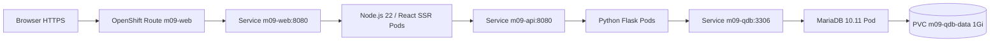

# Lab 09-D — Full stack: Python REST API + React UI + MariaDB (2026)

> **Самодостатъчен интеграционен lab.** 90–120 минути, Sandbox Project; **пълните изходни файлове и database.yaml са включени в това репо**, без нужда от старите примерни Git repos. Подходящ след основните OpenShift упражнения, но не изисква да си изпълнил друг lab.
>
> **Оригинал:** [Learn Kubernetes using the Developer Sandbox](https://developers.redhat.com/learn/openshift/learn-kubernetes-using-developer-sandbox) — [environment](https://developers.redhat.com/learning/learn:openshift:learn-kubernetes-using-developer-sandbox/resource/resources:set-your-activity-environment), [backend REST](https://developers.redhat.com/learning/learn:openshift:learn-kubernetes-using-developer-sandbox/resource/resources:create-back-end-restful-service), [React frontend](https://developers.redhat.com/learning/learn:openshift:learn-kubernetes-using-developer-sandbox/resource/resources:build-front-end-react-page), [MariaDB / PVC / self-healing](https://developers.redhat.com/learning/learn:openshift:learn-kubernetes-using-developer-sandbox/resource/resources:create-and-populate-database-mariadb).
>
> **Съзнателно адаптирано:** Red Hat използва browser-side React SPA, hard-coded demo passwords, Python 3.8, несъответстващи image paths и непълен cleanup. Тук React е **server-side rendered (React SSR на Node.js 22)** — React е реално dependency и се изпълнява в frontend Pod, а API се вика по вътрешен ClusterIP. Това демонстрира backend/frontend/database връзките **без CORS / public backend dependency в browser**. Модулът показва API + React + MariaDB, но не копира дословно стария UI.

## 1. Architecture and observable result



**Success:** браузърът отваря HTML `OpenShift Quotes - React SSR`, вижда три записа от MariaDB; `/quotes` REST API връща JSON; след DB Pod deletion данните остават. Само React frontend получава публична Route (освен кратък API debug при необходимост).

## 2. Предпоставки и версия

- [Developer Sandbox](https://developers.redhat.com/developer-sandbox), текущият личен Project, CLI `oc` от конзолата, Bash, `curl`, `git` и `openssl`. За frontend lockfile използвай **Node.js 22 с npm 10–11** локално или **Docker** с официалния UBI9 Node.js 22 image (командите са дадени в раздел 6). За safe login използвай [Lab 09-A](./LAB-01-SANDBOX-CLI-2026.md), но инструкции за source/environment са дадени **тук**.
- Нужен е стандартен PVC с default динамичен StorageClass, права за Deployment/Service/BuildConfig/ImageStream/Route/Secret и образи от публичен registry; **никакъв** cluster-admin.
- Използваме **Python 3.12 S2I, Node.js 22 S2I, MariaDB 10.11**. Target OpenShift = предоставената от Red Hat Sandbox версия, проверена чрез `oc version` (не я изравнявай с Kubernetes 1.37 от Modules 00–08).
- Външни зависимости при изпълнение: Red Hat UBI registries, Quay image за MariaDB, Python package index за Flask/PyMySQL/gunicorn, npm registry за React/Express. Увери се, че тези registries и package indexes са достъпни от Sandbox по време на build.
- Images `ubi9/python-312:latest`, `ubi9/nodejs-22:latest`, `mariadb-1011-c9s:latest` **не са digest-pinned**; при production адаптация pin-вай проверен multi-arch digest. Текущото упражнение записва resolved image references, а package versions са фиксирани в source.

```bash
oc whoami
oc project
oc version
oc get storageclass || echo 'Няма право за StorageClass list; проверката ще бъде чрез PVC'
oc get resourcequota || true
oc auth can-i create persistentvolumeclaims
oc auth can-i create buildconfigs.build.openshift.io
oc auth can-i create imagestreams.image.openshift.io
oc auth can-i create builds.build.openshift.io
oc auth can-i create secrets
oc auth can-i create deployments.apps
oc auth can-i create services
oc auth can-i create routes.route.openshift.io
oc get deploy,svc,pvc,secret,bc,is
```

**Очаквано:** `yes` за изискваните операции, динамично provision-ван PVC (проверяваме `Bound` след създаването му) и достатъчна quota за 3 Pods плюс build Pods (ориентир 2Gi memory). Ако мястото или permissions не стигат, **спри** и отчети лимита; не увеличавай quotas.

## 3. Изтегли всички нужни source файлове

Изтегли изходните файлове от основния branch на хранилището:

```bash
git clone https://github.com/pirocorp/Kubernetes.git
cd Kubernetes
git switch main
export M09_STACK="$PWD/09. OpenShift/labs/examples/quotes-stack"
test -f "$M09_STACK/backend/app.py"
test -f "$M09_STACK/backend/requirements.txt"
test -f "$M09_STACK/backend/.s2i/environment"
test -f "$M09_STACK/frontend/server.js"
test -f "$M09_STACK/frontend/package.json"
test -f "$M09_STACK/database.yaml"
```

Файловете са **част от репото**, не са placeholders:
- [Python API](./examples/quotes-stack/backend/app.py) и [dependencies](./examples/quotes-stack/backend/requirements.txt), [S2I settings](./examples/quotes-stack/backend/.s2i/environment).
- [React SSR app](./examples/quotes-stack/frontend/server.js), [Node.js dependencies](./examples/quotes-stack/frontend/package.json).
- [MariaDB PVC/Deployment/Service](./examples/quotes-stack/database.yaml).

## 4. Secret и database

Генерирай собствена временна парола с `openssl` — не добавяй нейното съдържание към Git, Markdown или публичен документ. Base64 не криптира Secret.

```bash
umask 077
CREDS="$(mktemp)"
printf 'MYSQL_USER=quotes\nMYSQL_DATABASE=quotesdb\n' > "$CREDS"
printf 'MYSQL_PASSWORD=%s\n' "$(openssl rand -hex 24)" >> "$CREDS"
oc create secret generic m09-qdb-creds --from-env-file="$CREDS"
rm -f -- "$CREDS"
unset CREDS
oc apply --dry-run=client -f "$M09_STACK/database.yaml"
oc apply -f "$M09_STACK/database.yaml"
oc get pvc/m09-qdb-data
oc rollout status deploy/m09-qdb --timeout=300s
oc get pods -l app=m09-qdb
oc get endpointslice -l kubernetes.io/service-name=m09-qdb
```

**Очаквано:** PVC `Bound`, DB Deployment 1 Ready replica и Service endpoint на 3306. Ако PVC е `Pending`, провери default StorageClass и `oc describe pvc m09-qdb-data`. Ако Pod не стартира, прегледай `oc logs deploy/m09-qdb` и `oc describe pod -l app=m09-qdb`; **не** изключвай SCC.

### 4.1. Инициализирай SQL с 3 записа

```bash
cat > /tmp/m09-quotes-seed.sql <<'SQL'
CREATE TABLE IF NOT EXISTS quotes (
  id INT PRIMARY KEY,
  text VARCHAR(255) NOT NULL
);
INSERT INTO quotes (id, text) VALUES
 (1, 'Kubernetes is the engine under OpenShift'),
 (2, 'React calls an internal REST API'),
 (3, 'PVC keeps MariaDB data after Pod restart')
ON DUPLICATE KEY UPDATE text=VALUES(text);
SELECT id, text FROM quotes ORDER BY id;
SQL
oc exec -i deployment/m09-qdb -- bash -lc \
  'mariadb -h 127.0.0.1 -u "$MYSQL_USER" -p"$MYSQL_PASSWORD" "$MYSQL_DATABASE"' \
  < /tmp/m09-quotes-seed.sql
rm -f /tmp/m09-quotes-seed.sql
```

**Очаквано:** SELECT показва точно три реда; командата е idempotent. **Не** експонирай MariaDB с Route или NodePort.

## 5. Backend — собствен Python REST service

В [app.py](./examples/quotes-stack/backend/app.py) има `GET /healthz`, `/readyz`, `/version`, `/quotes`, `/quotes/random` и `/quotes/{id}`. Достъпва DB през Kubernetes Service DNS `m09-qdb` и Secret env values, а SQL параметризира user-provided ID. Не логва credentials.

```bash
oc import-image m09-py312 --from=registry.access.redhat.com/ubi9/python-312:latest --confirm
oc get istag m09-py312:latest -o jsonpath='{.image.dockerImageReference}{"\n"}'
oc new-build --name=m09-api --binary --strategy=source --image-stream=m09-py312:latest
oc start-build m09-api --from-dir="$M09_STACK/backend" --follow --wait
oc get builds
oc new-app --image-stream=m09-api:latest --name=m09-api -l app=m09-api
oc set env deployment/m09-api --from=secret/m09-qdb-creds
oc set env deployment/m09-api DB_HOST=m09-qdb APP_MODULE=app:app APP_VERSION=v1
oc set probe deployment/m09-api --liveness --get-url=http://:8080/healthz
oc set probe deployment/m09-api --readiness --get-url=http://:8080/readyz
oc rollout status deploy/m09-api --timeout=240s
oc get svc m09-api -o yaml
```

**Очаквано:** `Build Complete`, Pod Ready, Service port 8080. Ако Service port е различен, виж генерирания Service YAML и коригирай според реалния port; не гадай. При Python dependency build error, прегледай точния `oc logs build/ИМЕ`; при DB connection error, `oc get endpointslice -l kubernetes.io/service-name=m09-qdb`, Secret refs и logs, без да печаташ паролата.

Вътрешният backend service не изисква публичен Route. Можеш да провериш API безопасно от workstation с временен port-forward в *отделен* терминал:

```bash
oc port-forward service/m09-api 18081:8080
```

После в друг локален терминал (същата authenticated session):

```bash
curl -fsS http://127.0.0.1:18081/readyz
curl -fsS http://127.0.0.1:18081/version
curl -fsS http://127.0.0.1:18081/quotes
curl -fsS http://127.0.0.1:18081/quotes/2
```

**Очаквано:** `ready`, `v1` и 3 JSON quotes. Спри port-forward с Ctrl+C след проверката; не го оставяй във фонов режим или да блокира следващите команди.

## 6. Frontend — React SSR / Node.js 22

Frontend е **React UI**, рендериран на сървъра чрез `react-dom/server` и Express. Чете `http://m09-api:8080/quotes` през вътрешния Kubernetes Service. Така браузърът има само един публичен URL и няма CORS настройки.

### 6.1. Зафиксирaй npm dependency tree за това изпълнение

`package.json` фиксира **директните** версии на React, React-DOM и Express, но без `package-lock.json` транзитивните зависимости могат да се изменят. За да не променяш на ръка версии или да търсиш команди, създай lockfile **преди** S2I binary build:

**Вариант A — локално инсталирани Node.js 22 и npm 10–11:**

```bash
node --version
npm --version
cd "$M09_STACK/frontend"
npm install --package-lock-only --ignore-scripts --no-audit --no-fund
npm run build
test -s package-lock.json
cd - >/dev/null
```

**Вариант B — Docker на Linux/WSL, без локална Node инсталация:**

```bash
docker run --rm --user "$(id -u):$(id -g)" -e HOME=/tmp \
  -v "$M09_STACK/frontend:/app" -w /app \
  registry.access.redhat.com/ubi9/nodejs-22:latest \
  bash -lc 'npm install --package-lock-only --ignore-scripts --no-audit --no-fund && npm run build'
test -s "$M09_STACK/frontend/package-lock.json"
```

**Избери само един вариант.** Не изпълнявай `npm install` без `--package-lock-only` локално в тази директория: `node_modules` не трябва да се качва със `oc start-build --from-dir`. `package-lock.json` ще бъде включен в binary build source. Неговото съдържание се създава от npm **в момента на упражнението**, а не е еднакво за всички бъдещи изпълнения; запази локалния lockfile, ако повториш същия build по-късно. За production се изисква **commit-нат и проверен lockfile и `npm ci`**. <https://docs.npmjs.com/cli/v11/commands/npm-ci/>

### 6.2. S2I build, Deployment и HTTPS Route

```bash
oc import-image m09-node22 --from=registry.access.redhat.com/ubi9/nodejs-22:latest --confirm
oc get istag m09-node22:latest -o jsonpath='{.image.dockerImageReference}{"\n"}'
oc new-build --name=m09-web --binary --strategy=source --image-stream=m09-node22:latest
oc start-build m09-web --from-dir="$M09_STACK/frontend" --follow --wait
oc new-app --image-stream=m09-web:latest --name=m09-web -l app=m09-web
oc set env deployment/m09-web API_URL=http://m09-api:8080/quotes
oc set probe deployment/m09-web --readiness --get-url=http://:8080/healthz
oc rollout status deployment/m09-web --timeout=240s
oc get svc m09-web -o yaml
M09_WEB_PORT="$(oc get svc m09-web -o jsonpath='{.spec.ports[0].port}')"
test "$M09_WEB_PORT" = "8080" || { echo "Frontend Service не е на очаквания port 8080" >&2; false; }
oc create route edge m09-web --service=m09-web --port="$M09_WEB_PORT" --insecure-policy=Redirect
WEB_HOST="$(oc get route m09-web -o jsonpath='{.spec.host}')"
curl -fsS "https://$WEB_HOST/" | grep 'OpenShift Quotes - React SSR'
curl -fsS "https://$WEB_HOST/" | grep 'Kubernetes is the engine'
```

**Очаквано:** генериран локален `package-lock.json`, успешна проверка на `server.js` и HTTPS page с 3 цитата от MariaDB и заглавие `OpenShift Quotes - React SSR`. Ако Route 503, провери Pod readiness, Endpoints и backend. Ако frontend връща 503, виж `oc logs deployment/m09-web`; Node DNS service `m09-api` трябва да е в **същия namespace**. Не използвай `curl -k` като нормален HTTPS тест.

## 7. Scaling, update, database self-healing

```bash
oc scale deploy/m09-api --replicas=2
oc rollout status deploy/m09-api --timeout=240s
oc get pods -l app=m09-api -o wide
oc get endpointslice -l kubernetes.io/service-name=m09-api
oc set env deploy/m09-api APP_VERSION=v2
oc rollout status deploy/m09-api --timeout=240s
oc port-forward service/m09-api 18081:8080
```

В друг терминал провери `curl -fsS http://127.0.0.1:18081/version` → `v2`; спри port-forward. Това е **configuration rolling update**, не нов build. Ако Sandbox няма quota за две replicas, намали до 1 и анализирай Pending events.

### 7.1. Изтрий само MariaDB Pod, не PVC

```bash
OLD_POD="$(oc get pod -l app=m09-qdb -o jsonpath='{.items[0].metadata.name}')"
test -n "$OLD_POD"
oc delete pod "$OLD_POD"
oc rollout status deploy/m09-qdb --timeout=300s
oc wait --for=condition=Ready pod -l app=m09-qdb --timeout=300s
oc get pvc m09-qdb-data
oc exec deployment/m09-qdb -- bash -lc \
 'mariadb -h 127.0.0.1 -u "$MYSQL_USER" -p"$MYSQL_PASSWORD" "$MYSQL_DATABASE" -e "SELECT COUNT(*) FROM quotes;"'
curl -fsS "https://$WEB_HOST/" | grep 'PVC keeps MariaDB data'
```

**Очаквано:** нов DB Pod, PVC Bound, 3 записа и frontend отново показва старите данни. Възможен е кратък период на 503 при DB restart: това е **single-instance база**, не production HA. `oc get events --sort-by=.lastTimestamp`, `oc logs deploy/m09-qdb`, `oc logs deploy/m09-api` показват проблема.

### 7.2. Rollback

```bash
oc rollout undo deploy/m09-api
oc rollout status deploy/m09-api --timeout=240s
oc scale deploy/m09-api --replicas=1
oc rollout status deploy/m09-api --timeout=240s
```

**Очаквано:** предходен Pod template (ако history е налична), 1 Ready API replica. Не приемай, че `rollout undo` връща състоянието на базата данни; то връща Deployment Pod template.

## 8. Troubleshooting и failure scenarios

| Грешка | Проверка | Корекция |
|---|---|---|
| DB PVC Pending | `oc describe pvc m09-qdb-data`, `oc get storageclass` | Подходящ StorageClass / quota; не hostPath |
| MariaDB CrashLoopBackOff | `oc logs deploy/m09-qdb --previous`, `oc describe pod` | Secret keys, data permissions, image |
| API readiness 503 | `oc logs deploy/m09-api`, DB Service endpoints | SQL seed, DB_HOST, Secret references |
| Frontend 503 | `oc logs deploy/m09-web`, API endpoints | Internal Service DNS/port, backend 200 |
| Python/npm build failure | `oc get builds`, `oc logs build/NAME` | Registry/package index network, pinned package availability |
| `ImagePullBackOff` | `oc describe pod` | UBI/Quay registry policy/availability |
| `Forbidden` on Builds or PVC | `oc auth can-i ...` | Не е разрешено в тази Sandbox instance; не bypass-вай RBAC |
| HTTP route 503 | `oc get endpointslice -l kubernetes.io/service-name=m09-web` | Wait for Ready Pods, selector, targetPort |
| After DB restart data missing | `oc get pvc` + DB logs | PVC unbound/deleted/reinitialized; не твърди persistence |
| Pods 12h trial timeout | [Sandbox FAQ](https://developers.redhat.com/developer-sandbox/FAQ) | Пресъздай lab с манифестите; не production гаранция |

## 9. Cleanup — само обекти от този лаб

**Първо се увери, че SQL записите са учебни и не ти трябват.** Изтриването на PVC може да изтрие данните според reclaim policy.

```bash
oc delete route/m09-web --ignore-not-found
oc delete deploy/m09-web deploy/m09-api deploy/m09-qdb --ignore-not-found
oc delete svc/m09-web svc/m09-api svc/m09-qdb --ignore-not-found
oc delete bc/m09-web bc/m09-api --ignore-not-found
oc delete builds -l buildconfig=m09-web --ignore-not-found
oc delete builds -l buildconfig=m09-api --ignore-not-found
oc delete is/m09-web is/m09-api is/m09-node22 is/m09-py312 --ignore-not-found
oc delete pvc/m09-qdb-data --ignore-not-found
oc delete secret/m09-qdb-creds --ignore-not-found
oc get deploy,svc,route,pvc,bc,is,secret
```

Ако останат Build records без очаквания label, прегледай `oc get builds` и изтрий **само** тези за `m09-web` или `m09-api`. Не използвай `oc delete all --all`, `oc delete project` или `rm ~/.kube/config`. Ако StorageClass използва Retain, Released PV може да изисква отделно действие от администратор.

## 10. Acceptance criteria

- [ ] Изтеглени са всички локални **actual source files** и DB manifest от репото.
- [ ] Secret без plaintext в Git, Bound 1Gi PVC, 3 SQL rows.
- [ ] Python REST API 200/JSON, отделна `/readyz` с DB connectivity.
- [ ] React SSR frontend 200 през HTTPS Route с данните от API.
- [ ] API 1→2 replicas (quota permitting), `v1→v2` rollout и undo.
- [ ] DB Pod deletion → нов Pod и същите 3 SQL records.
- [ ] Cleanup всички създадени resources и никакво SCC escalation.

**Забележка:** npm lockfile се генерира при изпълнение на този lab. Това премахва пропуснатата техническа стъпка, но **не е същото като предварително проверен lockfile, committed в main**. Runtime готовността зависи и от quota/registry/package достъпа на конкретния Sandbox.

**Използвани API:** `apps/v1` Deployments, `v1` PVC/Secret/Service, OpenShift `build.openshift.io/v1` BuildConfig, `route.openshift.io/v1` Route, Kubernetes readiness/liveness probes. **Съвместимост:** за OpenShift Sandbox с указаните API и разрешени Builds; провери действителните права, квоти и наличност на образите в твоя Sandbox. Оригиналният browser-side React се заменя с SSR, за да остане пътят лесен за диагностика; това е изрично отклонение от Red Hat примера.
