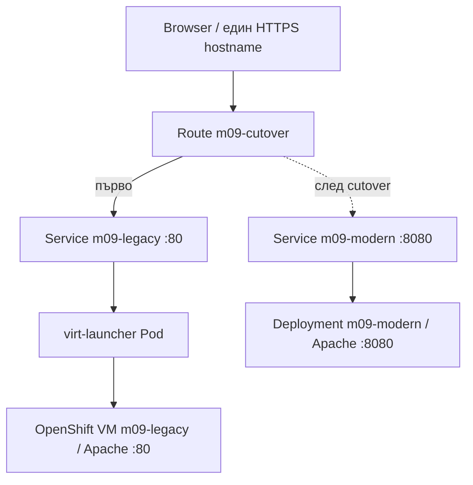

# Lab 09-E — OpenShift Virtualization: legacy VM → Service → Route → container cutover (2026)

> **Самодостатъчен lab с външна инфраструктурна предпоставка:** Red Hat Developer Sandbox с **активна OpenShift Virtualization**, разрешен VM template и свободна квота за CPU, RAM и PVC. Самата платформа/VM образът се предоставят от Red Hat, а **всички Service/Route/modern manifests и всички команди са тук**. **Статично проверен**, не изпълняван на live cluster.
>
> **Трите оригинални Red Hat урока:** [Create a VM](https://developers.redhat.com/learning/learn:openshift:openshift-virtualization-and-application-modernization-using-developer-sandbox/resource/resources:create-virtual-machine), [Set up a legacy app](https://developers.redhat.com/learning/learn:openshift:openshift-virtualization-and-application-modernization-using-developer-sandbox/resource/resources:set-legacy-application), [Modernize the app](https://developers.redhat.com/learning/learn:openshift:openshift-virtualization-and-application-modernization-using-developer-sandbox/resource/resources:modernize-application). [Пълна оригинална пътека](https://developers.redhat.com/learn/openshift/openshift-virtualization-and-application-modernization-using-developer-sandbox).
>
> **Адаптации:** не използваме фиксирана слаба парола, остарелия Fedora 39 template, `Kind: Service` (невалидно изписване), чужд/непиннат Git sample или ръчно заместване на целия Route YAML с риск от изгубен hostname. VM ресурсът и cloud-init се създават чрез **наличния официален Template Wizard**; без конкретен provider catalog не е коректно да се измисля универсален работещ VM image/PVC source. Ако Sandbox не предоставя подходящ template/rights, този сценарий е **блокиран по prerequisite** — не е грешка в YAML за Service и Route.

## 1. Архитектура и цел



**Цел:** след миграцията **външният hostname остава същият**, но Route сменя Service backend от VM към контейнер. Няма автоматична конверсия на VM или данните ѝ; това е контролирано прехвърляне на трафик. Rollback връща предишния Service, ако VM продължава да работи.

**Ограничение на Sandbox:** Red Hat FAQ към 11.11.2026 съобщава, че **Linux VM се спира след 1 час непрекъсната работа**, а Pods се изтриват след 12 часа. Изпълни този lab **в една сесия**, с готови манифести. Планирай време за provisioning на VM, прекъсвания и евентуално повторно стартиране.

## 2. Prerequisites / preflight

Нужно е:
- Действащ [Developer Sandbox](https://developers.redhat.com/developer-sandbox), личен Project и права за `VirtualMachine`, `Deployment`, `Service`, `ConfigMap` и `Route`.
- OpenShift CLI `oc`, Bash и `curl` за workstation. В browser — OpenShift Web Console и VM **VNC Console**. В guest — работеща **поддържана Fedora/RHEL-compatible** VM със `sudo`, `dnf` и outbound access до пакета `httpd`.
- Свободна resource quota за VM и един контейнерен Pod; подходящ boot image и PVC StorageClass от **sandbox template catalog**. Не инсталирай KubeVirt Operator сам и не използвай привилегирован container.
- Предварително създаден **личен** CLI context, без изтриване на `~/.kube/config`. Виж [Lab 09-A](./LAB-01-SANDBOX-CLI-2026.md) за безопасен `KUBECONFIG`.
- **Имената `m09-*` трябва да са свободни.** Не презаписвай съществуващи чужди ресурси.

```bash
oc whoami
oc project
oc version
oc get resourcequota
oc api-resources | grep -i virtualmachine
oc auth can-i create virtualmachines.kubevirt.io
oc auth can-i create services
oc auth can-i create routes.route.openshift.io
oc auth can-i create deployments.apps
oc get vm,vmi,pvc,deploy,svc,route,cm
```

**Очаквано:** VirtualMachine API и права за VM; наличен каталог в Console → **Virtualization → Catalog / VirtualMachines / Create** (точните имена зависят от версията). Ако `oc get vm` е Forbidden, провери правилния Project и правата; ако няма Fedora/RHEL template или quota, **спри**, документирай блокиращата предпоставка и не прескачай към въображаема VM.

### 2.1. Къде са файловете

След merge на този PR в `main`:

```bash
git clone https://github.com/pirocorp/Kubernetes.git
cd Kubernetes
git switch main
export VM_LAB="$PWD/09. OpenShift/labs/examples/vm-cutover"
test -f "$VM_LAB/legacy-service.yaml"
test -f "$VM_LAB/modern.yaml"
test -f "$VM_LAB/route.yaml"
```

Преди merge може да checkout-неш branch `docs/openshift-labs-virtualization-2026`, ако още е наличен. Използваме **готови проверими files**, не manifests от текущ чужд `main`.

## 3. Create VM чрез наличния поддържан template (без слаби credentials)

### 3.1. Template wizard

1. Влез в **Administrator** perspective, избери личния Sandbox **Project**.
2. **Virtualization → Catalog / VirtualMachines → Create from template**. Избери наличен **Fedora или RHEL compatible Linux boot image**, който изрично е **поддържан** и достъпен в твоя catalog. Не търси непременно Fedora 39, показан в оригиналния урок от 2024.
3. **Customize VirtualMachine**, задай **VM name `m09-legacy`**. Избери най-малкия позволен **CPU/RAM и storage** профил, който побира Linux + `httpd`. Ако няма съвместим template/достатъчен quota, спри тук.
4. Настрой **cloud-init** или template **CLOUD_USER_PASSWORD** параметъра. **Никога** не задавай `password`, `admin` или друга известна demo парола. За VNC използвай **нова силна, уникална парола**, запомни я локално и не я поставяй в Git, screenshots или историята на shell.
5. Ако wizard предлага само параметър **CLOUD_USER_PASSWORD**, въведи лично генерирана парола **директно в masked UI field**; документирай съответното потребителско име (често `fedora` при Fedora template). **Не** записвай паролата във файлове на проекта.
6. Ако wizard позволява custom **cloud-init user data**, използвай безопасната алтернатива в 3.2 по-долу за собствен потребител `m09student`. **Не прилагай двата подхода едновременно**, когато template ги комбинира конфликтно.
7. Натисни **Create VirtualMachine**, без да експонираш публично SSH/VNC. Наблюдавай **Events** и **Overview** до `Running`. Запиши си точните имена на личните **boot DataVolume/PVC**, създадени от wizard, защото cleanup трябва да премахне само тях.

**Важна разлика:** VM използва KVM през KubeVirt; `virt-launcher` е Kubernetes Pod, който интегрира управлението на виртуалната машина. **Гостовата ОС не е контейнер**, въпреки че се управлява през Kubernetes ресурси.

### 3.2. Опционален безопасен custom cloud-init (само при поддръжка от template)

Следните команди се изпълняват **локално** в Bash. Генерират временен **хеш** на нова парола; във файла няма plaintext password. Нужни са `openssl passwd -6` и `mktemp`.

```bash
umask 077
M09_VM_PRIVATE_DIR="$(mktemp -d)"
read -r -s -p "Избери уникална VM парола (мин. 16 знака): " M09_VM_PASSWORD
printf '\n'
test "$(printf '%s' "$M09_VM_PASSWORD" | wc -c)" -ge 16
M09_VM_HASH="$(printf '%s' "$M09_VM_PASSWORD" | openssl passwd -6 -stdin)"
unset M09_VM_PASSWORD
cat > "$M09_VM_PRIVATE_DIR/cloud-init-user-data.yaml" <<EOF
#cloud-config
users:
  - default
  - name: m09student
    gecos: OpenShift Module 09 Training
    groups: wheel
    shell: /bin/bash
    sudo: "ALL=(ALL) ALL"
    lock_passwd: false
    passwd: '$M09_VM_HASH'
chpasswd:
  expire: false
ssh_pwauth: false
EOF
unset M09_VM_HASH
chmod 600 "$M09_VM_PRIVATE_DIR/cloud-init-user-data.yaml"
```

В **cloud-init User Data** в VM wizard постави съдържанието на **този локален файл** (само в разрешения template field) и запази паролата в личния си password manager. **Не commit-вай и hash-а**, а при края на упражнението изтрий временния файл. Ако template **не приема custom cloud-init**, използвай **параметъра в 3.1** и не насилвай неподдържана конфигурация.

### 3.3. Проверка VM и VNC login

```bash
oc get vm m09-legacy
oc get vmi m09-legacy
oc get pods -l kubevirt.io=virt-launcher
oc get pvc
```

**Очаквано:** VM/VMI в `Running`, поне един `virt-launcher` Pod. Ако guest е `Provisioning` или `Scheduling`, провери VM Events и quota; ако липсва boot image, документирай блокажа. Открий правилната VNC Console от VM Overview. Влез като потребителя, определен в 3.1, или `m09student` от 3.2. Не използвай root VNC login.

## 4. Legacy application във VM — Apache port 80

Следващите команди се изпълняват **вътре в Linux guest** през VNC (не в локален терминал и не във Web Terminal Pod):

```bash
id
cat /etc/os-release
sudo dnf -y install httpd
printf '%s\n' '<!doctype html><html lang="en"><meta charset="utf-8"><title>Legacy VM</title><h1>Legacy VM - OpenShift Module 09</h1></html>' | sudo tee /var/www/html/index.html >/dev/null
sudo systemctl enable --now httpd
sudo systemctl is-active httpd
curl -fsS http://127.0.0.1/ | grep 'Legacy VM'
```

**Очаквано:** `active` и HTML с `Legacy VM`. Ако пакетът липсва, провери guest DNS/repositories и че image е Fedora/RHEL compatible; ако `Permission denied`, установи дали потребителят е в `wheel` и има `sudo`. **Не отключвай root SSH**, не изключвай SELinux и не отваряй firewall произволно. Ако гостовият firewall блокира port80 от cluster, администрирай **само** конкретния guest `http` service по правилата на Fedora/RHEL, напр. `sudo firewall-cmd --add-service=http --permanent` и `sudo firewall-cmd --reload`, **само ако** `firewalld` е активен и е потвърдена причината.

## 5. Привържи VM към OpenShift Service

**Red Hat изисква label в `spec.template.metadata.labels`, не само в top-level metadata.** При промяна на template **рестартирай VM**, за да се появи label върху новия `virt-launcher` Pod.

Отново **локално**, към Sandbox Project:

```bash
oc patch vm m09-legacy --type=merge \
  -p '{"spec":{"template":{"metadata":{"labels":{"module09-role":"legacy-web"}}}}}'
oc get vm m09-legacy -o jsonpath='{.spec.template.metadata.labels}{"\n"}'
```

В Web Console → VM `m09-legacy` → **Actions → Restart** (или Stop, после Start). Изчакай VM отново да стане `Running`, а `httpd` да е `active` (enabled в 4). **VM restart прави кратко прекъсване, не е zero-downtime операция.**

```bash
oc get vm,vmi m09-legacy
oc get pods -l module09-role=legacy-web --show-labels
oc apply --dry-run=client -f "$VM_LAB/legacy-service.yaml"
oc apply -f "$VM_LAB/legacy-service.yaml"
oc get service m09-legacy -o yaml
oc get endpointslice -l kubernetes.io/service-name=m09-legacy
```

**Очаквано:** поне **един** endpoint за Service `m09-legacy`, selector `module09-role=legacy-web`, порт 80 → 80. Ако Endpoints са празни, **не** продължавай с Route: провери `oc get pods -l module09-role=legacy-web --show-labels`, VM restart и Apache/guest firewall. Ако cluster policies не позволяват Service към VM, отбележи prerequisite failure, не пренасочвай към произволен Pod.

## 6. Публикувай същия Route към VM

```bash
oc apply --dry-run=client -f "$VM_LAB/route.yaml"
oc apply -f "$VM_LAB/route.yaml"
oc get route m09-cutover -o yaml
M09_VM_HOST="$(oc get route m09-cutover -o jsonpath='{.spec.host}')"
test -n "$M09_VM_HOST"
curl -fsS "https://$M09_VM_HOST/" | grep 'Legacy VM'
```

**Очаквано:** Route е `Admitted` и публичният HTTPS hostname показва **Legacy VM - OpenShift Module 09**. Ако `503`, провери Service endpoints, VM `Running`, guest firewall и readiness на Route. Не използвай `curl -k` като основен тест; Route edge TLS трябва да има валидно доверено име/сертификат.

## 7. Пусни модерното контейнерно приложение

Manifest [modern.yaml](./examples/vm-cutover/modern.yaml) съдържа:
- `ConfigMap m09-modern-html` със собствен HTML.
- `apps/v1 Deployment m09-modern`, непривилегирован UBI9 httpd image, порт 8080, readinessProbe и ресурси.
- `Service m09-modern`, порт 8080 → container 8080, **портът има същото име `http`** като legacy Service.

```bash
oc apply --dry-run=client -f "$VM_LAB/modern.yaml"
oc apply -f "$VM_LAB/modern.yaml"
oc rollout status deploy/m09-modern --timeout=240s
oc get deployment m09-modern
oc get svc m09-modern
oc get endpointslice -l kubernetes.io/service-name=m09-modern
```

**Очаквано:** 1/1 Ready, endpoint на 8080. Без да променяш Route можеш да тестваш modern backend с **временен port-forward** (първи терминал):

```bash
oc port-forward svc/m09-modern 18080:8080
```

Втори локален терминал:

```bash
curl -fsS http://127.0.0.1:18080/ | grep 'Modern container'
```

След проверката прекрати port-forward с Ctrl+C. **Важно:** този тест **не доказва** Route, а само container Service.

## 8. Cutover — същият hostname, нов backend

Не редактирай целия Route YAML. Променяме **само target Service**; port name `http` е еднакъв за двата Services:

```bash
oc patch route m09-cutover --type=merge \
  -p '{"spec":{"to":{"kind":"Service","name":"m09-modern","weight":100}}}'
oc get route m09-cutover -o jsonpath='{.spec.host}{" -> "}{.spec.to.name}{"\n"}'
curl -fsS "https://$M09_VM_HOST/" | grep 'Modern container'
```

**Очаквано:** host **същият**, target Service = `m09-modern`, съдържанието е от контейнера. Route router може да има кратък propagation interval; ако наблюдаваш 503/стар response, провери `oc get endpointslice` и изчакай синхронизация, не създавай нов hostname. **Това не доказва zero-downtime** или production data migration.

### 8.1. Rollback към VM (докато тя е Running)

```bash
oc patch route m09-cutover --type=merge \
  -p '{"spec":{"to":{"kind":"Service","name":"m09-legacy","weight":100}}}'
oc get route m09-cutover -o jsonpath='{.spec.host}{" -> "}{.spec.to.name}{"\n"}'
curl -fsS "https://$M09_VM_HOST/" | grep 'Legacy VM'
```

**Очаквано:** старият HTML се връща на **същия HTTPS адрес**. Ако Sandbox вече е спрял VM след 1 час, rollback ще сочи към недостъпен backend, докато VM не бъде безопасно рестартирана. Във всеки момент **поне един** backend трябва да е Ready, преди да сменяш Route.

## 9. Troubleshooting

| Симптом | Проверка | Решение |
|---|---|---|
| Virtualization меню/VM API липсва | `oc api-resources`, UI Catalog | Няма prerequisites; не инсталирай оператор в shared Sandbox |
| VM `Provisioning/Pending` | Events на VM, boot PVC, quota | Изчакай provisioning или избери разрешен шаблон/по-малък size |
| VNC login отказва | cloud-init status/user, template parameters | Използвай правилния template login; не включвай root password |
| `dnf` failed | DNS/repositories вътре в guest | Провери repository и network; без root privilege escalation |
| Service няма Endpoints | `oc get pods -l module09-role=legacy-web`, VM restart | Label в spec.template.metadata.labels + restart, firewall http |
| curl localhost в VM 200, Route 503 | endpoint/Service/VMI, guest firewall | Диагностицирай от Service към VM, после router |
| Modern Deployment NotReady | `oc logs deploy/m09-modern`, SCC, ConfigMap mount | Не изключвай SCC, провери UBI9 image/port |
| HTTP hostname сменен | `oc get route m09-cutover -o yaml` | Patch само `spec.to.name`, не създавай нов Route |
| VM спря след 1 час | `oc get vm,vmi`, [Sandbox FAQ](https://developers.redhat.com/developer-sandbox/FAQ) | Рестартирай и повтори проверки, преди rollback |

## 10. Cleanup — лични ресурси и VM disk

**Внимание:** изтриването на VM boot PVC/DataVolume унищожава учебните данни в guest. Не триѝ общи templates/Golden images от namespace на Red Hat. Първо прегледай attached disks и запиши имената, **без** да копираш чужди PVCs:

```bash
oc get vm m09-legacy -o yaml
oc get pvc
oc get dv 2>/dev/null || true
oc delete route/m09-cutover --ignore-not-found
oc delete service/m09-legacy service/m09-modern --ignore-not-found
oc delete deployment/m09-modern --ignore-not-found
oc delete configmap/m09-modern-html --ignore-not-found
```

След това във **Virtualization → VirtualMachines → m09-legacy → Delete** избери премахване на **VM и собствените ѝ създадени boot DataVolumes/PVCs**, **само ако** са ясно идентифицирани като нейни и нямат други consumers. Ако wizard не предлага опция за associated storage, след изтриване на VM използвай `oc get pvc` и изтрий **само** идентифицираните в началото ресурси по техните **реални имена**:

```bash
oc get vm,vmi,pvc,deploy,svc,route,cm
```

Локален временен cloud-init файл от 3.2:

```bash
if test -n "$M09_VM_PRIVATE_DIR" && test -f "$M09_VM_PRIVATE_DIR/cloud-init-user-data.yaml"; then
  rm -f -- "$M09_VM_PRIVATE_DIR/cloud-init-user-data.yaml"
  rmdir -- "$M09_VM_PRIVATE_DIR"
fi
unset M09_VM_PRIVATE_DIR
```

**Никога** не изтривай цял Sandbox Project, общи `DataSources` или boot images, свързани с други VM. Ако PV reclaim policy = Retain, освободеният PV остава за отделна администраторска обработка.

## 11. Acceptance checklist

- [ ] Има реален разрешен Fedora/RHEL-compatible VM template, а не остарял фиксиран Fedora 39.
- [ ] VM `m09-legacy` е Running; Apache отговаря локално в guest.
- [ ] Service selector съвпада с label в `spec.template.metadata.labels`; след restart има endpoints.
- [ ] Route `m09-cutover` показва Legacy HTML през HTTPS.
- [ ] Modern deployment е 1/1 Ready и отговаря през Service.
- [ ] Route се patch-ва към modern Service, **без промяна на hostname**.
- [ ] Rollback към VM връща Legacy HTML, ако VM още работи.
- [ ] Няма слаби credentials, неоторизирани privileged pods, hostPath или създадени чужди ресурси.
- [ ] Всички лични манифести и VM disk artifacts са почистени селективно.

**API:** VM = `kubevirt.io/v1`; Deployment = `apps/v1`; Service/ConfigMap = `v1`; Route = `route.openshift.io/v1`. **Референции:** [Red Hat VM Service labels and networking](https://docs.redhat.com/en/documentation/openshift_container_platform/4.21/html/virtualization/managing-vms), [Sandbox FAQ](https://developers.redhat.com/developer-sandbox/FAQ).

> **Честно ограничение:** не е валидиран live Sandbox wizard/boot catalog; точно това не може да бъде гарантирано със статичен преглед. Ако изисканата услуга липсва, lab правилно спира още на preflight. Останалият Service/Route/container workflow е напълно специфициран в Markdown и трите файлови manifests.
