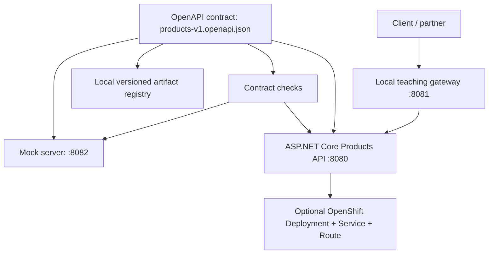

# Module 10 — API-First Development & API Management

**API-first** означава да дефинираме и договорим HTTP интерфейса **преди** неговата реализация. API договорът позволява на frontend/mobile екипите да работят с mock, на backend екипа — да пише кода, а на платформения екип — да управлява версията, достъпа и експлоатацията независимо от езика на реализация.

**Основен източник:** [Red Hat Solution Pattern — Manage and Secure APIs with an API First Approach](https://www.solutionpatterns.io/solution-pattern-api-first/api-first/index.html), Bernard Tison и Jaya Christina Baskaran. Оригиналният pattern използва Red Hat OpenShift, Apicurio/Service Registry, API mocking, Quarkus и 3scale. **Нашата адаптация използва ASP.NET Core 10/C# вместо Quarkus** и добавя напълно изпълним **локален път** с Python standard library mock, registry и gateway. Локалните инструменти **не са** продукти на Red Hat и **не заместват** enterprise deployment.

## 1. Какво ще научиш

- Да разделяш **API implementation lifecycle** (design, mock, implementation, tests) от **API management lifecycle** (publish, discover, authenticate, meter, govern).
- Да описваш операции, request/response schemas, errors, API ключове и examples в OpenAPI договор.
- Да позволяваш паралелна работа по **mock API**, преди backend реализацията.
- Да публикуваш версионирани договори и да разпознаваш **breaking changes**.
- Да реализираш договора като ASP.NET Core REST API, да го проверяваш чрез HTTP contract tests.
- Да различаваш API приложение, API gateway, registry, OpenShift Service и Route.
- Да наблюдаваш 401, 404, 429, usage metrics, health checks и да почистваш ресурсите безопасно.

**Необходими знания:** Modules 01–08 (Pods, Services, deployments, RBAC, TLS) и препоръчително [Module 09 — OpenShift](../09.%20OpenShift/README.md). **Предварителен опит с API-First, Apicurio или 3scale не се изисква.**

## 2. Архитектура на примера



Голямата разлика спрямо **code-first** е, че **договорът съществува, преди да изберем C# records, Minimal APIs, storage или CI**. `openapi.json` е каноничният източник, а не автоматично генериран от endpoint-ите файл.

**Защо JSON, не YAML?** И двете са валидни формати за OpenAPI. JSON позволява да прочетем договора, примери и schemas чрез стандартната Python библиотека **без pip install/PyYAML**. При production дизайн може да се използва YAML, Apicurio API Designer или друга визуална среда; структурата на OpenAPI остава същата.

## 3. Пълната учебна последователност

| Стъпка | Упражнение | Краен проверим резултат |
|---|---|---|
| **10-A** | [Design-first и API mocking](./labs/LAB-01-DESIGN-MOCK.md) | Версиониран OpenAPI документ и mock от неговите `examples`, преминали HTTP checks |
| **10-B** | [API Registry & governance](./labs/LAB-02-REGISTRY-GOVERNANCE.md) | Две immutable версии и открит breaking change |
| **10-C** | [ASP.NET Core API implementation](./labs/LAB-03-ASPNET-IMPLEMENTATION.md) | `dotnet build`, реални 200/401/404/201 responses и contract smoke tests |
| **10-D** | [API management & security](./labs/LAB-04-API-MANAGEMENT.md) | Gateway 401/200/429, admin-only metrics, разлика от 3scale |
| **10-E** | [OpenShift integration](./labs/LAB-05-OPENSHIFT-DEPLOY.md) | Docker strategy Build, Deployment, Service, HTTPS Route и contract check, ако средата позволява |

**Препоръка:** изпълнявай A → B → C → D → E. **A–D могат да работят без Kubernetes/OpenShift**; E е отделен платформен lab с истински external prerequisites.

## 4. Какво точно представляват компонентите

| Компонент | Отговорност | Какво НЕ прави |
|---|---|---|
| OpenAPI договор | Обещава HTTP paths, schemas, статути и security requirements | Не съхранява реални данни и не стартира API |
| Mock | Отговаря с фиксирани примери от договора | Не е backend и няма persistence |
| Registry | Версионира и споделя API artifacts | Не изпълнява API заявки |
| ASP.NET Core API | Имплементира бизнес операциите | Не е enterprise API management платформа |
| Gateway / 3scale | Контрол на достъп, политики, лимити, usage analytics | Не заменя backend бизнес логиката |
| OpenShift Route | Публикува Service чрез hostname/TLS | Не е автоматично API gateway или API registry |

**Red Hat еквиваленти:** [Apicurio Registry](https://www.apicur.io/registry/docs/apicurio-registry/3.0.x/index.html) за registry; [3scale](https://docs.redhat.com/en/documentation/red_hat_3scale_api_management/2.16/html/getting_started/launching-apis) за управление; [Microcks](https://microcks.io/) за mocking. В учебната програма тези решения са **референции за корпоративен вариант**, а не скрити зависимости.

## 5. Starter checklist

Използвай Bash (Ubuntu, macOS, WSL или Git Bash). Инсталирай Git, Python 3.10+, `curl`; за Lab C — [.NET SDK 10](https://dotnet.microsoft.com/en-us/download/dotnet/10.0). За Lab E са нужни `oc`, OpenShift permissions, quota и ingress.

```bash
git clone https://github.com/pirocorp/Kubernetes.git
cd "Kubernetes/10. API-First Development and API Management"
git status --short
python3 --version
python3 -m json.tool contract/products-v1.openapi.json >/dev/null
```

**Очаквано:** директорията съществува и JSON договорът се парсва без грешка. За Lab C: `dotnet --version` трябва да започва с `10.`. За Lab E: `oc whoami` и `oc project` трябва да сочат **собствената учебна OpenShift среда**, не kubeadm/Calico клъстера.

### Независима крайна проверка на локалния път

Можеш да провериш **от чиста среда** mock server, истинския C# API, договорите и учебния API gateway **без** OpenShift, 3scale или Apicurio. Нужни са .NET SDK **10**, Python 3.10+ и свободни TCP портове **8080, 8081, 8082**:

```bash
# Изпълни от корена на Module 10
bash scripts/verify-local.sh
```

Скриптът компилира C#, стартира собствените процеси с временни тайни, проверява JSON contract responses (включително 400/401/404), gateway quota 429 и admin metrics, а накрая спира само своите процеси. Ако порт вече е зает, **отказва да стартира**, вместо да се свърже с чужд endpoint. Изходен код: [scripts/verify-local.sh](./scripts/verify-local.sh). Тази проверка **не** включва live OpenShift, Apicurio или 3scale.

## 6. Файлова структура

```text
10. API-First Development and API Management/
├── README.md
├── contract/products-v1.openapi.json          # Source of truth
├── src/ProductsApi/ProductsApi.csproj
├── src/ProductsApi/Program.cs                  # Real C# implementation
├── tools/mock_server.py                         # Mock using contract examples
├── tools/registry.py                            # Local registry + compatibility
├── tools/gateway.py                             # Local proxy + rate limit
├── tools/contract_check.py                      # HTTP contract smoke suite
├── openshift/api.yaml                          # Deployment + Service + Route
├── Dockerfile
└── labs/LAB-01..LAB-05                        # Precise, ordered exercises
```

## 7. Какво означава „самодостатъчно“ за Module 10?

Всеки lab посочва prerequisites, **действителните файлове**, точни команди, наблюдаеми резултати, troubleshooting, алтернативи при ограничения и cleanup. Локалните упражнения използват основно **Python standard library** и .NET SDK, без registry/account абонаменти или paid services.

**Граници:** API ключът е **учебен**, mock/registry/gateway са локални заместители само на **определени концепции**; няма OIDC, TLS локално, multi-node gateway, production rate limits, реално 3scale или Apicurio deployment. Backend съхранява данни в паметта; няма PostgreSQL/SQL Server. **Не разполагаме с live OpenShift тест**, затова изискванията на конкретния Sandbox са изброени в Lab 10-E вместо да се обещава универсално работещ BuildConfig.

Не поставяй истински API keys, access tokens или kubeconfig в Git. Всички примерни данни са синтетични и всички имена/пътища са учебни.

## 8. Самопроверка

1. Защо започваме с contract, а не с `Program.cs`?
2. По какво се различават API Registry и runtime Gateway?
3. Защо `GET` от mock не доказва, че базата съхранява данни?
4. Какво би нарушило API consumers при премахване на `GET /v1/products/{id}`?
5. Защо HTTP 429 е gateway policy, а HTTP 404 може да е backend резултат?
6. Защо OpenShift Route и 3scale APIcast не са едно и също?
7. Защо `API_KEY` от env/Secret не е равнозначен на пълноценно identity management?

**Отговори:** (1) позволява съгласуване преди код; (2) registry публикува договори, gateway управлява заявки; (3) mock връща examples; (4) breaking change; (5) quota срещу липсващ ресурс; (6) Route е ingress публикуване, APIcast е API management gateway; (7) липсват lifecycle, identity и audit политики.

## Източници

- **Основен:** [Red Hat — Manage and Secure APIs with an API First Approach](https://www.solutionpatterns.io/solution-pattern-api-first/api-first/index.html).
- [OpenAPI Specification](https://spec.openapis.org/oas/v3.0.3.html).
- [Microsoft — ASP.NET Core Minimal APIs](https://learn.microsoft.com/en-us/aspnet/core/tutorials/min-web-api?view=aspnetcore-10.0).
- [Red Hat 3scale API Management 2.16](https://docs.redhat.com/en/documentation/red_hat_3scale_api_management/2.16/html/getting_started/launching-apis).
- [Apicurio Registry 3.x](https://www.apicur.io/registry/docs/apicurio-registry/3.0.x/index.html).
- [Red Hat Developer Sandbox](https://developers.redhat.com/developer-sandbox).

Всички учебни текстове и примери са написани за настоящия модул. Оригиналният Red Hat pattern остава достъпен чрез директен линк и не е копиран дословно.
