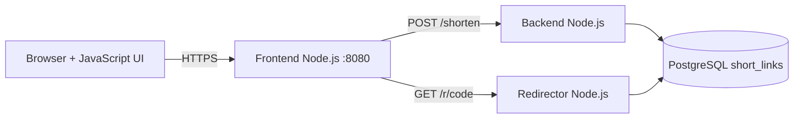
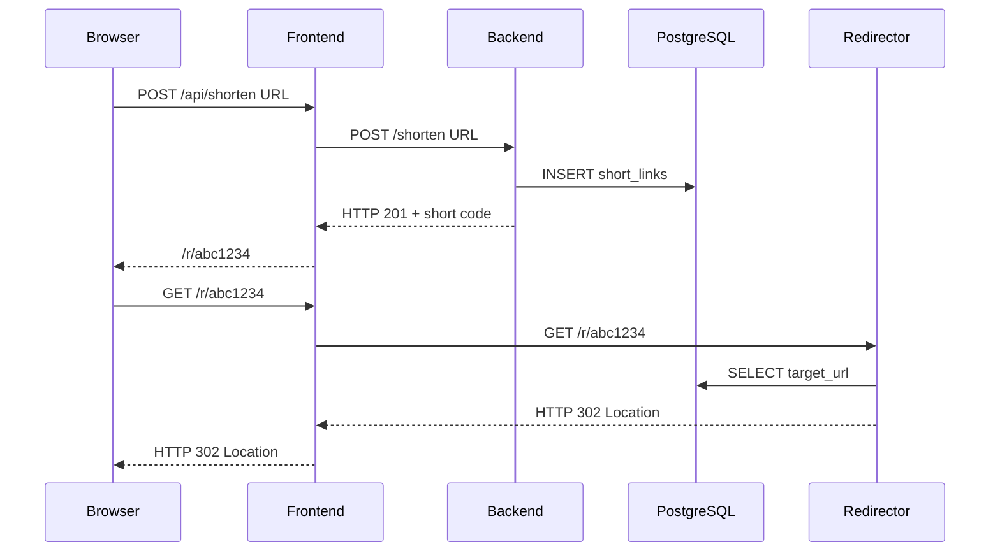

# Lab 10-A — Node.js, OpenShift environment и самостоятелно локално приложение

**Цел:** да подготвиш средата и да изпълниш оригинален full-stack JavaScript проект, преди да го deploy-неш в OpenShift. Това е първата практическа стъпка от [Red Hat learning path](https://developers.redhat.com/learn/openshift/how-deploy-full-stack-javascript-applications-openshift). Упражнението не изисква платен облак, Quay.io или служебен OpenShift клъстер.

## 1. Предварителни знания и технически изисквания

След Kubernetes Modules 00–08 и OpenShift 09 вече знаеш Pod, Deployment, Service, Route, Secret, Build, Project и `oc`. В този модул ще приложиш тези понятия върху **истински frontend + backend + redirector + database**.

За изпълнение на този lab локално:
- Node.js **22+** и Python **3.10+**, Bash (Linux/macOS/WSL), Git.
- За пълния стек: Docker Engine + Compose v2 **или** еквивалентна Podman Compose конфигурация (командите по-долу са проверявани с Docker Compose).
- Интернет за първото изтегляне на Node.js/PostgreSQL образите и npm `pg` dependency.
- Свободни localhost портове **3110**, **3111**, **3112**, **5439** и ресурси за PostgreSQL + три малки Node приложения.
- **OpenShift упражненията 10-B–E допълнително изискват** разрешен Developer Sandbox/Project, `oc` CLI, RBAC и registry/build quota. Тук не е нужен Kubernetes cluster.

Провери всички необходими файлове и версии **от корена на Module 10**:

```bash
pwd
node --version
python3 --version
docker compose version
python3 scripts/check-links.py
bash scripts/verify-node.sh
```

**Очаквано:** Node v22+; Python 3.10+; `PASS all 23 required files and consistent npm lock manifests`; успешен JavaScript syntax check; frontend HTTP 200 и коректно HTTP 502 при изключен backend. **502 тук е очакван резултат** — frontend не се преструва, че database и backend са ready.

## 2. Как е построено Shorties?

Оригиналният Red Hat tutorial използва URL Shortener с четири слоя. В оригинала redirector е Go image, но **нашият адаптиран пример включва Node.js redirector с пълен source**, за да няма непроверима външна зависимост.



**Frontend:** доставя HTML/CSS/client JS, приема `POST /api/shorten` и препраща към backend, предоставя `GET /api/status`, а `GET /r/{code}` се маршрутизира през redirector.

**Backend:** валидира URL, генерира случаен short code и записва в PostgreSQL чрез параметризирана SQL заявка.

**Redirector:** намира short code в PostgreSQL и връща HTTP **302 Location** към оригиналния URL.

**Database:** една таблица `short_links(code, target_url, created_at)`. Приложенията никога не пишат URL mapping в локален процесен state — записите оцеляват след рестарт.

## 3. Какво означават Route, Service и DNS?

В OpenShift **Route** публикува външен HTTPS endpoint, а **ClusterIP Service** позволява вътрешна комуникация по DNS име. Например `http://m10-backend:8080` работи от Pod в същия namespace, но не и в браузър извън клъстера.

Затова frontend обслужва browser request от своя Route и извиква backend/redirector **server-side**. Това ни спестява публични backend Routes, CORS конфигурации и browser mixed-content грешки, без да променя логиката на обучението.



## 4. Възпроизводими npm зависимости

Във всеки от трите Node.js проекта е включен реално генериран **`package-lock.json`**. Dockerfile-ите използват **`npm ci`** вместо `npm install` за фиксирани транзитивни зависимости и строг контрол за несъответствие между `package.json` и lockfile.

От директорията на Module 10 с Node.js 22+ и достъп до npm registry:

```bash
for service in frontend backend redirector; do
  npm ci --prefix "src/$service" --omit=dev --ignore-scripts --no-audit --no-fund
done
python3 scripts/check-links.py
```

**Очаквано:** всяка команда връща exit code 0; това проверява истинско инсталиране на зависимости, а не mock. За offline build зависимостите трябва предварително да са кеширани; Docker Compose integration остава независим acceptance test.

## 5. Реален локален end-to-end тест

**Една команда от чист checkout** изгражда трите Node container images, стартира PostgreSQL и тества HTTP потока:

```bash
python3 tools/init_env.py
docker compose config --quiet
bash scripts/verify-compose.sh
```

**Очаквано:** `PASS all services healthy`; реален HTTP 201 при създаване; реален HTTP 302 от frontend и redirector; 400 за непозволен URL; 404 за несъществуващ code; данните се запазват след рестартиране на трите JavaScript услуги. Скриптът проверява и записа в PostgreSQL със SQL.

Отвори <http://127.0.0.1:3110> — въведи `https://example.org/articles/123`, избери **Shorten URL** и отвори новия линк. В секцията **System health** трябва да виждаш `ready` за frontend, backend, database и redirector.

Тези портове са публикувани **само на 127.0.0.1**; приложението няма external exposure и demo потребителските данни са синтетични.

## 5. Разгледай реалната база данни

```bash
docker compose exec -T database \
  psql -U shorties -d shorties -c \
  "SELECT code,target_url,created_at FROM short_links ORDER BY created_at DESC LIMIT 5"
```

**Очаквано:** няколко short code стойности и целевите адреси, създадени от HTTP integration tests. Виж [sql/init.sql](../sql/init.sql) за schema и [src/backend/server.mjs](../src/backend/server.mjs) за параметризираните заявки.

## 6. Troubleshooting

| Симптом | Проверка | Действие |
|---|---|---|
| `node --version` е под 22 | `node -v` | Инсталирай Node.js 22+ |
| Docker daemon не работи | `docker info` | Стартирай Docker/Podman или провери permissions |
| `3110 already in use` | `ss -lnt` | Спри **собствения** стар контейнер/процес |
| PostgreSQL не е ready | `docker compose logs database` | Провери паролата, init volume, health |
| HTTP 502 при пълния стек | `docker compose logs frontend backend redirector` | Конфигурация на Service URLs |
| 201 работи, но 302 не | `docker compose logs redirector` | PostgreSQL connection, short code |
| Няма създадени таблици | `docker compose logs database` | SQL init се изпълнява само с **нов** volume |
| npm package download error | `docker compose build backend` | Провери registry/DNS/proxy |

## 7. Cleanup и проверка

Спиране **без** изтриване на PostgreSQL данни:

```bash
docker compose down
```

Пълно изчистване на **само този учебен** Docker Compose project, изтриващо неговия PostgreSQL volume:

```bash
docker compose down -v
```

Това изтрива всички кратки URL-и — изпълнявай само ако действително искаш празна учебна DB. Файлът `.env` остава локално и е Git-ignored; можеш да го премахнеш след курса.

**Приемане:** локалният реален full-stack URL Shortener работи и можеш да обясниш разликата между frontend Route, backend Service, redirector и persistent PostgreSQL.
