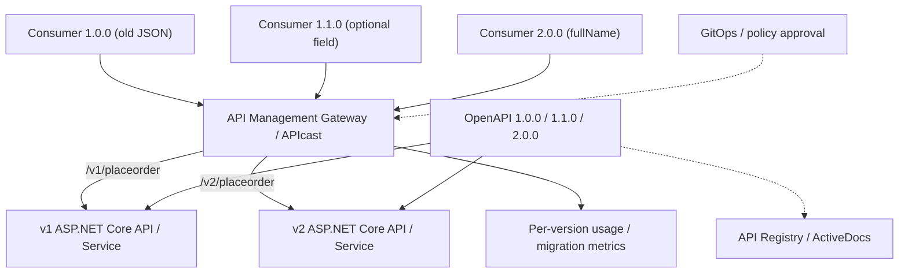
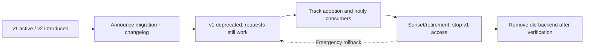

# Module 11 — API Versioning & Lifecycle Management

**API versioning** е процесът на въвеждане и поддържане на промени в публичен интерфейс, без неочаквано да прекъснем съществуващите му потребители. Това изисква повече от нов `/v2` endpoint: versioned contracts, промени в backend, управление на gateway, миграция на clients, документация, наблюдение на потреблението, deprecation и retirement.

**Основен учебен източник:** [Red Hat Solution Pattern — API versioning with 3scale API management](https://www.solutionpatterns.io/solution-pattern-api-versioning/api-versioning/index.html) ([Architecture](https://www.solutionpatterns.io/solution-pattern-api-versioning/api-versioning/02-architecture.html), [Workshop](https://www.solutionpatterns.io/solution-pattern-api-versioning/api-versioning/03-demo.html)), Jaya Christina Baskaran, Red Hat. Оригиналният Globex сценарий се основава на OrderPlacement, Quarkus, 3scale, Apicurio, OpenShift и Argo CD.

**Нашата реализация:** собствен **ASP.NET Core 10/C# OrderPlacement API**, три OpenAPI договора, три примера за consumer payload, contract compatibility checker, versioned clients, локален учебен gateway с per-version analytics и lifecycle policy, отделни OpenShift v1/v2 Services/Routes. Оригиналните Red Hat материали остават достъпни чрез горните линкове; **не ги копираме дословно**.

## 1. Какво трябва да знаеш

**Предварителни знания:** основни HTTP, JSON, REST, Docker/Kubernetes и [Module 10 — API-First Development](../10.%20API-First%20Development%20and%20API%20Management/README.md). За optional OpenShift lab е полезен и [Module 09 — OpenShift](../09.%20OpenShift/README.md). Не е нужен опит с Quarkus, 3scale или Apicurio.

**В края на модула ще можеш:**
- Да класифицираш промяна като compatible или breaking **от гледната точка на API consumer**.
- Да разграничиш `info.version = 1.1.0` от URI major version `/v1`.
- Да поддържаш `/v1` и `/v2` паралелно, с отделно versioned client поведение.
- Да наблюдаваш потреблението на старата версия, вместо да я изключваш „по усет“.
- Да планираш provider/consumer миграция, deprecation, sunset, rollback и окончателно извеждане от употреба.
- Да свързваш OpenShift routing и 3scale concepts, без да ги смесваш.
- Да изпълниш и почистиш всички локални примери, без да инсталираш платени продукти.

## 2. Globex OrderPlacement — един бизнес сценарий, три API договора

| Договор | URI | Request body | Вид промяна |
|---|---|---|---|
| **1.0.0** | `POST /v1/placeorder` | `firstName`, `lastName`, `sku`, `quantity` | Начална версия |
| **1.1.0** | `POST /v1/placeorder` | Същите полета + незадължително `deliveryInstructions` | Backward-compatible |
| **2.0.0** | `POST /v2/placeorder` | `fullName`, `sku`, `quantity` (+ optional `deliveryInstructions`) | Breaking change |

Това са двете промени от Red Hat case study: добавяне на незадължителни **Delivery Instructions** и замяна на отделните имена с **Full Name**. Исторически клиент по 1.0.0 остава работещ с latest v1.1.0 implementation; v2 изисква **изрична клиентска миграция**.

Пример за 1.0.0:

```json
{"firstName":"Alex","lastName":"Ivanov","sku":"BOOK-1","quantity":2}
```

Съвместим 1.1.0 payload:

```json
{"firstName":"Alex","lastName":"Ivanov","sku":"BOOK-1","quantity":2,"deliveryInstructions":"Leave at the door"}
```

Несъвместим 2.0.0 payload за старите v1 clients:

```json
{"fullName":"Alex Ivanov","sku":"BOOK-1","quantity":2,"deliveryInstructions":"Leave at the door"}
```

**Внимание:** истинската бизнес логика за лични имена не трябва автоматично да приема, че `fullName` е просто `firstName + lastName`. Реалната миграция може да има модели за различни култури, consent, retention и downstream system contracts. Нашите примери съдържат само синтетични данни.

## 3. Архитектура: provider → gateway → versioned backends → consumers



В оригиналната архитектура 3scale може да управлява **API Product**, един или повече **Backends**, **Mapping Rules**, **Methods/Metrics**, **Application Plans** и **Developer Portal**. Argo CD/GitOps versioning се прилага и към gateway настройките, не само към Java/C# source.

В нашия локален вариант:
- **ASP.NET Core :8080** — истински OrderPlacement HTTP endpoint с валидация.
- **Python gateway :8081** — локална *учебна* proxy/analytics симулация, **не 3scale**.
- **`tools/policy.py`** — сменя lifecycle policy, прочитана при следващата заявка.
- **`/_metrics`** — защитени с отделен admin key локални counters; **не** са production analytics.
- **OpenShift (по избор)** — две Deployments/Services и два Routes с един host и пътища `/v1` и `/v2`, но **без реално инсталиране на 3scale**.

## 4. Кога е нужна нова версия?

Решението зависи от **договорите и поведението, което вече са приели клиентите**. Премахване или преименуване на задължително поле е breaking; добавяне на действително незадължително поле обикновено е non-breaking, но се изискват compatibility тестове. Семантична промяна без schema промяна също може да е breaking.

Прилагаме Semantic Versioning като **учебна policy**, а не като автоматична HTTP спецификация:

- **Major** `2.0.0`: несъвместим request/response contract.
- **Minor** `1.1.0`: обратно съвместима нова възможност.
- **Patch** `1.0.1`: съвместимо поправяне на проблем.

**`/v1` и `/v2` са major compatibility lines**, не пълните SemVer стойности. URL versioning е изборът на този Red Hat pattern; header versioning и отделен API Product са реални алтернативи, обсъдени в [Lab 11-A](./labs/LAB-01-CONTRACTS-SEMVER.md).

## 5. Предсказуем lifecycle: не смесвай deprecation и retirement



- **Deprecation** е сигнал за lifecycle, но *не изключва* endpoint. RFC 9745 дефинира `Deprecation` HTTP header като Structured Field date, например `Deprecation: @1688169599`.
- **Sunset** сигнализира очаквана дата на край на достъпа чрез HTTP-date header (RFC 8594). Не трябва да е по-ранна от deprecation date.
- **Retirement** е техническа/продуктова промяна: този учебен gateway връща `410 Gone` за v1, но 3scale може да използва Application Plan visibility/access policies.
- **Rollback** на policy е възможен, но **не** връща автоматично промени по бази данни, съобщения или данни, мигрирани в downstream системи.

Примерните дати **2026-01-01** и **2027-06-30** са **само учебни**, не официален график за API retirement.

## 6. Практическа програма

| Последователност | Упражнение | Проверим резултат |
|---|---|---|
| **11-A** | [Contracts, SemVer и compatibility](./labs/LAB-01-CONTRACTS-SEMVER.md) | 1.0→1.1 compatible; 1.1→2.0 breaking, exit code 2 |
| **11-B** | [ASP.NET Core API и три клиента](./labs/LAB-02-ASPNET-CONSUMERS.md) | `dotnet build`, 201 на v1/v2, 400 при несъвместим body |
| **11-C** | [Gateway, provider analytics, 3scale concepts](./labs/LAB-03-GATEWAY-ANALYTICS.md) | Local gateway и `v1_201`/`v2_201` counters |
| **11-D** | [Deprecation, Sunset, migration, rollback](./labs/LAB-04-DEPRECATION-SUNSET.md) | v1: 201 → предупреждение → 410 → 201; v2 непрекъснато работи |
| **11-E** | [OpenShift dual backends/Routes](./labs/LAB-05-OPENSHIFT-VERSIONING.md) | 2 Deployments, 2 Services, 2 path-based HTTPS Routes в един host |

**Учебният ред е A → B → C → D → E.** A–D могат да работят локално без OpenShift. E изисква действителни Project/Build/Routing възможности на средата. Следвай всяко упражнение до cleanup, преди да го считаш за завършено.

## 7. Стартови инструменти

**Linux/macOS/WSL Bash**, Git, Python 3.10+, `curl` и за C/D [.NET SDK 10](https://dotnet.microsoft.com/en-us/download/dotnet/10.0). За E — `oc` и [Developer Sandbox](https://developers.redhat.com/developer-sandbox) или съвместим OpenShift cluster.

```bash
git clone https://github.com/pirocorp/Kubernetes.git
cd "Kubernetes/11. API Versioning and Lifecycle Management"
python3 --version
python3 -m json.tool contracts/orderplacement-1.0.0.openapi.json >/dev/null
dotnet --version  # нужно само за 11-B/C/D
```

**Очаквано:** файловете са налични, JSON се парсва, а `dotnet --version` започва с `10.` за упражненията, които използват C#.

### Независима крайна проверка на локалния път

От корена на Module 11 изпълни:

```bash
bash scripts/verify-local.sh
```

Нужни са .NET SDK **10**, Python 3.10+ и свободни портове **8080, 8081**. Скриптът компилира реалния C# OrderPlacement API, проверява compatibility/breaking contracts, изпълнява HTTP тестове към директния API и gateway за `active → deprecated → sunset → rollback`, проверява version-specific metrics и спира своите процеси. За да не заличава потребителски state, отказва да започне при съществуващ `.runtime/lifecycle.json`; прегледай и премахни този файл **само ако е твой стар учебен state**. Източник: [scripts/verify-local.sh](./scripts/verify-local.sh).

Тази проверка **не** означава успешно изпълнен 3scale/Argo CD или OpenShift lab; те имат отделни инфраструктурни предпоставки.

## 8. Структура на проекта

```text
11. API Versioning and Lifecycle Management/
├── README.md
├── contracts/orderplacement-{1.0.0,1.1.0,2.0.0}.openapi.json
├── src/OrderPlacementApi/OrderPlacementApi.csproj
├── src/OrderPlacementApi/Program.cs
├── consumers/client.py
├── examples/order-{1.0.0,1.1.0,2.0.0}.json
├── tools/contract_diff.py
├── tools/check.py
├── tools/gateway.py
├── tools/policy.py
├── tools/metrics.py
├── docs/MIGRATION.md
├── openshift/workloads.yaml
├── openshift/route-v1.yaml
├── openshift/route-v2.yaml
├── Dockerfile
└── labs/LAB-01..LAB-05
```

Всички sample credentials се генерират локално. Не добавяй реални API tokens, kubeconfig, customer payload или лични данни в Git. `.runtime/` и build artifacts се игнорират от Git.

## 9. Важни граници на учебния пример

- Образователният `contract_diff.py` открива основни breaking промени, но **не** е пълна OpenAPI compatibility validator.
- Backend съхранява **само в паметта** идентификаторите/състоянието на учебните поръчки; не използва database, Kafka или webhook.site. Няма финансово действие или реална доставка.
- Локалният gateway има **одна учебна тайна** и in-memory version counters; не е 3scale/APIcast, не осигурява HA, persistent auditing, distributed quotas, TLS, customer identity или developer portal.
- Red Hat оригиналният workshop използва **OpenShift 4.15, cluster-admin, Ansible и оператори**. Не го изпълнявай сляпо в Developer Sandbox или по-нова инфраструктура. Нашият OpenShift lab не ги инсталира.
- Успехът в live Sandbox зависи от quota, BuildConfig rights, route admission, registry/network и Node image compatibility. Документацията изброява тези prerequisites, но **не може да гарантира наличността им**.

## 10. Самопроверка

1. Защо `1.1.0` може да използва старото URI `/v1/placeorder`?
2. Защо `fullName` вместо `firstName/lastName` е breaking?
3. Защо `Deprecated` не трябва моментално да води до HTTP 410?
4. Каква е разликата между скриване на 3scale Application Plan за **нови** клиенти и блокиране на старите активни клиенти?
5. Защо трябва да имаш per-version usage metrics преди sunset?
6. Кой компонент публикува HTTPS Route и кой управлява API products/application plans?
7. Защо успешен `GET /healthz` не доказва съвместимост на `POST /v2/placeorder`?

**Насоки за отговор:** (1) major compatibility line; (2) старият payload вече е невалиден; (3) deprecation е предупреждение, докато retirement е промяна на услугата; (4) onboarding срещу достъп на съществуващи клиенти; (5) за информирано решение и проследяване на остатъчните consumers; (6) OpenShift router срещу 3scale/APIcast; (7) нужни са contract tests с реални заявки.

## Официални източници

- [Red Hat — API Versioning: начало](https://www.solutionpatterns.io/solution-pattern-api-versioning/api-versioning/index.html)
- [Red Hat — архитектура и versioning стратегии](https://www.solutionpatterns.io/solution-pattern-api-versioning/api-versioning/02-architecture.html)
- [Red Hat — Globex 3scale/ArgoCD workshop](https://www.solutionpatterns.io/solution-pattern-api-versioning/api-versioning/03-demo.html)
- [Semantic Versioning](https://semver.org/)
- [OpenAPI Specification](https://spec.openapis.org/oas/v3.0.3.html)
- [RFC 9745 — Deprecation](https://www.rfc-editor.org/rfc/rfc9745)
- [RFC 8594 — Sunset](https://www.rfc-editor.org/rfc/rfc8594)
- [OpenShift Routes](https://docs.redhat.com/en/documentation/openshift_container_platform/4.19/html-multi/ingress_and_load_balancing/routes)
- [.NET 10](https://dotnet.microsoft.com/en-us/download/dotnet/10.0)

Всички source файлове и обяснения са написани за това упражнение; Red Hat pattern служи за учебна основа и е запазен като оригинална препратка.
