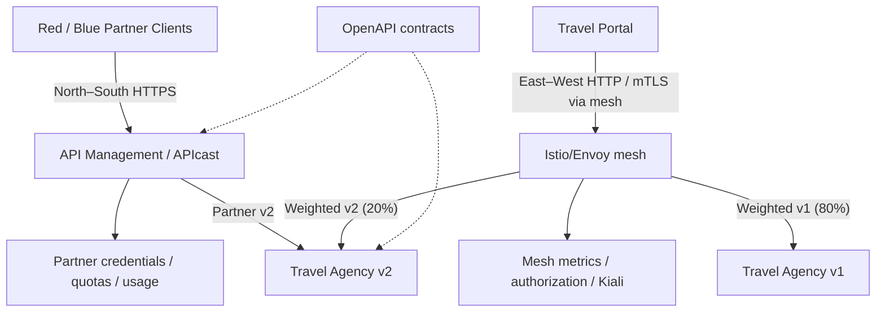

# Module 13 — Comprehensive Service Architecture: API Management + Service Mesh

**API Management и Service Mesh са допълващи се инфраструктурни слоеве.** Първият управлява публикуването и използването на API-та от партньори и други организационни домейни. Вторият управлява service-to-service комуникацията, workload identities, трафика и observability **вътре** в microservices платформа.

**Оригинален учебен източник:** [Red Hat Solution Pattern — Comprehensive Service Architecture with API Management and Service Mesh](https://www.solutionpatterns.io/solution-pattern-apim-servicemesh/comprehensive-service-architecture/index.html), с [архитектура](https://www.solutionpatterns.io/solution-pattern-apim-servicemesh/comprehensive-service-architecture/02-architecture.html) и [практически walkthrough](https://www.solutionpatterns.io/solution-pattern-apim-servicemesh/comprehensive-service-architecture/03-demo.html). Red Hat използва измислената туристическа компания **Travelz**, 3scale, OpenShift Service Mesh/Istio, Kiali и Java/Quarkus приложения.

**Нашата адаптация:** собствен **ASP.NET Core 10/C# Travelz пример** с три service роли (Travel Agency v1, v2 и Travel Portal), локален демонстрационен API Management gateway за два партньора, routing/resilience simulator, а също **реални namespace-scoped OpenShift/Istio manifests** за 80/20 canary, mTLS и policy. Историческият 3scale WASM plugin **не се използва**, защото не е поддържан в Service Mesh 3.

**Execution profiles:** [OpenShift L/S/P guide](../docs/OPENSHIFT-LAB-PROFILES.md) and read-only `scripts/check-openshift-profile.sh m13-mesh`. 13-C is a local simulator; actual Envoy sidecars, STRICT mTLS and identity policy require an operator-enabled 13-E environment.

## 1. Учебни цели

След Module 13 ще можеш да:
- Разграничиш North–South (партньорски/client access) от East–West (microservice-to-microservice) трафик.
- Разпознаваш 3scale API Product, Backend, APIcast, Application Plan, API key, usage analytics и Developer Portal.
- Разграничиш Istio control plane от Envoy data plane, Sidecar injection и Service Mesh security.
- Построиш Travel Portal → Agency v1/v2 с работещ C# source и ясни Service endpoints.
- Тестваш контролирани partner limits, 401/429 и metrics без реални клиентски credentials.
- Разбереш canary traffic splitting, retry, fallback, latency, metrics и correlation/tracing.
- Приложиш (при наличен mesh) Istio `DestinationRule`, `VirtualService`, `PeerAuthentication STRICT` и `AuthorizationPolicy`.
- Разпознаеш опасните/остарели части от стар Red Hat walkthrough и да планираш поддържана enterprise интеграция.

**Предварителни знания:** [Modules 00–08 — Kubernetes](../README.md) (Services, Deployments, RBAC, probes, ConfigMaps/Secrets, ingress), [Module 09 — OpenShift](../09.%20OpenShift/README.md), [Module 11 — API-First](../11.%20API-First%20Development%20and%20API%20Management/README.md), [Module 12 — API Versioning](../12.%20API%20Versioning%20and%20Lifecycle%20Management/README.md). **Първи опит с Istio и 3scale не е необходим.**

## 2. Историята на Travelz

Travelz има две организационни единици:
- **Travel Portal**: обслужва туристически клиентски заявки.
- **Travel Agency**: предоставя travel quotes за хотел, самолетен билет, кола и застраховка.

С разрастването си Travelz има четири задачи:
1. Да управлява и наблюдава вътрешната service-to-service комуникация с Service Mesh.
2. Да публикува нова Agency v2 услуга и да извърши **canary** rollout.
3. Да предоставя v2 API безопасно на **външни партньори**, с отделни credentials, квоти и analytics.
4. Да стандартизира достъпа и за други вътрешни business units, без да заобикаля security политики.

Това е **структурата на оригиналния Red Hat Pattern**. Нашите имена и синтетични данни са учебни; няма реални bookings, payments или туристически оферти.

## 3. Архитектура: едно приложение, две управленски граници



**Разлика:** API Management **не заменя** Service Mesh, а Service Mesh **не предоставя автоматично** developer portal, partner billing или customer relationship management. Един и същ API може да бъде защитаван от двата слоя с различни политики.

### Какво е реално в нашите упражнения?

| Компонент | Локален път (13-A–C) | OpenShift път (13-D–E) |
|---|---|---|
| Travel Agency/Portal | Реален ASP.NET Core 10 API | Реални Deployments и Services |
| Partner API access | Python demo gateway — **не 3scale** | Същият gateway, Route с edge TLS — **не 3scale** |
| Canary traffic | Python routing **simulation** 80/20 | Истински Istio VirtualService/DestinationRule, само с mesh |
| Resilience | Детерминистичен GET retry/fallback | Istio retry/timeout policy, без гаранция за cross-version failover |
| Security | Loopback-only, учебни keys | Secrets, ServiceAccounts; mTLS STRICT/AuthorizationPolicy само в 13-E |
| Observability | In-memory counters, correlation ID | Logs, реален sidecar; Kiali/Prometheus само ако са предоставени |

## 4. Обяснение на основните понятия

**North–South:** заявки между външни потребители/партньори и корпоративна API граница. Обичайно се нуждаят от TLS, authentication, plans, quotas, developer registration, governance и analytics.

**East–West:** повиквания между вътрешни services. Istio Service Mesh добавя прозрачен proxy dataplane (Envoy sidecars или друг deployment mode) и централизирани policies за routing, authorization и mutual TLS.

**Control plane:** конфигурацията и управлението на proxies — Istio разпространява policy към Envoy. **Data plane:** proxies обработват действителните заявки. 3scale и Istio имат собствени управленски и runtime компоненти; не ги смесвай.

**Workload identity:** сертификатно удостоверяване на service identity при Istio mTLS. То не е partner API key и не бива да се заменя с произволен HTTP header.

**Canary:** пускаш нова v2 версия към част от трафика, наблюдаваш latency/error rates и увеличаваш процента контролирано. 80/20 е routing policy, **не SLA**, и малък брой заявки не доказва точно това съотношение.

**Retry:** безопасен само при ясна idempotency/side-effect политика. Нашият local retry е ограничен до GET. Не повтаряй автоматично booking/payments операции.

**Observability:** request correlation, metrics и distributed tracing са различни. Истинска tracing система изисква collector, sampling и подходящи интеграции; просто наличие на `X-Correlation-Id` не означава Jaeger tracing.

## 5. Пълна практическа програма

| Упражнение | Какво изграждаш | Резултат |
|---|---|---|
| **13-A** | [Travelz microservices и Portal → Agency](./labs/LAB-01-TRAVELZ-MICROSERVICES.md) | .NET build; пет local health endpoints; v1/v2 и correlation |
| **13-B** | [Partner API Management / North–South](./labs/LAB-02-PARTNER-API-MANAGEMENT.md) | Red/Blue keys, различни quotas, 401/200/429, metrics |
| **13-C** | [East–West routing & resilience](./labs/LAB-03-TRAFFIC-CANARY-RESILIENCE.md) | Локално 80/20, retry/fallback и observability; изрично симулация |
| **13-D** | [OpenShift Travelz & Partner gateway](./labs/LAB-04-OPENSHIFT-DEPLOY.md) | C# images, Python gateway image, 4 Deployments, 5 Services, HTTPS Route |
| **13-E** | [Real Istio Service Mesh](./labs/LAB-05-REAL-ISTIO-MESH.md) | Envoy proxies, VirtualService, DestinationRule, STRICT mTLS, authorization, canary/rollback |

**Изпълнявай 13-A → 13-B → 13-C → 13-D → 13-E.** A–C работят на лична машина без Docker, OpenShift, 3scale или платени продукти; нужен е .NET SDK 10. D изисква Sandbox с достатъчни права и registry; E изисква **вече инсталиран и работещ Istio mesh**. Ако D или E са недостъпни по инфраструктурни причини, не ги отбелязвай като изпълнени.

## 6. Първи стъпки

Локална среда: Linux/macOS/WSL, Bash, Python >=3.10, [.NET SDK 10](https://dotnet.microsoft.com/en-us/download/dotnet/10.0), `curl`, Git. Не са нужни NuGet пакети извън стандартния ASP.NET Core shared framework.

```bash
git clone https://github.com/pirocorp/Kubernetes.git
cd "Kubernetes/13. API Management and Service Mesh"
dotnet --version
python3 --version
python3 tools/keys.py check-ports
bash scripts/start.sh
```

**Очаквано:** успешна C# компилация и `PASS` за Health, Agency v1/v2, Portal correlation, unauthorized Partner. Ключовете се създават локално в `.runtime/keys.env`, със restricted permissions; не ги публикувай или изпращай в Git.

За спиране:

```bash
bash scripts/stop.sh
```

### Автоматична крайна проверка на локалния път

Преди да преминеш към OpenShift/Istio можеш да изпълниш **всички локални acceptance проверки наведнъж**, без липсващи файлове или външни API услуги:

```bash
# От корена на Module 13; .NET SDK 10, Python 3.10+, свободни портове 5100–5300
bash scripts/verify-local.sh
```

Скриптът изгражда реалния C# проект, стартира пет локални процеса, проверява health, Portal → Agency, 80/20, един безопасен GET fallback, Red/Blue quota 401/200/429 и admin metrics, след което спира **собствените** процеси. Изходен код: [scripts/verify-local.sh](./scripts/verify-local.sh). Запазените учебни credentials в `.runtime/keys.env` са локални (mode 0600) и не се commit-ват. **Локалният тест не доказва изпълнение на истински Istio/3scale** — тези цели остават в 13-D/13-E при налична среда.

## 7. Файлова структура

```text
13. API Management and Service Mesh/
├── README.md
├── contracts/travelz-partner-v1.openapi.json
├── src/Travelz/Travelz.csproj
├── src/Travelz/Program.cs
├── Dockerfile
├── container/partner.Dockerfile
├── tools/keys.py
├── tools/mesh_sim.py
├── tools/partner_gateway.py
├── tools/verify.py
├── tools/mesh_sample.py
├── tools/partner_client.py
├── tools/partner_metrics.py
├── scripts/start.sh
├── scripts/stop.sh
├── openshift/base.yaml
├── mesh/destination-rule.yaml
├── mesh/canary-80-20.yaml
├── mesh/rollback-v1.yaml
├── mesh/policy-mtls.yaml
├── mesh/probe-denied.yaml
├── docs/ENTERPRISE-3SCALE-MESH.md
└── labs/LAB-01...LAB-05
```

Всички **потребителски source files и manifests** са в това хранилище. Външните images/Registries, .NET SDK и cluster/operator възможности остават **ясни prerequisites**, които трябва да се проверят при изпълнение.

## 8. Важно: старият 3scale WASM подход не е актуален за Service Mesh 3

Оригиналният walkthrough показва `threescale-wasm-auth` (3scale auth/usage reporting в Istio sidecar). Но [Red Hat 3scale 2.16 Operating Guide](https://docs.redhat.com/en/documentation/red_hat_3scale_api_management/2.16/html/operating_red_hat_3scale_api_management/) посочва, че този модул е **deprecated и неподдържан от OpenShift Service Mesh 3**.

Затова курсът **не инсталира** стария WASM image или неговите секрети. Вместо това показва **3scale/APIcast като отделен North–South слой** и **OpenShift Service Mesh за East–West**, а enterprise ограниченията и migration checklist са в [ENTERPRISE-3SCALE-MESH.md](./docs/ENTERPRISE-3SCALE-MESH.md).

## 9. Самопроверка

1. Коя е разликата между API Product в 3scale и Istio Service?
2. Защо partner API key не идентифицира автоматично Kubernetes workload?
3. Каква е ролята на Envoy proxy и на Istio control plane?
4. Защо 80/20 weighted route не гарантира точно 8 v2 заявки от 40?
5. Защо `oc get pods` с един Pod на service не доказва mTLS?
6. Как доказваш, че AuthorizationPolicy отказва неоторизиран service account?
7. Защо старият 3scale WASM plugin не трябва да се копира върху Service Mesh 3?

**Насоки:** (1) API продукт/клиентски договор срещу service discovery и routing; (2) приложен credentials срещу сертификатна workload identity; (3) data plane/control plane; (4) статистически избор; (5) нужен е реален sidecar и политика; (6) negative request от непозволено workload identity; (7) официална deprecation/unsupported матрица.

## Официални и допълнителни източници

- [Red Hat — Comprehensive Service Architecture](https://www.solutionpatterns.io/solution-pattern-apim-servicemesh/comprehensive-service-architecture/index.html)
- [Red Hat — Architecture / Travelz Scenarios](https://www.solutionpatterns.io/solution-pattern-apim-servicemesh/comprehensive-service-architecture/02-architecture.html)
- [Red Hat — Original Workshop](https://www.solutionpatterns.io/solution-pattern-apim-servicemesh/comprehensive-service-architecture/03-demo.html)
- [Red Hat — OpenShift Service Mesh 3.x](https://docs.redhat.com/en/documentation/red_hat_openshift_service_mesh/3.3/html-single/installing/index)
- [Red Hat — Service Mesh Operator lifecycle](https://access.redhat.com/support/policy/updates/openshift_operators)
- [Red Hat 3scale 2.16 — Operating / WASM support](https://docs.redhat.com/en/documentation/red_hat_3scale_api_management/2.16/html/operating_red_hat_3scale_api_management/)
- [Istio — Traffic Management](https://istio.io/latest/docs/concepts/traffic-management/)
- [Istio — AuthorizationPolicy](https://istio.io/latest/docs/reference/config/security/authorization-policy/)
- [OpenAPI 3.0.3](https://spec.openapis.org/oas/v3.0.3.html)

Материалите са оригинална учебна адаптация към ASP.NET Core 10; Red Hat Pattern остава основният цитируем източник.