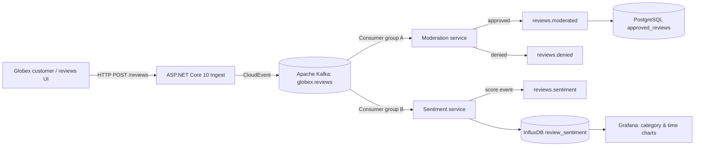
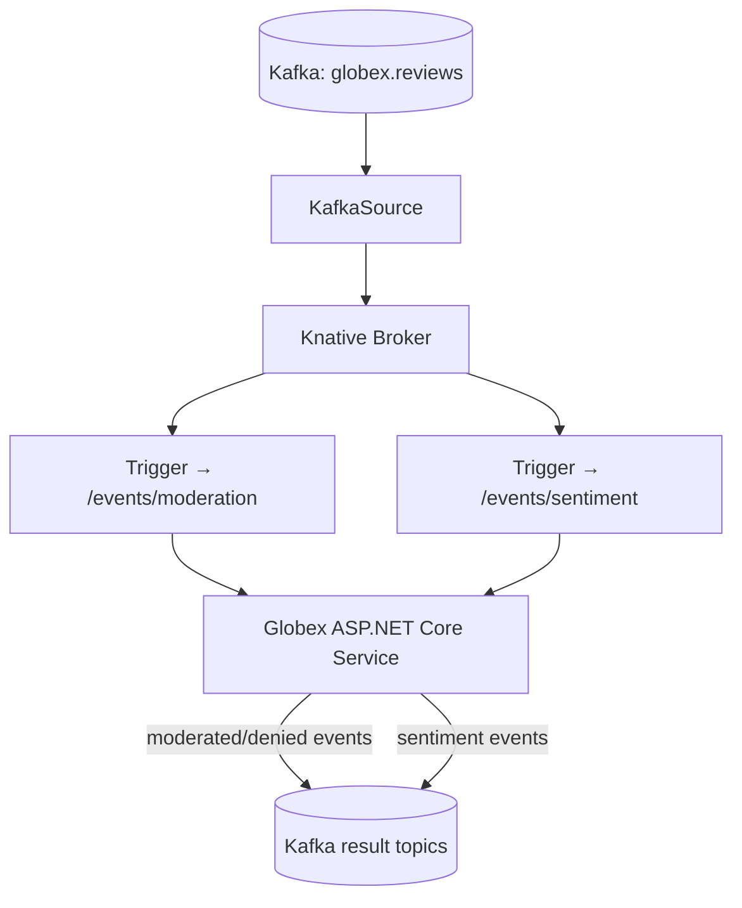

# Module 13 — Event-Driven Intelligent Applications: Kafka, CloudEvents & Sentiment Analysis

**Учебна цел:** да проектираш, напишеш, стартираш и валидираш **event-driven приложение** с независимо обработване на ревюта, moderation, sentiment scoring, Kafka, PostgreSQL, time-series analytics и OpenShift Serverless/Knative. Всички основни компоненти имат пълен C# source, конкретни настройки, работещи примери, проверки, troubleshooting и cleanup.

**Каноничен учебен източник:** [Red Hat Solution Pattern — Event-Driven Intelligent Applications / Sentiment Analysis](https://www.solutionpatterns.io/solution-pattern-sentiment-analysis/solution-pattern-sentiment-analysis/index.html), с [архитектура](https://www.solutionpatterns.io/solution-pattern-sentiment-analysis/solution-pattern-sentiment-analysis/02-architecture.html) и [практически walkthrough](https://www.solutionpatterns.io/solution-pattern-sentiment-analysis/solution-pattern-sentiment-analysis/03-demo.html). Автори: Jaya Christina Baskaran и Ritesh Shah.

**Адаптация:** вместо Quarkus използваме **ASP.NET Core 10/C#**, `Confluent.Kafka 2.16.0` и `Npgsql 10.0.3`. Основните архитектурни идеи от Red Hat са запазени: **Globex** customer reviews → Kafka → два независими processing branches → moderated reviews в PostgreSQL и sentiment series в InfluxDB/Grafana. По избор, върху вече подготвен OpenShift cluster, `KafkaSource → Knative Broker → 2 Triggers` замества директното Kafka consumer обработване. <https://www.solutionpatterns.io/solution-pattern-sentiment-analysis/solution-pattern-sentiment-analysis/02-architecture.html>

## 1. Какво ще можеш след модула?

- Да различаваш **синхронни HTTP операции** от асинхронно `202 Accepted` и eventual consistency.
- Да описваш събития със **CloudEvents 1.0** и ясно разграничени event ID / business review ID.
- Да обясняваш Kafka `topic`, `partition`, `offset`, `consumer group`, `at-least-once delivery`, replay, idempotency и backpressure.
- Да обработваш едно ревю по два независими пътя: **moderation** и **sentiment**.
- Да пазиш **само approved reviews** в PostgreSQL, докато sentiment оценките се съхраняват като времеви редове в InfluxDB.
- Да визуализираш и проверяваш резултатите в Grafana и чрез действителни HTTP/SQL/time-series проверки.
- Да създадеш pluggable inference client, различавайки истински ML service от детерминистичен demo scorer.
- Да използваш реални `KafkaSource`, `Broker` и `Trigger` resources, ако платформата разрешава Knative Eventing.
- Да диагностицираш грешки, зависимост от инфраструктура, дублирани събития, недостъпни модели, privacy и cleanup.

**Предварителни знания:** [Kubernetes 00–08](../COURSE-2026.md), [Module 09 — OpenShift](../09.%20OpenShift/README.md); препоръчително [Module 10 — API-First](../10.%20API-First%20Development%20and%20API%20Management/README.md), [Module 11 — API Versioning](../11.%20API%20Versioning%20and%20Lifecycle%20Management/README.md) и [Module 12 — API Management & Service Mesh](../12.%20API%20Management%20and%20Service%20Mesh/README.md). Основните Kafka понятия са обяснени в настоящия урок — не се предполага предварителен Kafka опит.

## 2. Globex: бизнес задача

Globex е фиктивен eCommerce магазин. Потребителите оставят ревюта за продукти от различни категории. Компанията има **две отделни цели**:

1. **Moderation:** отхвърляне на обидно/spam съдържание преди показване на продуктовата страница.
2. **Sentiment analysis:** разбиране на положителни/негативни тенденции по продуктова категория и време.

**Важно:** негативното мнение не е непременно нарушение. Ревю от вида `"The product is broken and terrible"` е негативно, но допустимо; `"This is spam"` е отхвърлено от учебната политика независимо от sentiment. Оригиналният Red Hat pattern подчертава точно тази независимост. Не предлагай автоматичен production moderation без human review, privacy и evaluation.

### Архитектурата на решението



Използваме два **различни Kafka consumer groups**, така че всеки обработчик да получи **всички** ревюта независимо. `review_id` е общ business key; събитията имат собствени CloudEvent IDs. В реалния Kafka mode source и двата workers са в едно учебно C# приложение/процес, но са **отделни consumers**; production обикновено ги deploy-ва независимо.

При OpenShift Eventing вариант Kafka не се консумира директно от двата .NET worker-а: вместо това се използва:



**Kafka broker и Knative Broker НЕ са една и съща услуга**. Kafka е durable log; Knative Broker управлява Eventing доставката до subscribers с неговите механизми.

## 3. Три execution modes — без скрити зависимости

| Режим | Стартиране | Какво реално се използва | Какво НЕ се доказва |
|---|---|---|---|
| **`REVIEWS_MODE=local`** | .NET SDK 10, Python | Два bounded in-memory channels, real API/HTTP, moderation и sentiment scoring | Kafka delivery, durable storage, ML или Knative |
| **`REVIEWS_MODE=kafka`** | .NET + Docker Compose | Реален Kafka broker, **2 Kafka consumer groups**, PostgreSQL, InfluxDB и Grafana | OpenShift Serverless и trained AI model |
| **`REVIEWS_MODE=knative`** | Разрешен OpenShift + Knative + Kafka | Реален KafkaSource, Broker и 2 Triggers към C# callbacks | Автоматично provisioned Kafka/DB/AI cluster или enterprise IAM |

**Не** наричай `local` Channel „Kafka“; той е учебен аналог на fan-out. **Не** наричай `demo-lexicon-v1` „AI модел“ — това са прости детерминистични правила. Истинският Kafka/data-stack е наличен в **13-C**, а model HTTP boundary — в **13-D**.

## 4. Практическа програма

| Стъпка | Лабораторно упражнение | Приемане / проверка |
|---|---|---|
| **13-A** | [EDA, CloudEvents и C# локален pipeline](./labs/LAB-01-EVENTS-CLOUDEVENTS.md) | Build и 202/400/404; CloudEvents; независими processors |
| **13-B** | [Moderation и sentiment scoring](./labs/LAB-02-MODERATION-SCORING.md) | Approved/denied, negative ≠ denied, score, idempotency и privacy |
| **13-C** | [Реален Kafka + PostgreSQL + InfluxDB + Grafana](./labs/LAB-03-KAFKA-STORAGE-DASHBOARD.md) | Четири topics, две groups, SQL записи, Influx series и dashboard |
| **13-D** | [Model inference boundary и observability](./labs/LAB-04-MODEL-INFERENCE-OBSERVABILITY.md) | Реално HTTP inference към локален fixture и валидиран model response |
| **13-E** | [OpenShift Serverless/Knative Eventing](./labs/LAB-05-OPENSHIFT-KNATIVE.md) | KafkaSource → Broker → 2 Triggers → C# callbacks; namespace cleanup |

**Последователност:** 13-A → 13-B → 13-C → 13-D → 13-E. Всяко упражнение има собствена секция за prerequisites, старт, команди, очаквани резултати, откази и cleanup. Можеш да започнеш **13-C самостоятелно**, защото неговите Docker/SQL/Grafana файлове са включени в Module 13.

## 5. Quick start — без Docker

Необходими са Linux/macOS/WSL Bash, Python >=3.10, [.NET SDK 10](https://dotnet.microsoft.com/en-us/download/dotnet/10.0), `curl` и интернет достъп при NuGet restore. Нямаш нужда от GPU, AI abonnement, OpenShift или Kafka акаунт.

```bash
git clone https://github.com/pirocorp/Kubernetes.git
cd "Kubernetes/13. Event-Driven Sentiment Analysis"
dotnet --version
python3 --version
bash scripts/verify-local.sh
```

**Очаквано:** скриптът компилира истинския ASP.NET Core 10 проект, стартира локален API, публикува synthetic reviews, проверява moderation/sentiment, CloudEvents и го спира, без да засяга други процеси. Това е **задължителният smoke test** преди всяко следващо упражнение.

## 6. Quick start — истински Kafka и бази

Нужни са Docker Engine + Docker Compose v2, допълнителни свободни ресурси и local TCP портове 5080, 9092, 5433, 8086, 3300.

```bash
# От корена на Module 13. Освободи :5080 от предишен ръчен run.
python3 tools/init_env.py
bash scripts/verify-kafka.sh
```

**Очаквано:** реална C# компилация, Kafka producer + два independent consumer groups, PostgreSQL approved reviews, InfluxDB data points, Grafana containers. **Готова Grafana dashboard:** <http://127.0.0.1:3300>, credentials в локалния `.env`. Не commit-вай `.env`.

**Cleanup:** `docker compose down` запазва volumes; `docker compose down -v` изтрива **само след изрично решение** учебните volumes. Подробни инструкции: [Lab 13-C](./labs/LAB-03-KAFKA-STORAGE-DASHBOARD.md).

## 7. Как изглежда CloudEvent?

При клиентска заявка:

```json
{
  "productId": "shirt-1",
  "category": "clothing",
  "text": "I love this great shirt"
}
```

API връща **HTTP 202** с `reviewId`, а publisher записва структурирано Kafka събитие (или локално event envelope):

```json
{
  "specversion": "1.0",
  "id": "generated-event-id",
  "source": "/globex/reviews",
  "type": "globex.review.submitted",
  "time": "2026-11-11T12:00:00Z",
  "datacontenttype": "application/json",
  "data": {
    "id": "generated-review-uuid",
    "productId": "shirt-1",
    "category": "clothing",
    "text": "I love this great shirt",
    "submittedAt": "2026-11-11T12:00:00Z"
  }
}
```

Това е примерен JSON със символични IDs и дата. Реалните стойности се генерират от приложението. Подробно обяснение на всеки атрибут има в Lab 13-A.

## 8. Политики за надеждност и безопасност

- **At-least-once, не exactly-once:** Kafka offsets се commit-ват след успешни странични ефекти, но Postgres/Influx/Kafka outputs не участват в обща транзакция. При retry derived event може да се появи повторно. SQL използва idempotent ключ за approved review; моделът на Influx е **за малък synthetic dataset**, не за безкрайни high-cardinality tags.
- **Backpressure:** локалните channels имат 1024 slots; в Kafka се използват partitions, consumer groups и lag. Не твърди „безкрайна мащабируемост“.
- **Partial failures:** producer може да откаже HTTP 503, KafkaSource може да не е Ready, inference може да timeout-не. Използвай readiness, retries и observability, а не игнорирай грешките.
- **Security:** всички local Compose ports са bind-нати на `127.0.0.1`; credentials се генерират локално, `.env` не се commit-ва. OpenShift Route изисква ingest key; callbacks са вътрешни. **Не** е production SSO, private Kafka SASL/TLS или identity-aware API management.
- **Privacy:** не използвай реални клиентски ревюта/PII в публични услуги или локален demo dashboard; при production приложи data minimization, retention, GDPR и human review. `/events` показва сурови текстове за демонстрация и трябва да остане **само вътрешен** endpoint.
- **Model accuracy:** default scorer е на прост английски лексикон, който не интерпретира negation, контекст, ирония, многоезичност и bias. Няма ML training/production-quality inference.

## 9. Пълна структура на проекта

```text
13. Event-Driven Sentiment Analysis/
├── README.md
├── contracts/review-submitted.json
├── examples/reviews.json
├── src/GlobexReviews/
│   ├── GlobexReviews.csproj
│   ├── Program.cs
│   ├── Domain.cs
│   ├── ReviewState.cs
│   ├── LocalChannels.cs
│   ├── KafkaTransport.cs
│   ├── ReviewProcessor.cs
│   ├── SentimentScorer.cs
│   └── OutputSinks.cs
├── Dockerfile
├── compose.yaml
├── sql/init.sql
├── grafana/provisioning/
│   ├── datasources/influx.yaml
│   └── dashboards/dashboards.yaml
├── grafana/dashboards/globex.json
├── tools/
│   ├── verify.py
│   ├── generate_reviews.py
│   ├── init_env.py
│   ├── check_external.py
│   ├── check_grafana.py
│   ├── verify_knative_callbacks.py
│   └── mock_model.py
├── scripts/
│   ├── verify-local.sh
│   ├── verify-kafka.sh
│   ├── verify-model.sh
│   └── verify-knative-callbacks.sh
├── openshift/
│   ├── README.md
│   ├── workload.yaml
│   └── knative-eventing.yaml
└── labs/
    ├── LAB-01-EVENTS-CLOUDEVENTS.md
    ├── LAB-02-MODERATION-SCORING.md
    ├── LAB-03-KAFKA-STORAGE-DASHBOARD.md
    ├── LAB-04-MODEL-INFERENCE-OBSERVABILITY.md
    └── LAB-05-OPENSHIFT-KNATIVE.md
```

**Модулът съдържа необходимите source files и manifests**, не зависи от недостъпен външен Globex repository. Само инструментите и runtime dependencies са предварителни изисквания: .NET SDK, NuGet, Docker registries или предварително конфигуриран OpenShift/Knative/Kafka cluster.

## 10. Самопроверка

1. Защо `202 Accepted` не означава „review е published“?
2. Защо moderation и sentiment са в **различни Kafka consumer groups**, а не един?
3. Защо отрицателен sentiment не трябва да се цензурира от moderation?
4. Кой компонент записва `approved_reviews` и кой записва `review_sentiment`?
5. Защо `KafkaSource` и `Knative Broker` са различни от Kafka broker?
6. Кога Kafka `Commit` се случва спрямо записите в PostgreSQL/InfluxDB?
7. Защо истински модел изисква model version и evaluation, а не само HTTP endpoint?
8. Защо при production трябва да имаме outbox/poison-message policy, вместо безкраен retry?

**Насоки:** (1) asynchronous acceptance; (2) независим fan-out; (3) negative feedback is valid; (4) moderation/score sink; (5) Knative Eventing layer; (6) след side-effects; (7) проследимост и доказана точност; (8) delivery, duplicates и системни откази.

## 11. Източници

**Основни:**
- [Red Hat — Event-Driven Intelligent Applications / Sentiment Analysis](https://www.solutionpatterns.io/solution-pattern-sentiment-analysis/solution-pattern-sentiment-analysis/index.html)
- [Red Hat — Architecture and Technology Stack](https://www.solutionpatterns.io/solution-pattern-sentiment-analysis/solution-pattern-sentiment-analysis/02-architecture.html)
- [Red Hat — Original Walkthrough, Kafka topics, Moderation and Grafana](https://www.solutionpatterns.io/solution-pattern-sentiment-analysis/solution-pattern-sentiment-analysis/03-demo.html)

**Официални спецификации:**
- [CloudEvents 1.0](https://cloudevents.io/)
- [Apache Kafka Docker image](https://kafka.apache.org/41/getting-started/docker/)
- [Confluent.Kafka for .NET](https://www.nuget.org/packages/Confluent.Kafka/2.16.0)
- [Npgsql 10.0.3](https://www.nuget.org/packages/Npgsql/10.0.3)
- [Knative KafkaSource](https://knative.dev/docs/eventing/sources/kafka-source/)
- [Knative Triggers](https://knative.dev/docs/eventing/triggers/)
- [InfluxDB OSS v2 API](https://docs.influxdata.com/influxdb/v2/api/write/)
- [Grafana InfluxDB data source](https://grafana.com/docs/grafana/latest/datasources/influxdb/)

Текстовете, C# implementation и тестовите fixtures са създадени за този модул; оригиналният Red Hat pattern е запазен като първичен архитектурен източник, а не копиран дословно.
