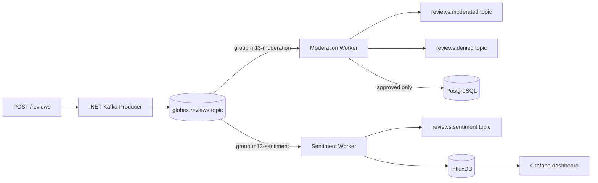

# Lab 13-C — Реален Kafka + PostgreSQL + InfluxDB + Grafana

**Учебна цел:** да замениш in-memory каналите с **истински Apache Kafka broker**, два независими consumer groups, event topics, persistence в PostgreSQL и time-series в InfluxDB, визуализирани през Grafana. Това е **локалният пълен end-to-end вариант** на [Red Hat Globex Architecture](https://www.solutionpatterns.io/solution-pattern-sentiment-analysis/solution-pattern-sentiment-analysis/02-architecture.html).

## 1. Предпоставки

- **.NET SDK 10**, Python **3.10+**, Bash, Docker Engine + Docker Compose v2 и `curl`; нужна е връзка към NuGet и Docker image registries за първо изпълнение.
- Препоръчително: **8 GiB RAM свободни** за локални Kafka, PostgreSQL, InfluxDB, Grafana, .NET приложения. Реалните изисквания варират според хоста.
- Следните **локални** TCP портове трябва да са свободни: **5080 (API), 9092 (Kafka), 5433 (PostgreSQL), 8086 (InfluxDB), 3300 (Grafana)**.
- **Работна директория: корен на Module 13.** Файловете са включени: [compose.yaml](../compose.yaml), [SQL schema](../sql/init.sql), [Kafka producer/consumers](../src/GlobexReviews/KafkaTransport.cs), [Postgres/Influx adapters](../src/GlobexReviews/OutputSinks.cs), [Grafana datasource + dashboard](../grafana/provisioning/datasources/influx.yaml), [integration acceptance](../scripts/verify-kafka.sh).
- Не стартирай локалния Lab 13-A/B API на :5080 едновременно с този вариант.
- **Не** използвай външни истински customer reviews. Този Docker Compose е за личен lab на `127.0.0.1` — Kafka няма SASL/TLS и **не** е годен за публична мрежа или production.

### 1.1. Безопасна конфигурация

```bash
docker --version
docker compose version
dotnet --version
python3 --version
python3 tools/init_env.py
test -s .env
docker compose config --quiet
```

**Очаквано:** Docker Compose YAML се валидира, а `.env` съдържа **случайно генерирани** `PG_PASSWORD`, `INFLUX_PASSWORD`, `INFLUX_TOKEN` и `GRAFANA_PASSWORD` с permissions `0600`. Скриптът **никога не презаписва съществуващ файл** и не отпечатва тайните. `.env` е игнориран от Git.

## 2. Какво реално стартира Docker Compose?

| Component | Образ/порт | Отговорност |
|---|---|---|
| Apache Kafka 4.1.x | `apache/kafka:4.1.2`, localhost:9092 | Durable topic log + independent consumer groups |
| PostgreSQL 17 | localhost:5433 → 5432 | Само **approved** reviews, SQL schema |
| InfluxDB OSS 2.7 | localhost:8086 | Sentiment score as timestamped time-series |
| Grafana OSS | localhost:3300 → 3000 | Provisioned InfluxDB source и dashboard |
| ASP.NET Core 10 | localhost:5080 | HTTP ingestion, Kafka producer, 2 independent workers |

Тези версии са изрично посочени за повторяемост. Оригиналният Red Hat pattern е тестван върху **OpenShift 4.13**, но **този lab не използва OpenShift Operator или Kafka Strimzi**. Kafka е официалният Apache Kafka Docker image, докато Red Hat AMQ Streams е поддържаният enterprise/OpenShift вариант.



**Защо два consumer groups?** Един Kafka topic може да се чете независимо от няколко групи; всяка група има собствени committed offsets. Ако двата workers бяха в един group на single-partition topic, те биха **разделяли** събитията помежду си вместо всеки да получава всички reviews.

## 3. Стартирай broker и базите

```bash
docker compose up -d kafka postgres influxdb grafana
docker compose ps
```

Изчакай Docker да завърши стартовата инициализация. Провери:

```bash
docker compose exec -T kafka \
  /opt/kafka/bin/kafka-topics.sh --bootstrap-server localhost:9092 --list
docker compose exec -T postgres pg_isready -U globex -d globex
curl -fsS http://127.0.0.1:8086/health
curl -fsS http://127.0.0.1:3300/api/health
```

**Очаквано:** Kafka CLI работи, PostgreSQL е `accepting connections`, InfluxDB и Grafana връщат валидни health responses. При първо стартиране Kafka/InfluxDB може да се инициализира по-бавно; **не** продължавай докато някоя dependency не е Ready.

## 4. Стартирай приложението срещу истински Kafka

В Bash терминал 1:

```bash
set -a
. .env
set +a
export REVIEWS_MODE=kafka
export KAFKA_BOOTSTRAP=127.0.0.1:9092
export POSTGRES_CONNECTION="Host=127.0.0.1;Port=5433;Database=globex;Username=globex;Password=$PG_PASSWORD"
export INFLUX_URL=http://127.0.0.1:8086
export INFLUX_ORG=globex
export INFLUX_BUCKET=review_sentiment
dotnet build src/GlobexReviews/GlobexReviews.csproj -c Release
ASPNETCORE_URLS=http://127.0.0.1:5080 \
  dotnet run -c Release --no-build --no-launch-profile \
  --project src/GlobexReviews/GlobexReviews.csproj
```

**Очаквано:** .NET Web API на 5080, две Kafka consumer groups, topics `globex.reviews`, `reviews.moderated`, `reviews.denied` и `reviews.sentiment`. Проектът сам създава **учебните** topics, само ако Kafka Admin API го позволява (в този локален Compose позволява). **Ако не можеш да създаваш topics**, използвай pre-created topics и `KAFKA_MANAGE_TOPICS=false`, описано в Lab 13-E.

В терминал 2 от същия корен:

```bash
curl -fsS http://127.0.0.1:5080/healthz
python3 tools/verify.py --base-url http://127.0.0.1:5080 --timeout 60
```

**Очаквано:** четири реално произведени synthetic CloudEvents, moderation/sentiment results, филтриране на denied и `ALL MODULE 13 HTTP ACCEPTANCE CHECKS PASSED`.

### 4.1. Kafka topics и съобщения

```bash
docker compose exec -T kafka \
  /opt/kafka/bin/kafka-topics.sh --bootstrap-server localhost:9092 --list
docker compose exec -T kafka \
  /opt/kafka/bin/kafka-consumer-groups.sh --bootstrap-server localhost:9092 --list
docker compose exec -T kafka \
  /opt/kafka/bin/kafka-consumer-groups.sh --bootstrap-server localhost:9092 \
  --describe --group m13-moderation
docker compose exec -T kafka \
  /opt/kafka/bin/kafka-consumer-groups.sh --bootstrap-server localhost:9092 \
  --describe --group m13-sentiment
```

**Очаквано:** четири topics и две независими groups с committed offsets. Може да инспектираш sample events:

```bash
docker compose exec -T kafka \
  /opt/kafka/bin/kafka-console-consumer.sh --bootstrap-server localhost:9092 \
  --topic reviews.moderated --from-beginning --max-messages 1 --timeout-ms 10000
```

**Очаквано:** structured CloudEvent JSON с `type=globex.review.moderated`, а не произволен Kafka string.

## 5. PostgreSQL approved reviews

```bash
docker compose exec -T postgres \
  psql -U globex -d globex -c \
  "SELECT category, count(*) AS approved FROM approved_reviews GROUP BY category ORDER BY category"
```

**Очаквано:** категория `clothing`, `bags`, `electronics` са налични от test fixtures, но review `"This is spam"` **не е в тази таблица**. SQL source е [sql/init.sql](../sql/init.sql): `review_id UUID PRIMARY KEY` и `ON CONFLICT DO NOTHING` при повторно обработване. Не изпълнявай SQL от текст, подаден от потребител; C# използва **параметризирани** Npgsql queries.

## 6. InfluxDB и Grafana

Терминал 2: зареди **собствения** `.env` за token; не го отпечатвай:

```bash
set -a
. .env
set +a
python3 tools/check_external.py --minimum-approved 3
```

**Очаквано:** `PASS PostgreSQL approved reviews` и `PASS InfluxDB real sentiment score record`.

Отвори **http://127.0.0.1:3300**, влез като `admin` с паролата в **локалния** `.env`, после **Dashboards → Globex → Globex — Product Review Sentiment (demo)**. Има provisioned InfluxDB data source и две панели: средна оценка по категория и последни scores.

За повече точки:

```bash
python3 tools/generate_reviews.py --base-url http://127.0.0.1:5080 --count 60
```

Използвай времевия диапазон **Last 1 hour**; възможно е малко забавяне за обработката и dashboard refresh.

**Истински ли е моделът?** Не. В Kafka Lab **съхранението и event transport са реални**, но default sentiment оценката все още е **детерминистичен лексикон**, а не trained ML. В [Lab 13-D](./LAB-04-MODEL-INFERENCE-OBSERVABILITY.md) се упражнява границата към inference service.

## 7. Еднокоманден интеграционен тест

Ако искаш скриптът да изпълни **build, compose startup, readiness checks, HTTP проверки, PostgreSQL/Influx validation** самостоятелно:

```bash
# Първо спри ръчния API с Ctrl+C (за да освободиш port 5080).
bash scripts/verify-kafka.sh
```

**Очаквано:** завършва с `PASS real Kafka fan-out, PostgreSQL writes and InfluxDB time-series`. Скриптът спира само **собствения API процес** и оставя Docker контейнерите и volumes за Grafana inspection.

## 8. Failure scenarios

| Симптом | Проверка | Действие |
|---|---|---|
| Broker не е готов | `docker compose logs kafka` | Провери memory/port 9092, readiness |
| Kafka consume fail | `docker compose exec kafka ... kafka-consumer-groups.sh --list` | Провери Kafka bootstrap/group и topics |
| API `503 event_unavailable` | C# stdout и Kafka logs | Kafka не приема produce; не приемай 503 за успешна заявка |
| Pending review | Review status, C# logs, consumer lag | Kafka consumer side effect failure; inspect Pg/Influx |
| PostgreSQL `relation does not exist` | `docker compose logs postgres` | SQL init се изпълнява само при **първоначално празен volume**; не изтривай volume без преглед |
| Influx HTTP 401 | `INFLUX_TOKEN` / `.env` | Провери token, org/bucket без да печаташ secret |
| Grafana no data | Time range, datasource, Flux query | Провери Influx record с `check_external.py` |
| Docker collision на порт | `docker compose ps` | Спри собствена предходна услуга; не променяй чужда |
| `dotnet restore` отказ | NuGet достъп | Провери trusted network/certificate; няма offline NuGet bundle |

## 9. Cleanup

Първо спри C# foreground приложението с Ctrl+C. След това:

```bash
# Само от корена на Module 13
docker compose down
```

**Това запазва базите и Kafka данните в именуваните Docker volumes.** Ако искаш **напълно празна учебна среда** и си потвърдил, че няма лични данни:

```bash
docker compose down -v
```

`-v` **безвъзвратно изтрива** учебните PostgreSQL/Influx/Grafana volumes. Не го изпълнявай върху чужд Compose проект. Файлът `.env` остава локално; когато приключиш курса, изтрий **само** този файл ако нямаш нужда от него.

**Критерий:** два реални Kafka consumer groups, четири event topics, approved-only PostgreSQL таблица и действителни InfluxDB measurements с Grafana dashboard.
