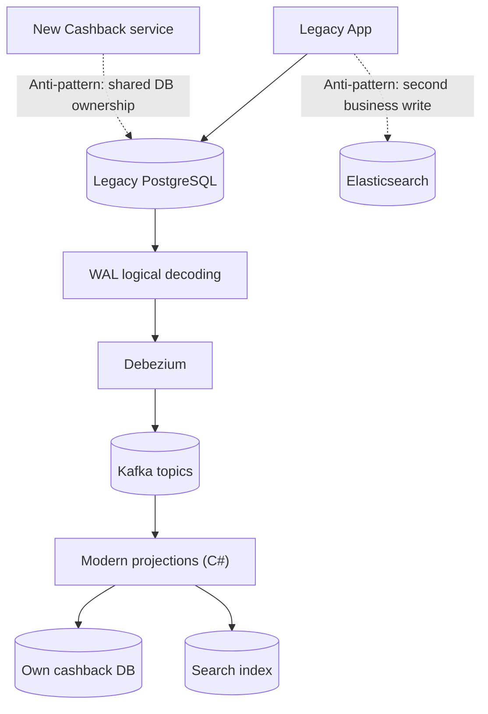

# Lab 14-A — Legacy data ownership, WAL и концепция за CDC

**Цел:** да разбереш защо не можем просто да променим старата система или да четем директно чуждата DB. Ще компилираш **пълния C# учебен проект**, ще разгледаш SQL schema и ще научиш защо Debezium не изисква промени в legacy business code.

**Red Hat източник:** [CDC modernization — original architecture and anti-patterns](https://www.solutionpatterns.io/solution-pattern-modernization-cdc/solution-pattern-modernization-cdc/02-architecture.html).

## 1. Preflight

От корена на Module 14 са нужни .NET **SDK 10**, Python **3.10+**, Bash, интернет за първоначален NuGet restore. **Docker, Kafka и OpenShift не са необходими за този първи lab.**

```bash
pwd
dotnet --version
python3 --version
test -f src/RetailModernization/Program.cs
test -f src/RetailModernization/LegacyRoutes.cs
test -f src/RetailModernization/ModernRoutes.cs
test -f sql/legacy.sql
bash scripts/verify-build.sh
```

**Очаквано:** `Build succeeded` с target `net10.0`, `PASS Module 14 C# and Python build`. **Важно:** това не изпълнява Postgres, Debezium или Kafka — пълният integration path е в Labs 14-B–D.

## 2. Legacy app и bounded contexts

Фиктивната компания поддържа код/приложение, което **не можем да модифицираме**. В учебния проект симулираме тези операции с [LegacyRoutes.cs](../src/RetailModernization/LegacyRoutes.cs): `POST/PUT/DELETE /legacy/products`, `POST /legacy/sales`, `PUT /legacy/customers/{id}/tier`. В тези методи **няма Kafka/Elasticsearch client** — само `Npgsql` към `LEGACY_CONNECTION`.

Таблиците на legacy owner са:
- `customer(customer_id, full_name, tier)` — bronze/silver/gold.
- `product(product_id, name, description, price_cents)` — каталог.
- `sale(sale_id, customer_id, expected_lines)` — header на покупка.
- `line_item(line_item_id, sale_id, product_id, quantity, unit_price_cents)` — редове.

Една продажба се записва в **една SQL транзакция**, която съдържа sale header и всички line items. Запазената `unit_price_cents` стойност е **цена към момента на продажбата**, а не текуща цена в каталога; промяна в каталожната цена не бива да променя стари продажби.

## 3. Anti-patterns



**Shared DB** нарушава ownership/coupling. **Dual write** означава два независими commits без обща атомичност. CDC надгражда чрез **committed database changes**, но добавя lag, retry/replay, schema compatibility, monitoring и WAL retention obligations.

## 4. WAL, replication slot, publication и първоначален snapshot

- **WAL** — последователен write-ahead log на PostgreSQL; първо участва в гарантираното възстановяване на DB.
- **wal_level=logical** — позволява logical decoding на committed промени.
- **publication** — определя кои таблици да са достъпни за логическа репликация.
- **replication slot** — запомня до кой LSN (log sequence number) потребителят е напреднал; ако consumer-ът спре, WAL може да се задържа и да запълни диска.
- **Debezium snapshot** — начално копие на редовете, които вече съществуват, обичайно с operation `r`; след това CDC events с `c` (create), `u` (update), `d` (delete).
- **Kafka offset** — позиция на consumer group в topic partition, **не** PostgreSQL LSN.

Това е реално следващият lab, а не само концептуална диаграма.

## 5. Кодова инспекция — доказателство за separation

```bash
grep -n 'LEGACY_CONNECTION\\|INSERT INTO\\|UPDATE product\\|DELETE FROM product' \
  src/RetailModernization/LegacyRoutes.cs
grep -n 'CASHBACK_CONNECTION\\|SEARCH_URL\\|Kafka' \
  src/RetailModernization/CdcProjection.cs src/RetailModernization/CdcWorker.cs
```

**Очаквано:** `LegacyRoutes.cs` работи чрез `LEGACY_CONNECTION`, projection code — през `CASHBACK_CONNECTION` / `SEARCH_URL` и Kafka. **Това е статичен boundary check**, не security proof; в production е необходимо реално credential-level ограничение.

## 6. Troubleshooting

| Симптом | Проверка | Корекция |
|---|---|---|
| NuGet `NU1301` | SDK output, DNS/HTTPS trust | Увери се, че NuGet е разрешен |
| `NETSDK1045` | `dotnet --version` | Инсталирай SDK 10, не runtime |
| Missing source file | `pwd` | Влез в корена на Module 14 |
| Няма Kafka events | Тук **няма broker** | Lab 14-B |
| Не виждаш search | Elasticsearch не е стартиран | Lab 14-C |
| Няма Wallet | Cashback DB не е стартирана | Lab 14-D |

## 7. Cleanup и приемане

Няма стартирани процеси или Docker resources, само компилационни папки `obj/` и `bin/`. По желание: `dotnet clean src/RetailModernization/RetailModernization.csproj -c Release`.

**Критерий:** компилацията минава и можеш да аргументираш защо modern services нямат директен write access до legacy база и защо committed events не решават автоматично exactly-once end-to-end.
