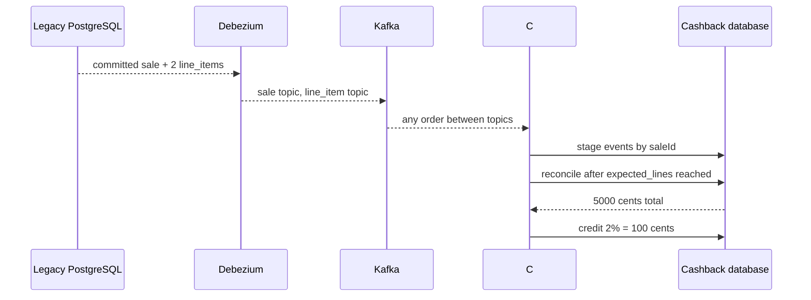

# Lab 14-D — CDC sale + line_item aggregation и Cashback Wallet

**Цел:** изгради нова бизнес функционалност **в отделна база**, без да променяш legacy приложението. Не само търсене: демонстрираме **customer snapshot**, **продажба с няколко реда**, **асинхронна агрегация**, **процентна cashback политика**, **tier UPDATE** и обработка на дублирани/разместени събития.

**Основен източник:** [Red Hat — Cashback Wallet context](https://www.solutionpatterns.io/solution-pattern-modernization-cdc/solution-pattern-modernization-cdc/02-architecture.html) и [Original cashback demo](https://www.solutionpatterns.io/solution-pattern-modernization-cdc/solution-pattern-modernization-cdc/03-demo.html).

## 1. Предпоставки и автономен старт

Docker Compose v2, Python 3.10+, Bash, същите портове и ресурси като Lab 14-C. **Не** зависи от ръчно работеща предишна сесия. От корена на Module 14:

```bash
python3 tools/init_env.py
docker compose up -d --build
set -a
. .env
set +a
python3 tools/register_connector.py
python3 tools/check_infra.py
```

**Очаквано:** connector RUNNING и вече заредени seed customers, продукти. Началните клиенти са `1=bronze` и `2=gold`.

## 2. Продуктови цени, продажба и центове

В C# използваме **long cents**, а не floating-point парични стойности. `sale` е header с `expected_lines`, `line_item` запазва цената към момента на продажбата. Тестовите проценти са **избрани за този курс**, не са rates от Red Hat: bronze 2%, silver 5%, gold 10%.

```bash
curl -fsS http://127.0.0.1:5084/legacy/products
```

**Очаквано:** Red Fern (1500 cents) и Blue Pot (2000 cents).

В старото приложение изпълни **една атомарна SQL транзакция** за продажбата:

```bash
curl -sS -i -H 'Content-Type: application/json' \
  -d '{"customerId":1,"items":[{"productId":101,"quantity":2},{"productId":102,"quantity":1}]}' \
  http://127.0.0.1:5084/legacy/sales
```

**Очаквано:** HTTP 201 и JSON `saleId`. Запиши този ID от реалния response; той се генерира от PostgreSQL sequence (не гадай).

## 3. Защо не смятаме по първия event?



Продажбата съдържа `expected_lines=2`. След първия item още не знаем целия total. Stage таблиците `sale_stage` и `item_stage` пазят данни по стабилните IDs. Отделният `customer_projection` носи current tier. SQL reconciliation проверява, че всички редове са пристигнали, **преди** създаването на `expense`.

## 4. Провери новия wallet чрез Modern API

Използвай своя `saleId` от POST:

```bash
# Замени 1 с реалния saleId от предишната команда.
curl -fsS http://127.0.0.1:5085/expenses/1
curl -fsS http://127.0.0.1:5085/wallets/1
```

**Очаквано, ако първата продажба има ID 1:** `totalCents=5000`, `cashbackCents=100`, `wallet.balanceCents=100` и `tier=bronze`. Ако ID не е 1, замени в `/expenses/ИСТИНСКИ_ID`. Докато projection още обработва, `/expenses/{id}` може временно да върне 404 — това е **eventual consistency**, а не задължително отказ. При повтаряща се грешка виж `docker compose logs modern`.

За точните bounded проверки без ръчна промяна на saleId използвай:

```bash
python3 tools/verify.py
```

**Важно:** ако вече си направил ръчна продажба, този тест създава **допълнителна** продажба, затова общият wallet balance ще е по-голям и точните test assertions за „първи wallet=100“ няма да съвпаднат. За **чист repeatable run** използвай само собствените lab volumes и направи `docker compose down -v` преди `bash scripts/verify-cdc.sh`; не изтривай база с непознати данни.

## 5. Customer tier update → нови derived balances

```bash
curl -sS -i -X PUT -H 'Content-Type: application/json' \
  -d '{"tier":"gold"}' \
  http://127.0.0.1:5084/legacy/customers/1/tier
curl -fsS http://127.0.0.1:5085/wallets/1
```

**Очаквано за една продажба от 5000 cents:** нов tier `gold` и balance `500 cents`. Повторни Kafka deliveries не увеличават balance повече: в demo SQL пълната projection се преизчислява **в една транзакция** на база stage rows, а не прави `balance += reward` при всеки event.

**Бизнес предупреждение:** в истинска система cashback tier може да се **фиксира към момента на покупката**. Тук съзнателно показваме реактивно преизчисляване на *исторически* награди при смяна на tier; това е **учебно правило**, не реална финансова препоръка.

## 6. Доказателство за database ownership

```bash
docker compose exec -T cashback-db \
  psql -U cashback -d cashback -c \
  "SELECT sale_id, customer_id, total_cents, cashback_cents FROM expenses"
docker compose exec -T cashback-db \
  psql -U cashback -d cashback -c \
  "SELECT customer_id, balance_cents FROM wallets"
docker compose exec -T legacy-db \
  psql -U retail -d retail -c \
  "SELECT sale_id, customer_id, expected_lines FROM sale"
```

**Очаквано:** `expenses`/`wallets` са **само** в cashback-db; `sale` и `line_item` — в legacy-db. Modern source code не съдържа `LEGACY_CONNECTION`; legacy source не съдържа `CASHBACK_CONNECTION` и `SEARCH_URL`.

## 7. Idempotency, replay и грешки

**Kafka offsets** се commit-ват **след** успешна DB transaction/ES indexing. Ако modern service се рестартира преди offset commit, едно събитие може да бъде получено повторно. Projector-ът изпълнява `UPSERT` на stage rows с PK и **преизчислява** derived balance — повторение не удвоява сумата. Това е **at-least-once** с idempotent ефекти, а не distributed transaction.

**Production ограничения:** global full-rebuild след всяко event е само за малък demo dataset. Трябва да се замени с per-sale incremental algorithm, bounded retry, poison-message DLQ, observable lag и incremental snapshots, outbox/inbox и schema/version governance. При невалидно събитие настоящият consumer ще retry-ва — той **не разполага** с production DLQ.

## 8. Troubleshooting

| Симптом | Проверка | Корекция |
|---|---|---|
| Expense 404 | `docker compose logs modern`, Kafka topics | Изчакай line_item + sale + customer CDC |
| Total е по-малък | `SELECT * FROM item_stage` | Проверка expected_lines, consumer lag |
| Wallet остава 0 | `SELECT * FROM customer_projection` | Customer snapshot, Debezium task |
| Cashback удвоен | Stage IDs/SQL aggregation | Няма право на incremental `balance +=` без inbox |
| C# consumer retry loop | `docker compose logs modern` | Анализирай schema mismatch и Kafka offsets |
| Gold rate не е приложен | `UPDATE /legacy/customers/1/tier` | Провери event с `op=u` и wallet projection |
| Друг резултат от 100 cents | Има предходни продажби | Използвай празни **свои** lab volumes |
| 409 product delete | Продукт вече е използван в продажби | Това е FK защита; не изтривай исторически данни |

## 9. Cleanup

Ако продължаваш с OpenShift Lab 14-E, Docker stack не е нужен за remote cluster. Локално:

```bash
docker compose down
unset PG_PASSWORD CASHBACK_PASSWORD
```

Изтриване на **собствени учебни** volumes: `docker compose down -v`, само след преглед. Не изтривай replication slot в чужда база.

**Приемане:** виждаш committed продажба с два реда, правилни 5000 cents total, 100 cents bronze cashback и 500 cents след tier change; можеш да обясниш защо дублиран CDC event не увеличава wallet повторно.
