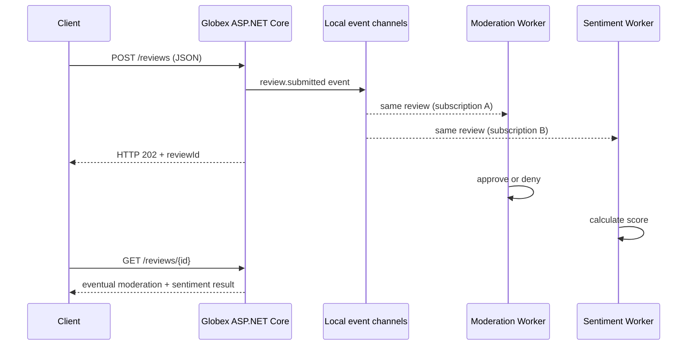

# Lab 14-A — Event-Driven Architecture, CloudEvents и асинхронна обработка

**Учебна цел:** за първи път да създадеш работещ review ingestion API, което **приема** заявка веднага, а moderation и sentiment работят **асинхронно и независимо**. Тази част е изпълнима без Kafka, Docker, GPU, OpenShift, платени акаунти или база данни.

**Оригинален Red Hat източник:** [Event-Driven Intelligent Applications — Globex](https://www.solutionpatterns.io/solution-pattern-sentiment-analysis/solution-pattern-sentiment-analysis/index.html) и [Architecture](https://www.solutionpatterns.io/solution-pattern-sentiment-analysis/solution-pattern-sentiment-analysis/02-architecture.html).

## 1. Предпоставки

- Познаваш Kubernetes Modules 00–08 (Deployment, Services, pods, consumers) и имаш основни знания за REST/C#.
- Инсталирани **.NET SDK 10** (не само ASP.NET runtime), **Python 3.10+**, Git, Bash (Linux/macOS/WSL), `curl`.
- Свободен локален порт **5080**, работна директория — корен на Module 14.
- Всички необходими файлове са включени: [GlobexReviews.csproj](../src/GlobexReviews/GlobexReviews.csproj), [Program.cs](../src/GlobexReviews/Program.cs), [Domain.cs](../src/GlobexReviews/Domain.cs), [LocalChannels.cs](../src/GlobexReviews/LocalChannels.cs), [verify.py](../tools/verify.py).
- При `dotnet restore` е нужен достъп до NuGet за фиксираните версии на `Confluent.Kafka` и `Npgsql`, **макар локалният режим да не се свързва към Kafka/Postgres**.

Провери:

```bash
dotnet --version
python3 --version
test -f src/GlobexReviews/GlobexReviews.csproj
test -f src/GlobexReviews/Domain.cs
test -f contracts/review-submitted.json
python3 -m json.tool contracts/review-submitted.json >/dev/null
```

**Очаквано:** .NET SDK версия, започваща с `10.`; валиден OpenAPI 3.0.3 JSON документ и всички файлове. Изходната спецификация се намира в [contracts/review-submitted.json](../contracts/review-submitted.json).

## 2. Защо EDA, а не синхронно API?

Синхронно `POST /reviews`, което изчаква AI модел, moderation, database и dashboard, смесва много различни латентности и точки на отказ. При **Event-Driven Architecture (EDA)** API приема данни и публикува събитие; downstream услугите обработват събитието независимо.



В локалния вариант използваме **два bounded .NET Channels**. Те демонстрират **fan-out**, **backpressure** и **eventual consistency**, но **не са Kafka**: няма broker, durable partitions, replay или независим consumer group на различен node. Именно затова [Lab 14-C](./LAB-03-KAFKA-STORAGE-DASHBOARD.md) въвежда реалния Kafka.

**Ключова концепция:** `202 Accepted` означава *прието за асинхронна обработка*, **не** „одобрено за публикуване“ и **не** „успешно записано в PostgreSQL“.

## 3. Какво е CloudEvent?

[CloudEvents 1.0](https://cloudevents.io/) е обща спецификация за описване на събития. Използваме **structured JSON** със следните задължителни полета:

| Поле | Роля | Нашият пример |
|---|---|---|
| `specversion` | Версия на спецификацията | `1.0` |
| `id` | Уникална идентичност на събитието | Генериран UUID |
| `source` | Логически източник | `/globex/reviews` |
| `type` | Какво се е случило | `globex.review.submitted` |
| `time` | UTC момент на събитието | ISO 8601 |
| `datacontenttype` | Формат на payload | `application/json` |
| `data` | Бизнес данни | reviewId, productId, category, text |

Едно ревю може да породи **различни събития**: submitted, moderated/denied и sentiment. Event ID ≠ Review ID: събитието описва факт, а business ID свързва всички събития към един review aggregate.

Примерно съдържание:

```json
{
  "specversion": "1.0",
  "id": "a7bd9b70-58f1-4398-a931-0b5e624fba0c",
  "source": "/globex/reviews",
  "type": "globex.review.submitted",
  "time": "2026-11-11T12:00:00Z",
  "datacontenttype": "application/json",
  "data": {
    "id": "e6912f5d-8352-42fe-a62f-8c7e5c5d1281",
    "productId": "shirt-1",
    "category": "clothing",
    "text": "I love this great shirt",
    "submittedAt": "2026-11-11T12:00:00Z"
  }
}
```

Тези UUID и дата са **илюстративни**, а не фиксирани резултати от работеща система.

## 4. Компилация и стартиране

В един Bash терминал:

```bash
dotnet restore src/GlobexReviews/GlobexReviews.csproj
dotnet build src/GlobexReviews/GlobexReviews.csproj -c Release --no-restore
ASPNETCORE_URLS=http://127.0.0.1:5080 REVIEWS_MODE=local \
  dotnet run -c Release --no-build --no-launch-profile \
  --project src/GlobexReviews/GlobexReviews.csproj
```

Остави процеса на преден план. В **втори терминал** от същата директория:

```bash
curl -fsS http://127.0.0.1:5080/healthz
curl -sS -i -H 'Content-Type: application/json' \
  -d '{"productId":"shirt-1","category":"clothing","text":"I love this great shirt"}' \
  http://127.0.0.1:5080/reviews
```

**Очаквано:** `ok` и `HTTP/1.1 202 Accepted` с JSON `reviewId` и `status=queued`.

За следващите GET използвай реалния `reviewId` от отговора. Можеш да го получиш автоматично и да видиш eventual consistency:

```bash
python3 tools/verify.py --base-url http://127.0.0.1:5080
```

**Очаквано:** `ALL MODULE 14 HTTP ACCEPTANCE CHECKS PASSED`, включително moderation/approval, denied review, положителен/отрицателен/неутрален sentiment и валидни CloudEvents.

## 5. Проверки за действителни резултати

```bash
curl -fsS http://127.0.0.1:5080/reviews/approved
curl -fsS http://127.0.0.1:5080/metrics/sentiment
curl -fsS http://127.0.0.1:5080/events
```

**Очаквано:**
- `/reviews/approved` показва само **approved**, никога denied reviews.
- `/metrics/sentiment` връща категории и числови оценки в диапазон **[-1, 1]**.
- `/events` съдържа поне `globex.review.submitted`, `globex.review.moderated`, `globex.review.denied` и `globex.review.sentiment`.
- Порядъкът на събитията от независими workers **не е гарантиран**.

**Важна граница:** в локалния режим review state е **само в паметта** и се губи след рестарт. Използвай Kafka/PostgreSQL/InfluxDB варианта от Lab 14-C за реална брокерна и database демонстрация. Дори там **exactly-once end-to-end** не е автоматично гарантирано.

## 6. Troubleshooting и cleanup

| Симптом | Причина/проверка | Корекция |
|---|---|---|
| `dotnet: command not found` | `dotnet --info` | Инсталирай .NET SDK 10 |
| `NU1301` при restore | NuGet endpoint недостъпен | Провери DNS/proxy/certificate; използвай разрешена NuGet среда |
| Port 5080 busy | `ss -lnt | grep 5080` | Спри **своя** предишен процес; не убивай чужд |
| POST 400 | Грешна category, текст празен или прекалено дълъг | Сравни със schema в `contracts/review-submitted.json` |
| Pending за кратко | Workers са asynchronous | Направи GET отново или използвай polling от `verify.py` |
| 404 при GET /reviews/id | Неправилен reviewId | Използвай UUID от отговора на POST |
| Не виждаш Kafka messages | Работиш в `REVIEWS_MODE=local` | Това е очаквано; Kafka е в Lab 14-C |

**Cleanup:** Ctrl+C в foreground терминала. Локалният процес спира и in-memory state се изчиства; не са създавани Kafka topics, Docker volumes или OpenShift ресурси.

За автоматичен **чист старт + build + tests + selective cleanup**:

```bash
bash scripts/verify-local.sh
```

Скриптът проверява порта, компилира C#, стартира собствен процес, тества HTTP поведението и го спира в `trap`. **Не стартирай този скрипт едновременно с ръчно работещ API на :5080.**

**Критерий:** разбираш защо 202 не е крайният резултат и можеш да покажеш CloudEvent fan-out с два независими обработчика.
