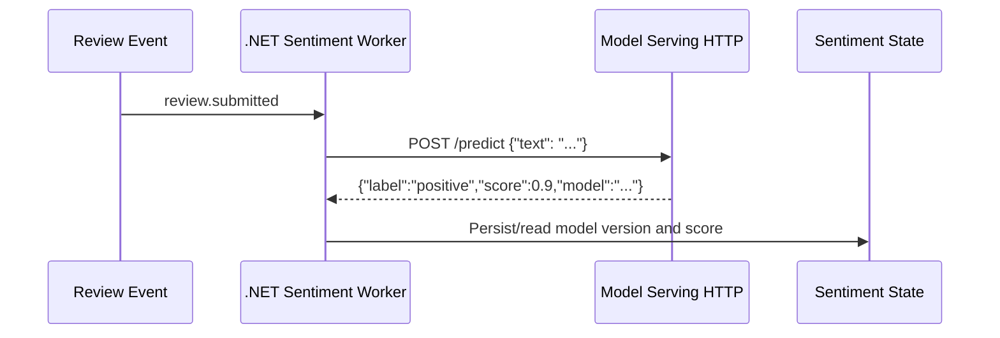

# Lab 14-D — Inference service, scoring contracts, observability и model governance

**Цел:** да разбереш границата между **event-processing app** и **AI/ML inference service**. Ще смениш локалния лексикон с реално HTTP повикване към **учебна inference услуга**, ще провериш договора и ще разбереш как после се включва модел от OpenShift AI. Тази част е напълно локална, без GPU, Hugging Face акаунт или платен inference API.

**Оригинален източник:** [Red Hat — OpenShift Data Science / Intelligent Applications](https://www.solutionpatterns.io/solution-pattern-sentiment-analysis/solution-pattern-sentiment-analysis/02-architecture.html).

## 1. Предпоставки

- .NET SDK 10, Python 3.10+, Bash, свободни портове **5080** (Globex API) и **8090** (inference fixture).
- От корена на Module 14 провери наличието на [SentimentScorer.cs](../src/GlobexReviews/SentimentScorer.cs), [tools/mock_model.py](../tools/mock_model.py), [HTTP verification](../tools/verify.py).
- Ако Lab 14-A/B още работи на 5080, спри собствения процес с Ctrl+C. Ако Kafka Lab 14-C още работи, спри неговия C# процес — не трябва да стартираш две версии на една и съща port.
- Docker/Postgres/Influx не са нужни за упражнението. Ако искаш да продължиш по Kafka пътя, можеш да използваш `REVIEWS_MODE=kafka` и същите model configuration, но това е отделно deployment.

## 2. Architecture: model serving interface



**Важен принцип:** входът към scoring adapter е текст на ревю; изходът е структурирано JSON с `label`, `score` и `model`. C# adapter изрично валидира, че `label` е `positive|negative|neutral`, а `score` е число в интервала **[-1,+1]**. Ако inference услугата е недостъпна или върне невалиден response, worker **не трябва да твърди**, че е успешно анализирал review.

В предоставения `mock_model.py` scoring-ът е **отново детерминистичен тестов stub**. Няма training, weights, embeddings или evaluation dataset; **това НЕ е истински ML**. Използваме го за доказване на работещия HTTP integration contract.

## 3. Стартирай модела

**Терминал 1** (корен на Module 14):

```bash
python3 tools/mock_model.py
```

**Терминал 2:**

```bash
curl -fsS -H 'Content-Type: application/json' \
  -d '{"text":"I love this great product"}' \
  http://127.0.0.1:8090/predict
```

**Очаквано:** JSON `{"label":"positive","score":0.9,"model":"python-fixture-NOT-ML"}`. При отказ на port 8090 провери дали python process слуша и дали вече не работи стар stub.

## 4. Стартирай C# API с истинско HTTP model повикване

**Терминал 3** (същия корен):

```bash
dotnet build src/GlobexReviews/GlobexReviews.csproj -c Release
ASPNETCORE_URLS=http://127.0.0.1:5080 \
REVIEWS_MODE=local \
SENTIMENT_MODEL_URL=http://127.0.0.1:8090/predict \
dotnet run -c Release --no-build --no-launch-profile \
  --project src/GlobexReviews/GlobexReviews.csproj
```

**Терминал 2:**

```bash
python3 tools/verify.py \
  --base-url http://127.0.0.1:5080 \
  --expect-model python-fixture-NOT-ML
curl -fsS http://127.0.0.1:5080/metrics/sentiment
curl -fsS http://127.0.0.1:5080/events
```

**Очаквано:** HTTP тестовете преминават, `globex.review.sentiment` events съдържат `model=python-fixture-NOT-ML`, scores и категории. Данните не са просто response от mock server — **ASP.NET Core worker реално е направил HTTP повикване**, валидирал е резултата и е създал ново domain event.

### Еднокоманден acceptance test

Ако искаш автоматичен **чист старт на модела и приложението, компилация, HTTP тестове и cleanup**, без да управляваш три терминала, първо спри собствените процеси на портове 5080/8090 и изпълни:

```bash
bash scripts/verify-model.sh
```

**Очаквано:** `PASS real HTTP inference boundary`; проверява се реално извикване към учебния HTTP fixture, а не статичен JSON файл. Изходният скрипт е [scripts/verify-model.sh](../scripts/verify-model.sh).

## 5. Как би се заменил fixture с обучен модел?

Необходимо е обучен модел да бъде хостнат в реална платформа, например **Red Hat OpenShift AI** (преди OpenShift Data Science). След като platform team осигури endpoint и authentication:

1. Определи inference API contract: request/response JSON schema, supported language, класове, score semantics, model revision.
2. Изгради/адаптирай HTTP adapter към действителния model-serving wire protocol (нашето `/predict` не е универсален KServe protocol).
3. Конфигурирай `SENTIMENT_MODEL_URL` с разрешен HTTPS адрес, а credentials — чрез Secret/managed identity, **не** в source code.
4. Добави timeouts, circuit breaker, bounded retries, rate limiting, request telemetry, drift and error analysis, fallback policy и manual review.
5. Проведи evaluation върху реалистичен, legally sourced multilingual набор, включително precision/recall/F1, calibration, language bias, abusive-content false negatives и privacy assessment.
6. Публикувай model version в sentiment event, за да може при dashboards да различиш промяна в истинското клиентско мнение от промяна в самия модел.

**Не** извеждай в production текстове с лични данни към публична AI услуга без разрешение и договорна/правна оценка. Този курс използва само синтетични fixtures.

## 6. Observability: кое се измерва?

| Signal | Пример | Как се измерва |
|---|---|---|
| API ingest latency | Време за HTTP 202 | Application metrics/tracing |
| Queue/Kafka lag | Закъснение между produced event и processing | Kafka consumer group metrics |
| Moderation rejections | Денied по категория | Moderation events |
| Sentiment distribution | Негативни/позитивни scores през времето | InfluxDB/Grafana |
| Model latency/errors | Timeout или invalid inference | HTTP metrics/traces |
| Model drift | Промяна в score distribution при нов model version | Time-series анализ и offline evaluation |
| Duplicate processing | Повторен reviewId | Idempotency counters / DB constraints |

`X-Correlation-Id` само по себе си **не е пълноценен distributed trace**. За истински distributed tracing добави OpenTelemetry SDK + collector/exporter към инфраструктурата с адекватна privacy политика. Допълнителните upstream components не са скрита предпоставка за локалните упражнения.

## 7. Failure scenarios

| Симптом | Диагноза | Корекция |
|---|---|---|
| `Connection refused` при :8090 | Model fixture не работи | Стартирай `python3 tools/mock_model.py` |
| Остава `pending` | Инференцията е недостъпна или отказва | Виж C# log на Sentiment worker |
| JSON schema error | Model връща невалиден `label/score` | Коригирай adapter/response; не заобикаляй валидатора |
| Тестовете очакват `demo-lexicon-v1` | Не е зададен `SENTIMENT_MODEL_URL` | Изпълни env настройката от този lab |
| `HTTP 503/timeout` | Inference service не отговаря | Диагностика на model endpoint и timeout |
| Port 5080/8090 busy | Оставен стар процес | Спри само собствения foreground process |

## 8. Cleanup

Спри C# API в терминал 3 с Ctrl+C; спри mock inference в терминал 1 с Ctrl+C. Няма създадени Docker volumes, Kafka topics или OpenShift resources. На следващо локално стартиране без `SENTIMENT_MODEL_URL` се използва default deterministic scorer.

**Критерий:** можеш да посочиш къде scoring service е отделен от event processor, да провериш `model` metadata в CloudEvent и да обясниш защо обучен ML модел и fixture не са едно и също.
