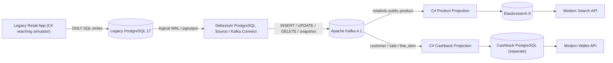
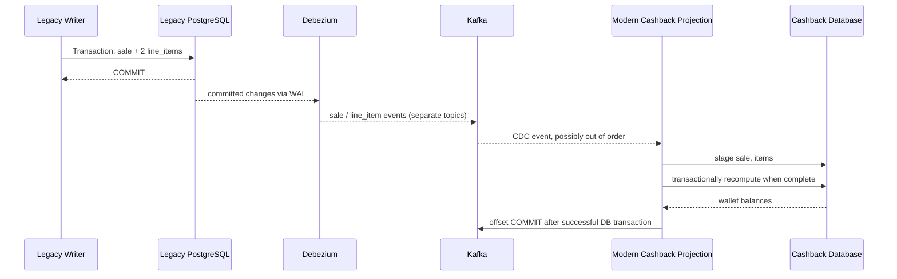

# Module 15 — Modernize a Legacy Stack with Change Data Capture (CDC)

**Самодостатъчен курс:** PostgreSQL logical WAL → **Debezium** → Apache **Kafka** → ASP.NET Core 10/C# projections → **Elasticsearch Product Search** + **Cashback Wallet в собствена PostgreSQL база**. Основен източник е [Red Hat Solution Pattern — Using Change Data Capture for Stack Modernization](https://www.solutionpatterns.io/solution-pattern-modernization-cdc/solution-pattern-modernization-cdc/index.html). Запазваме **и двата оригинални бизнес сценария**, но адаптираме реализацията от Quarkus/Camel към C#.

**Източници от оригинала:** [Introduction](https://www.solutionpatterns.io/solution-pattern-modernization-cdc/solution-pattern-modernization-cdc/index.html) · [Architecture, anti-patterns, scenarios](https://www.solutionpatterns.io/solution-pattern-modernization-cdc/solution-pattern-modernization-cdc/02-architecture.html) · [Original walkthrough](https://www.solutionpatterns.io/solution-pattern-modernization-cdc/solution-pattern-modernization-cdc/03-demo.html) · [Developer resources](https://www.solutionpatterns.io/solution-pattern-modernization-cdc/solution-pattern-modernization-cdc/04-devresources.html).

## 1. Каква е бизнес задачата?

Фиктивната търговска фирма има 15+ годишно **legacy** решение за стоки, клиенти, продажби и наличности, чийто код не е достъпен за промяна. Системата работи непрекъснато и спирането ѝ вреди на бизнеса. Трябват две нови функции:

1. **Full-text търсене** в каталог — цените и описанията се актуализират от старата система; търсещият индекс трябва да се синхронизира при INSERT/UPDATE/DELETE.
2. **Cashback Wallet** — продажбата в старото приложение има sale header + line items; новите услуги агрегира данните, прилага tier-based процент и записва wallet/expenses в **отделна** база.

Ключовото ограничение е: **никакви промени в кода на legacy приложението**, никакви „двойни записи“ в два независими datastore-а, и модерните services **нямат право да модифицират чуждата бизнес база**.

Това е **модернизация чрез асинхронно разширяване**, не миграция на всички данни към нов master. Legacy database остава source of truth. Новите projection-и са **eventually consistent** read models.

## 2. Архитектурата — истинският CDC поток



**Защо CDC?** Съществуващите SQL транзакции записват само в първичната legacy DB. PostgreSQL logical WAL представя committed промени на Debezium connector-а, който ги публикува в Kafka. C# приложенията **консумират** Kafka събития и изграждат нови independent projections. Kafka topic-ите действат като интеграционна граница, **а не като нова write API към legacy DB**.

**Не бъркай:**
- **PostgreSQL WAL:** вътрешен write-ahead log за надеждността/репликацията на DB; Debezium чете логически декодирани промени чрез replication slot и `pgoutput`.
- **Debezium:** CDC source connector (може да направи първоначален snapshot + stream от WAL).
- **Kafka Connect:** runtime, конфигурация и lifecycle на connectors (REST на 8083).
- **Kafka broker:** append-only topic log, където consumer groups четат записи със собствени offsets.
- **Elasticsearch:** собствен search index/read model — **не** authoritative DB.
- **Cashback database:** собствен datastore на новата функционалност. Клиентският tier и sale total са копия/деривати на legacy данните.

В реална продукция CDC **не е с нулев ресурсен ефект**: replication slot задържа WAL при спрял consumer; първоначалният snapshot генерира I/O; трябва да се контролират retention, lag, storage, права и класифициране на данни. „Без промени в приложението“ **не означава** „без операционен риск“.

## 3. Защо другите решения са опасни?

### Anti-pattern 1: shared database

Новият cashback service директно чете/променя production legacy таблиците. Това нарушава ownership, свързва двата release lifecycle-а и позволява скрити зависимости. В тази реализация **modern C# няма connection string към legacy DB** — може да използва само Kafka, Elasticsearch и cashback PostgreSQL.

### Anti-pattern 2: dual write

Legacy приложение първо записва SQL, после пише Elasticsearch/Kafka; ако втората операция се провали, транзакциите **не са атомични** и двата източника се разминават. CDC прихваща **вече committed** DB промени, но не предоставя magical end-to-end exactly once: Kafka/Elasticsearch/новата DB още изискват replay и idempotent projections.

### Anti-pattern 3: naive event aggregation

Една покупка генерира 1 `sale` и N `line_item` събития **в различни Kafka topics**. Няма глобален ред на доставка между topics. Невярно е да изчислиш cashback при първия `sale` event, преди всички редове да пристигнат. Нашият пример съхранява `expected_lines` и stage таблици; cashback се появява само след достатъчно line items и customer data.

## 4. Технологии и версии

| Компонент | Учебен вариант | Отговорност |
|---|---|---|
| C# | ASP.NET Core **.NET 10**, Confluent.Kafka 2.16.0, Npgsql 10.0.3 | Legacy simulator + modern projections |
| Legacy DB | PostgreSQL **17.6** с `wal_level=logical` | Customer, Product, Sale, LineItem |
| CDC | Debezium Kafka Connect **3.3** + `pgoutput` | Snapshot, replication slot, Kafka topics |
| Broker | Apache Kafka **4.1.2** (KRaft) | Durable event log |
| Search | Elasticsearch **8.17.10** | Индекс за Product и full-text search |
| Modern DB | отделен PostgreSQL **17.6** | Projected customer, sale/item staging, expenses, wallets |
| Orchestration | Docker Compose v2 | Изолирана локална demo инфраструктура |
| Cloud | optional OpenShift with preexisting managed DB/Kafka/Search/CDC | Namespace-scoped ASP.NET deployment (Lab 15-E) |

В оригиналния pattern приложенията са Quarkus/Camel и интеграцията ползва OpenShift/AMQ Streams; **нашият C# код не е буквален порт**. Запазена е топологията и бизнес семантиката, включително customer→sale/line_item→cashback и product→search.

## 5. Пет самодостатъчни упражнения

| Lab | Практика | Приемане |
|---|---|---|
| **15-A** | [Legacy, DB ownership, CDC и анти-патерни](./labs/LAB-01-LEGACY-AND-CDC.md) | Build и inspection на schema, WAL prerequisites |
| **15-B** | [Debezium, PostgreSQL WAL, snapshot и Kafka](./labs/LAB-02-DEBEZIUM-KAFKA.md) | 4 Kafka topics, active replication slot, connector RUNNING |
| **15-C** | [Product Search чрез CDC](./labs/LAB-03-SEARCH-PROJECTION.md) | INSERT/UPDATE/DELETE от legacy се появяват/изчезват в Elasticsearch |
| **15-D** | [Sales → cashback aggregation и wallet](./labs/LAB-04-CASHBACK-WALLET.md) | 2 line items = 5 000 cents → bronze 100 cents; tier gold → 500 cents |
| **15-E** | [OpenShift deployment, reliability и cleanup](./labs/LAB-05-OPENSHIFT-RUNBOOK.md) | Namespace-scoped images, Services/Secrets, CDC checks, rollback/cleanup |

Всяко упражнение започва от ясно описана работна директория и включва точни команди, очаквани резултати, troubleshooting и cleanup. **15-B–D** могат да се изпълнят от чист checkout чрез един общ скрипт, без да зависят от процеси, оставени от предишен lab. 15-E е **условен live-cluster lab** и не инсталира глобални оператори.

## 6. Quick start — реална локална CDC интеграция

**Изисквания:** Docker Engine + Docker Compose v2, Python 3.10+, Bash, curl, Git, достъп до Docker registries/NuGet за first-run build; препоръчително **поне 10–12 GiB свободна RAM** и свободни портове **5084, 5085, 5441, 5442, 9092, 8083, 9200**. Командата ползва **Docker build** за .NET 10; не е необходим инсталиран локален .NET SDK. Локален SDK 10 е нужен само за самостоятелния build от Lab 15-A.

```bash
git clone https://github.com/pirocorp/Kubernetes.git
cd "Kubernetes/15. CDC Legacy Modernization"
python3 tools/init_env.py
bash scripts/verify-cdc.sh
```

**Очаквано (при успешен run):** реални Postgres DBs, active Debezium connector + logical replication slot, четири Kafka topics, C# modern search + cashback, и проверки за snapshot, create/update/delete, multi-line aggregation и tier change. Няма mock/симулиран CDC в този път.

**Важно:** тестът работи върху **synthetic** data и без публичен достъп — Docker порти са bind-нати към `127.0.0.1`. .env ключове се генерират локално с mode 0600 и са Git-ignored. Успешен Docker тест не доказва enterprise production readiness.

**Cleanup, без изтриване на данни:**

```bash
docker compose down
```

**Полно изтриване на четирите учебни named volumes (legacy DB, cashback DB, Elasticsearch и Kafka log), САМО ако искаш празна среда:**

```bash
docker compose down -v
```

Нито един скрипт не използва `docker system prune`, не засяга други проекти и не изтрива чужд namespace/cluster.

## 7. Cashback — точната семантика

Използваме **целочислени центове**, за да избегнем финансови rounding грешки от `float/double`. Tier-based политика в този **демонстрационен** проект: bronze **2%**, silver **5%**, gold **10%**. Тези проценти **не са корпоративна бизнес политика от оригиналния pattern** — избрани са за повторяеми упражнения.

Например:
- 2 × Red Fern (`1500 cents`) + 1 × Blue Pot (`2000 cents`) = **5000 cents (€50)**.
- Клиент 1 с bronze: `5000 × 2 / 100` = **100 cents (€1)**.
- След промяна към gold: **500 cents (€5)**.

Това демонстрационно правило **преизчислява историческия cashback при промяна в tier**. Реални системи може вместо това да фиксират tier/rate **в момента на покупката**. Такава промяна трябва да се моделира изрично като бизнес изискване; не прави тихо ретроактивни промени в истински финансов портфейл.

### Идемпотентност и eventual consistency



Нашата имплементация **за малък lab dataset** изчислява projection-a наново в една SQL транзакция при всяко релевантно CDC събитие. Това е лесно за инспекция и устойчиво на replays/извънреден ред, но **НЕ е мащабируем алгоритъм** за production. Там се използват per-sale incremental reconciliation, inbox/outbox, partitioning, DLQ, monitoring, bounded retries, snapshot/recovery plans и schema evolution strategy. Тук няма distributed transaction/true exactly-once.

## 8. Инструменти и source файлове

```text
15. CDC Legacy Modernization/
├── README.md
├── .gitignore / .dockerignore
├── Dockerfile / compose.yaml
├── src/RetailModernization/
│   ├── RetailModernization.csproj
│   ├── Program.cs
│   ├── LegacyRoutes.cs
│   ├── ModernRoutes.cs
│   ├── CdcWorker.cs
│   └── CdcProjection.cs
├── sql/legacy.sql / sql/cashback.sql
├── tools/
│   ├── init_env.py
│   ├── register_connector.py
│   ├── verify.py
│   └── check_infra.py
├── scripts/verify-build.sh / scripts/verify-cdc.sh / scripts/kafka-init.sh
├── openshift/workloads.yaml
└── labs/LAB-01...LAB-05
```

**Не** са нужни външни/частни Quarkus/Camel source repositories, за да изпълниш локалните упражнения. Включени са C# source, SQL, Kafka Connect регистрация, Docker images/Compose definitions и tests. Външните tools/images/NuGet пакети са **явни prerequisites**.

## 9. Самопроверка

1. Защо модерният search service **не трябва** да чете директно legacy PostgreSQL?
2. Какъв е рискът от `dual write`, ако записът в Elasticsearch се провали след SQL COMMIT?
3. Каква е разликата между `snapshot op=r` и WAL streaming `c/u/d`?
4. Какво се случва с PostgreSQL WAL, ако replication slot съществува, но Debezium е спрял?
5. Защо `sale` event не е достатъчен за cashback без `line_item` events?
6. Каква е разликата между Kafka broker, Kafka Connect и Debezium?
7. Защо при повторно консумиране cashback **не трябва да се удвои**?
8. Как доказваш, че `DELETE product` премахва и документа от search index?
9. Как би мигрирал от лабораторно пълно преизчисление към production incremental model?

**Насоки:** (1) ownership и coupling; (2) distributed non-atomic writes; (3) initial state versus committed changes; (4) WAL retention/disk pressure; (5) cross-topic ordering; (6) transport/runtime/source; (7) idempotency/primary keys; (8) delete CDC and search GET; (9) per-aggregate state + replay + DLQ + reconciliation.

## 10. Официални и първични източници

- [Red Hat — CDC Modernization Home](https://www.solutionpatterns.io/solution-pattern-modernization-cdc/solution-pattern-modernization-cdc/index.html)
- [Red Hat — In-depth Architecture](https://www.solutionpatterns.io/solution-pattern-modernization-cdc/solution-pattern-modernization-cdc/02-architecture.html)
- [Red Hat — Original Demo and Walkthrough](https://www.solutionpatterns.io/solution-pattern-modernization-cdc/solution-pattern-modernization-cdc/03-demo.html)
- [Debezium PostgreSQL Connector 3.3](https://debezium.io/documentation/reference/3.3/connectors/postgresql.html)
- [Debezium 3.3 Kafka Connect Docker Tutorial](https://debezium.io/documentation/reference/3.3/tutorial.html)
- [PostgreSQL Logical Decoding](https://www.postgresql.org/docs/current/logicaldecoding.html)
- [Kafka 4.1 Docker](https://kafka.apache.org/41/getting-started/docker/)
- [Elasticsearch Search API](https://www.elastic.co/docs/api/doc/elasticsearch/operation/operation-search)
- [Red Hat AMQ Streams](https://docs.redhat.com/en/documentation/red_hat_amq_streams/)
- [Confluent.Kafka .NET package](https://www.nuget.org/packages/Confluent.Kafka/2.16.0)
- [Npgsql package](https://www.nuget.org/packages/Npgsql/10.0.3)
